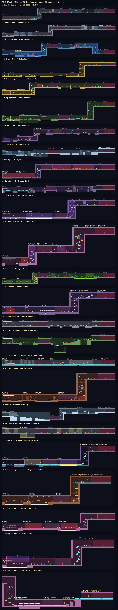

# Kịch bản & sơ đồ toàn chiến dịch

Màn mẫu đã duyệt: **Lò Nham Thạch** (`x5_dinorex`), xem `../lo-nham-thach-kich-ban.md`. 25 màn còn lại được thiết kế theo đúng chuẩn đó: sơ đồ có địa hình theo ô (nền, dốc, hố, giếng dọc, kệ, bẫy, đường đi chính, lối bí mật), kịch bản từng phòng có tọa độ và thông số nhịp, bảng vật phẩm/kẻ địch, phần engine cần bổ sung, danh sách hình cần vẽ và dữ liệu JSON (`data/<id>.level.json`).

## Quy ước chung

- **Kích thước (chuẩn đã duyệt):** khung hình 640×360 px = 20×11.25 ô; hành lang trần 1 ô + trong lòng 9 ô, trần luôn nằm trong khung; phòng nhảy bệ 11 ô; phòng 2 tầng 17 ô; đấu trường cao 11 ô, rộng 20–30 ô; giếng rộng 12–20 ô.
- **Nhảy:** X nhảy cao ~2.6 ô, xa ~5 ô. Trên đường chính gờ ≤ 2.5 ô, nhảy xa ≤ 5 ô, lướt-nhảy ≤ 7 ô; mọi đường chính được **kiểm tra tự động** (`tools/lib.py`).
- Mỗi màn có **2 Area**, **1 mini-boss** giữa màn, **2 checkpoint**, **4 Reploid**, 11–14 kẻ địch thường ở màn boss, 7–10 ở màn pháo đài (Sniper / Drone / Brute), đặt có chủ đích.
- Màn boss: thêm **1 Heart Tank, 1 Sub-Tank** và capsule giáp đúng theo dữ liệu game. Đỉnh độ khó 7/10 ở đoạn cao trào.
- Màn pháo đài: không có Heart Tank/Sub-Tank (như dòng X gốc), có trạm năng lượng lớn trước boss; chỉ Zero Space 3 và Gate Lab 3 có capsule bí mật. Đỉnh độ khó 8/10.
- Mọi bẫy chết ngay đều có báo trước; không có đoạn tự cuộn bắt buộc (đoạn tự cuộn gốc làm lại thành đoạn đuổi do người chơi điều khiển).
- Boss giữ bộ chiêu và điểm yếu theo dữ liệu game; pha 2 (dưới 50% HP) thêm một thay đổi môi trường gắn với cơ chế của màn.

## Mở đầu và 7 màn boss X5 (Act I)

| Màn | Boss | Capsule | Cơ chế chính | Cao trào | Bí mật |
|---|---|---|---|---|---|
| [Cao tốc Neo Arcadia](intro.md) | 1D-1000 → High Max | Fourth Armor (bộ đầy đủ) | Bảng chỉ dẫn nút hiện theo vùng; Hố "dạy chơi" (rơi mất máu, không chết) | R4 Tầng trên cao tốc (3) | capsule, Heart Tank, Sub-Tank |
| [Tàu bọc thép](x5_grizzly.md) | Crescent Grizzly | Falcon Foot | Gió ngược trên nóc toa; Khớp nối toa tách theo thời gian | R6 Nóc toa đầu và hầm (7) | capsule, Heart Tank, Sub-Tank |
| [Căn cứ đáy biển](x5_makkoeen.md) | Tidal Makkoeen | Falcon Head | Vùng nước (trọng lực 0.32); Mực nước thay đổi theo công tắc | R5 Ống hải lưu (7) | capsule, Heart Tank, Sub-Tank |
| [Nhà máy điện](x5_kraken.md) | Volt Kraken | Falcon Arm | Ride Chaser chạy tự do; Tấm boost | R4 Tháp tụ điện (7) | capsule, Heart Tank, Sub-Tank |
| [Phòng thí nghiệm Laser](x5_hotarunicus.md) | Shining Hotarunicus | Falcon Body | Tia laser; Công tắc quang học | R5 Vực hologram (7) | capsule, Heart Tank, Sub-Tank |
| [Rừng đột biến](x5_rosered.md) | Spike Rosered | Gaea Foot | Bụi gai độc; Nấm bật | R6 Thân cây cổ thụ (7) | capsule, Heart Tank, Sub-Tank |
| [Đài thiên văn](x5_necrobat.md) | Dark Necrobat | Gaea Head | Vùng trọng lực tùy chỉnh; Vùng làm chậm thời gian | R6 Quỹ đạo hố đen (7) | capsule, Heart Tank, Sub-Tank |
| [Không quân](x5_pegacion.md) | Spiral Pegacion | Gaea Body | Gió giật theo lịch; Luồng khí nâng | R5 Tầng mây cao (7) | capsule, Heart Tank, Sub-Tank |

## 4 màn pháo đài Zero Space (X5)

| Màn | Boss | Capsule | Cơ chế chính | Cao trào | Bí mật |
|---|---|---|---|---|---|
| [Zero Space 1](x5_f1_dynamo.md) | Dynamo | — | Laser quét toàn chiều cao; Hốc trú trong sàn | R6 Hành lang tử thần (8) | — |
| [Zero Space 2](x5_f2_shadow.md) | Shadow Devil | — | Bệ 2 pha; Luồng khí nâng bật/tắt theo nhịp | R6 Luồng nâng 2 (8) | — |
| [Zero Space 3](x5_f3_rangda.md) | Rangda Bangda W | bí mật Black Zero / Ultimate Armor X5 | Vùng đảo trọng lực; Gai sàn/vách/trần | R4 Biển gai trọng lực ngược (8) | capsule |
| [Zero Space Final](x5_f4_sigma.md) | Final Sigma W | — | Dùng lại đối tượng của Act I; Bệ chạy vòng quanh tâm trong trục dọc | R5 Trục lõi virus (8) | — |

## 8 màn boss X6 (Act II)

| Màn | Boss | Capsule | Cơ chế chính | Cao trào | Bí mật |
|---|---|---|---|---|---|
| [Đền Inami](x6_turtloid.md) | Rainy Turtloid | Shadow Body | Mưa axit theo nhịp; Cổng mở bằng công tắc | R6 Hồ axit (7) | capsule, Heart Tank, Sub-Tank |
| [Viện Laser](x6_sheldon.md) | Shield Sheldon | Shadow Head | Sàn và vách kính trơn; Tia laser đi theo đường gương | R4 Bệ kính cao (7) | capsule, Heart Tank, Sub-Tank |
| [Trung tâm vũ khí](x6_mijinion.md) | Infinity Mijinion | Blade Head | Tâm ngắm bám người chơi; Bệ treo cáp | R3 Vực cáp lớn (7) | capsule, Heart Tank, Sub-Tank |
| [Khu Amazon](x6_yammark.md) | Commander Yammark | Blade Foot | Khúc gỗ trôi; Bệ hoa nở/khép theo nhịp | R7 Thác nước (7) | capsule, Heart Tank, Sub-Tank |
| [Phòng thí nghiệm tái chế](x6_shark.md) | Metal Shark Player | Shadow Foot | Trần ép toàn phòng; Khối rác rơi theo làn và lịch | R6 Hầm tường ép đuổi (7) | capsule, Heart Tank, Sub-Tank |
| [Khu dung nham](x6_heatnix.md) | Blaze Heatnix | Shadow Arm | Cột dung nham phun theo nhịp; Bệ phản lực bay ngang có hết nhiên liệu | R5 Trục núi lửa (7) | capsule, Heart Tank, Sub-Tank |
| [Bắc Cực](x6_wolfang.md) | Blizzard Wolfang | Blade Body | Ride Chaser đổ dốc; Tảng băng lăn | R6 Sông băng trôi (7) | capsule, Heart Tank, Sub-Tank |
| [Bảo tàng Trung tâm](x6_scaravich.md) | Ground Scaravich | Blade Arm | Đèn pha quét theo đường cố định; Cổng dịch chuyển theo cặp | R6 Cụm phòng Cell 2 (7) | capsule, Heart Tank, Sub-Tank |

## 5 màn pháo đài Gate Lab (X6)

| Màn | Boss | Capsule | Cơ chế chính | Cao trào | Bí mật |
|---|---|---|---|---|---|
| [Không gian ác mộng](x6_f1_nzero.md) | Nightmare Zero | — | Vùng tối nhiễu; Bệ ảo ảnh và bệ thật phản ứng ngược nhau với vệt đèn quét | R5 Giếng hai chiều (8) | — |
| [Phòng thí nghiệm Gate 1](x6_f2_nmother.md) | Nightmare Mother | — | Bệ di động ngang; Dung nham dâng liên tục có tăng tốc | R3 Trục thang máy dung nham (8) | — |
| [Phòng thí nghiệm Gate 2](x6_f3_highmax.md) | High Max | — | Bệ nhỏ 2 ô; Tia laser dọc chạy ngang | R5 Chuỗi bệ nhỏ 2 (8) | — |
| [Phòng thí nghiệm Gate 3](x6_f4_gate.md) | Gate | bí mật Ultimate Armor | Tinh thể Nightmare; Vùng đảo trọng lực bật bằng công tắc ngụy trang | R5 Giếng tinh thể (8) | capsule |
| [Phòng thí nghiệm cuối](x6_f5_bossrush.md) | 8 boss → Hell Sigma | — | Băng chuyền và trần gai; Sảnh 8 cổng | R3 Cầu thang Sigma (8) | — |

## Công cụ

- Dữ liệu từng màn: `tools/stages/<id>.py` (phòng ghép từ khối, thực thể, đường đi, kịch bản).
- Thư viện: `tools/lib.py` (xếp phòng, kiểm tra đường chính, vẽ sơ đồ, viết kịch bản, xuất JSON); khối phòng: `tools/kit.py`.
- `python3 tools/gen2.py` trong thư mục này sinh lại toàn bộ sơ đồ, kịch bản, JSON, README và ảnh tổng quan; `python3 tools/gen2.py <id>` sinh một màn.
- Dữ liệu boss/capsule lấy từ `campaign-data.js` vào `tools/game_data.json`.

## Nguồn tham khảo
Nguồn chính là mô tả cơ chế và vị trí capsule sẵn có trong dữ liệu dự án (`campaign-data.js`). Bổ sung thêm các mẫu thiết kế từ dòng X:
- [Mega Man X5 – Mega Man Wiki](https://megamanwiki.com/wiki/Mega_Man_X5), [X5 – MobyGames](https://www.mobygames.com/game/3790), [X5 walkthrough (video-games-museum)](https://video-games-museum.com/en/faqs/Playstation/28537-Mega-Man-X5.pdf)
- [Mega Man X6 – Mega Man Wiki](https://megamanwiki.com/wiki/Mega_Man_X6), [Inami Temple](https://mugen.fandom.com/wiki/Inami_Temple), [Weapon Center](https://megaman.fandom.com/wiki/Weapon_Center), [X6 hints (SuperCheats)](https://www.supercheats.com/playstation/mega-man-x6/14966/randomness/)
- [Mega Man X4 – MobyGames](https://www.mobygames.com/game/3136), [X4 hints (mmhp)](https://mmhp.net/GameHints/MMX4.html)
- [Mega Man X8 – TV Tropes](https://tvtropes.org/pmwiki/pmwiki.php/VideoGame/MegaManX8), [X8 review – GameSpot](https://www.gamespot.com/reviews/mega-man-x8-review/1900-6114749/), [X8 16-bit demake – Time Extension](https://www.timeextension.com/news/2024/09/mega-man-x8-has-just-got-a-free-16-bit-fan-demake)
- [Mega Man X Corrupted – TV Tropes](https://www.tvtropes.org/pmwiki/pmwiki.php/VideoGame/MegaManXCorrupted)

Bài học rút ra: X8 bị chê vì gimmick tự cuộn, gai và vực dày đặc, phải thử-sai nhiều. Màn được khen là màn có gimmick thật sự vui (Gravity Antonion) và có lối phụ cần thiết bị (Bamboo Pandamonium). Vì vậy bộ kịch bản này: không dùng màn tự cuộn bắt buộc (trừ đường hầm ép ở Recycle Lab), mọi bẫy chết ngay đều có báo trước, bí mật luôn gắn với giáp hoặc kỹ năng.
