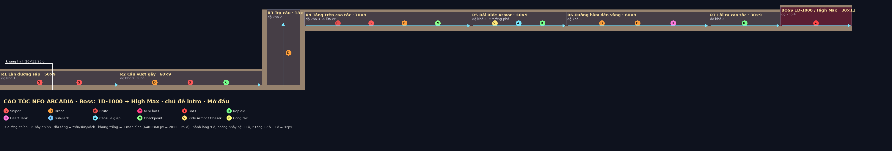

# Cao tốc Neo Arcadia — Boss 1D-1000 → High Max

`intro` · chủ đề `intro` · Mở đầu · tổng chiều ngang khoảng 358 ô (11456px)

## Ý tưởng
Màn dạy chơi trên cao tốc đổ nát 2 tầng lúc hoàng hôn. Mỗi phòng dạy đúng một kỹ năng: chạy, bắn, lướt, đá tường, cưỡi Ride Armor. Kết thúc bằng con nhện 1D-1000 rồi High Max xuất hiện.

## Tham khảo
X4/X5 intro (dạy 1 kỹ năng/đoạn, boss kích thước lớn), X8 intro (màn duy nhất chơi "thẳng", không gimmick nặng).

## Chuẩn kích thước
Theo màn mẫu Lò Nham Thạch: khung hình 640×360 px = 20×11.25 ô; hành lang trần→sàn 9 ô, khối trần luôn nằm trong khung; phòng nhảy bệ/vực/nước 11 ô; phòng 2 tầng 17 ô (hai hành lang chồng nhau); đấu trường cao 11 ô, rộng 20–30 ô; giếng rộng 12–20 ô, leo bằng đá tường và kệ nghỉ. X nhảy cao ~2.6 ô (vy 520), xa ~5 ô: gờ trên đường chính ≤ 2.5 ô, hố ≤ 4 ô; cao/xa hơn phải dùng đá tường, lướt-nhảy hoặc giáp, và chỉ dùng cho bí mật.

## Nhịp màn
R1 (1) → R2 (2) → R3 (2) → R4 (3) → R5 (3) → R6 (3) → R7 (2) → BOSS (4)

## Kịch bản từng phòng

### R1 – Làn đường sập (50×9 ô, đi ngang) · độ khó 1
Đường thẳng an toàn, vài khối bê tông thấp để dạy nhảy và bắn. Bảng chỉ dẫn hiện nút.
- **Đặt trong phòng:** Sniper, Sniper

### R2 – Cầu vượt gãy (60×9 ô, đi ngang) · độ khó 2
Hai hố nhỏ trên cầu gãy (rơi = mất máu, không chết). Drone bay ngang dạy bắn chéo.
- **Bẫy:** hố
- **Đặt trong phòng:** Drone, Sniper, Reploid

### R3 – Trụ cầu (18×34 ô, leo dọc) · độ khó 2
Giếng leo ngắn giữa hai trụ cầu, dạy đá tường. Có kệ nghỉ mỗi 8 ô.
- **Đặt trong phòng:** Drone

### R4 – Tầng trên cao tốc (70×9 ô, đi ngang) · độ khó 3
Ô tô cháy làm vật che, Brute đứng chặn. Lướt dưới biển báo thấp.
- **Bẫy:** lửa xe
- **Đặt trong phòng:** Brute, Sniper, Drone, Checkpoint

### R5 – Bãi Ride Armor (40×9 ô, đi ngang) · độ khó 3
Ride Armor Pod đậu ở đầu phòng. Dùng nó đấm vỡ tường bê tông tầng 2 → lối lên capsule Fourth Armor.
- **Bẫy:** tường phá
- **Đặt trong phòng:** Ride Armor / Chaser, Capsule giáp, Reploid

### R6 – Đường hầm đèn vàng (60×9 ô, đi ngang) · độ khó 3
Hầm tối, đèn trần chớp; Drone lao từ hai đầu. Heart Tank sau khe thông gió (lướt + nhảy).
- **Đặt trong phòng:** Drone, Drone, Heart Tank

### R7 – Lối ra cao tốc (30×9 ô, đi ngang) · độ khó 2
Phòng nghỉ, Reploid cuối, cửa boss.
- **Đặt trong phòng:** Reploid

### BOSS – 1D-1000 / High Max (30×11 ô, đấu trường) · độ khó 4
Nhện 1D-1000 bám trần và hai tường, thả bom; sau đó High Max đáp xuống (không thể thắng, chuyển cảnh).
- **Đặt trong phòng:** Boss

## Bí mật và vật phẩm
| Vật phẩm | Phòng | Cách lấy |
|---|---|---|
| Capsule Fourth Armor | R5 | Dùng Ride Armor đấm vỡ tường tầng 2. |
| Heart Tank | R6 | Khe thông gió trên trần: lướt rồi nhảy. |

## Cơ chế mới cần engine
- Bảng chỉ dẫn nút
- Tường bê tông phá bằng Ride Armor

## Hình ảnh / element
terrain-intro / cap-intro, native-deck cho cầu, mmx5_destructablewalls cho tường bê tông, x5-hovermech cho Ride Armor.
