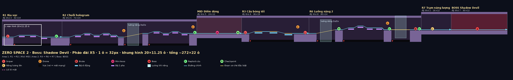

# Zero Space 2 — Boss Shadow Devil

`x5_f2_shadow` · chủ đề `shadow` · Pháo đài X5 · tổng ~272×22 ô (8704×704 px)

## Ý tưởng
Toàn màn là vực không đáy; đường đi là chuỗi bệ hai pha và luồng khí nâng bật/tắt theo nhịp. Area 1: rìa vực và chuỗi hologram; Area 2: cầu bóng tối với bệ di động và luồng nâng thứ hai.

## Tham khảo
X5 Zero Space 2 (bệ 2 pha), X2 X-Hunter base (bệ di động), X8 Gateway.

## Chuẩn kích thước
Khung hình 640×360 px = 20×11.25 ô. Hành lang: trần 1 ô, trong lòng 9 ô, khối trần luôn nằm trong khung; phòng nhảy bệ/vực/nước 11 ô; phòng 2 tầng 17 ô; đấu trường cao 11 ô, rộng 20–30 ô; giếng rộng 12–20 ô. X nhảy cao ~2.6 ô, xa ~5 ô: trên đường chính gờ ≤ 2.5 ô, nhảy xa ≤ 5 ô (lướt-nhảy ≤ 7 ô); cao/xa hơn chỉ bằng đá tường, giáp hoặc cơ chế của màn, và dùng cho bí mật.

## Cấu trúc

- **Area 1** (R1 → R2): rìa vực, chuỗi hologram
- **Mid** (MID): khối thạch đen
- **Area 2** (R3 → R6 → R7): cầu bóng tối, luồng nâng 2
- **Boss** (BOSS): đấu trường đen

## Nhịp màn (độ khó)
R1 (3) → R2 (6) → MID (5) → R3 (6) → R6 (8) → R7 (2) → BOSS (7)

## Kịch bản từng phòng

### R1 – Rìa vực · đi ngang · độ khó 3
*x 0–32, y 6–20 (32×14 ô) · vào ở sàn y 16, ra ở sàn y 16* · Area 1 · rìa vực

Bệ 2 pha đầu tiên đổi mỗi 2 s, có bệ cứng xen giữa để nghỉ.
- **Thông số:** bệ 2 pha: 2 s / 2 s, nháy 0.5 s
- **Địa hình:** hố vực (rơi = mất mạng) x 6–26 (rộng 20 ô); bệ 2 pha x 9–12, y 15; bệ 2 pha x 15–18, y 15; bệ 2 pha x 21–24, y 16
- **Thực thể:** Sniper (3, 16); Reploid cứu (29, 16)
- **Đường chính dùng:** nhảy

### R2 – Chuỗi hologram · đi ngang · độ khó 6
*x 32–104, y 6–20 (72×14 ô) · vào ở sàn y 16, ra ở sàn y 14* · Area 1 · rìa vực

Mười bệ đổi pha liên tiếp; giữa chuỗi là luồng khí nâng (bật 3 s / tắt 2 s) để vượt khe lớn 10 ô.
- **Thông số:** bệ 2 pha 2 s; luồng nâng bật 3 s / tắt 2 s
- **Địa hình:** hố vực (rơi = mất mạng) x 36–62 (rộng 26 ô); bệ 2 pha x 39–42, y 15; bệ 2 pha x 44–47, y 14; bệ 2 pha x 49–52, y 15; bệ 2 pha x 54–57, y 14; bệ 2 pha x 58–61, y 15; hố vực (rơi = mất mạng) x 65–75 (rộng 10 ô); luồng khí nâng x 67–73, y 8–20 (luồng nâng 3s/2s); hố vực (rơi = mất mạng) x 78–100 (rộng 22 ô); bệ 2 pha x 81–84, y 13; bệ 2 pha x 86–89, y 14; bệ 2 pha x 91–94, y 13; bệ 2 pha x 96–99, y 14
- **Thực thể:** Drone (65, 13); Drone (102, 11); Reploid cứu (103, 14)
- **Đường chính dùng:** luồng khí nâng, nhảy

### MID – Điểm dừng · đấu trường · độ khó 5
*x 104–128, y 4–16 (24×12 ô) · vào ở sàn y 14, ra ở sàn y 14* · Mid

Mini-boss: khối thạch đen 45 HP chia làm 3 phần bay quanh. Checkpoint 1 sau trận.
- **Thông số:** 3 khối lao theo thứ tự mỗi 2 s
- **Thực thể:** Mini-boss (115, 14) – khối thạch 45 HP; Checkpoint (126, 14)

### R3 – Cầu bóng tối · đi ngang · độ khó 6
*x 128–164, y 4–18 (36×14 ô) · vào ở sàn y 14, ra ở sàn y 14* · Area 2 · cầu bóng tối

Bệ di động ngang trên vực, Drone ném bom xuống bệ. Sniper trên bệ cứng.
- **Thông số:** bệ di động ±4 ô, 2.5 s; bom mỗi 2 s
- **Địa hình:** hố vực (rơi = mất mạng) x 132–156 (rộng 24 ô); bệ di động x 135–139, y 13; bệ di động x 143–147, y 13; bệ di động x 151–155, y 14
- **Thực thể:** Sniper (130, 14); Drone (158, 11); Sniper (162, 14)
- **Đường chính dùng:** bệ di động, nhảy

### R6 – Luồng nâng 2 · đi ngang · độ khó 8
*x 164–224, y 4–18 (60×14 ô) · vào ở sàn y 14, ra ở sàn y 12* · Area 2 · cầu bóng tối

Cao trào: luồng nâng đứt quãng + bệ 2 pha + Drone; nghỉ ở bệ cứng giữa. Checkpoint 2 ở bệ cứng.
- **Thông số:** luồng nâng bật 2 s / tắt 2 s; bệ 2 pha 1.5 s
- **Địa hình:** hố vực (rơi = mất mạng) x 168–178 (rộng 10 ô); luồng khí nâng x 170–176, y 6–18 (luồng nâng 2s/2s); hố vực (rơi = mất mạng) x 182–204 (rộng 22 ô); bệ 2 pha x 185–188, y 11; bệ 2 pha x 190–193, y 10; bệ 2 pha x 195–198, y 11; bệ 2 pha x 200–203, y 11; hố vực (rơi = mất mạng) x 208–218 (rộng 10 ô); luồng khí nâng x 210–216, y 4–16
- **Thực thể:** Checkpoint (180, 12); Drone (206, 9); Reploid cứu (207, 12); Brute (221, 12); Reploid cứu (223, 12)
- **Đường chính dùng:** luồng khí nâng, nhảy

### R7 – Trạm năng lượng · đi ngang · độ khó 2
*x 224–240, y 2–14 (16×12 ô) · vào ở sàn y 12, ra ở sàn y 12* · Area 2 · cầu bóng tối

Trạm năng lượng lớn trước boss.
- **Thực thể:** Năng lượng lớn (230, 12) – trạm năng lượng lớn

### BOSS – Shadow Devil · đấu trường · độ khó 7
*x 240–270, y 2–14 (30×12 ô) · vào ở sàn y 12, ra ở sàn y 12* · Boss

Khối thạch đen ghép lại thành boss; mắt đỏ là điểm yếu.
- **Thực thể:** Boss (254, 12)

## Bảng kẻ địch và vật phẩm

| Loại | Phòng | x | y | Ghi chú |
|---|---|---|---|---|
| Sniper | R1 | 3 | 16 |  |
| Reploid cứu | R1 | 29 | 16 |  |
| Drone | R2 | 65 | 13 |  |
| Drone | R2 | 102 | 11 |  |
| Reploid cứu | R2 | 103 | 14 |  |
| Mini-boss | MID | 115 | 14 | khối thạch 45 HP |
| Checkpoint | MID | 126 | 14 |  |
| Sniper | R3 | 130 | 14 |  |
| Drone | R3 | 158 | 11 |  |
| Sniper | R3 | 162 | 14 |  |
| Checkpoint | R6 | 180 | 12 |  |
| Drone | R6 | 206 | 9 |  |
| Reploid cứu | R6 | 207 | 12 |  |
| Brute | R6 | 221 | 12 |  |
| Reploid cứu | R6 | 223 | 12 |  |
| Năng lượng lớn | R7 | 230 | 12 | trạm năng lượng lớn |
| Boss | BOSS | 254 | 12 |  |

Tổng: 8 kẻ địch thường (Sniper 3, Drone 4, Brute 1), 4 Reploid, 2 checkpoint, Heart Tank 0, Sub-Tank 0, capsule 0.

## Boss
**Shadow Devil** · điểm yếu: Tri-Thunder
- **Bộ chiêu (dữ liệu game):** Blob Rain (khối thạch rơi), Eye Beam (mắt đỏ bắn tia), Body Slam (ghép thân đè).
- **Đấu trường:** 30×11 ô, sàn cứng.
- **Pha 2 (dưới 50% HP):** sàn tách thành 3 bệ 2 pha; khối thạch rơi theo nhịp đổi pha.

## Engine cần bổ sung
- Bệ 2 pha có nháy báo
- Luồng khí nâng bật/tắt
- Bệ di động ngang

## Hình cần vẽ
- Bệ hologram xanh/tím
- Quạt nâng có đèn trạng thái
- Nền vực không đáy

## Kiểm tra tự động
Đường chính đã được kiểm tra theo khả năng nhảy (gờ ≤ 2.5 ô, nhảy xa ≤ 5 ô, lướt-nhảy ≤ 7 ô, đi bộ phải có nền) và theo quy ước số lượng.

**Kết quả: đạt.**
