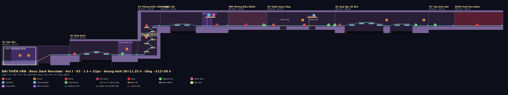

# Đài thiên văn — Boss Dark Necrobat

`x5_necrobat` · chủ đề `shadow` · Act I · X5 · tổng ~312×38 ô (9984×1216 px)

## Ý tưởng
Đài thiên văn bỏ hoang trong đêm. Vùng trọng lực tùy chỉnh (0.42) cho nhảy cao và rơi chậm; vùng làm chậm thời gian tím làm chậm mọi thứ kể cả đạn địch. Area 1 lên đỉnh đài; Area 2 qua hành lang cổng và vòm sao băng, cao trào ở quỹ đạo hố đen.

## Tham khảo
X5 Dark Necrobat (đài thiên văn), X3 Gravity Beetle (trọng lực), X8 Dark Mantis (bóng tối).

## Chuẩn kích thước
Khung hình 640×360 px = 20×11.25 ô. Hành lang: trần 1 ô, trong lòng 9 ô, khối trần luôn nằm trong khung; phòng nhảy bệ/vực/nước 11 ô; phòng 2 tầng 17 ô; đấu trường cao 11 ô, rộng 20–30 ô; giếng rộng 12–20 ô. X nhảy cao ~2.6 ô, xa ~5 ô: trên đường chính gờ ≤ 2.5 ô, nhảy xa ≤ 5 ô (lướt-nhảy ≤ 7 ô); cao/xa hơn chỉ bằng đá tường, giáp hoặc cơ chế của màn, và dùng cho bí mật.

## Cấu trúc

- **Area 1** (R1 → R2 → R3 → R4): sân đài, vòm kính, kính viễn vọng, đỉnh đài
- **Mid** (MID): máy chiếu sao
- **Area 2** (R5 → R6 → R7): hành lang cổng, quỹ đạo hố đen
- **Boss** (BOSS): vòm tối

## Nhịp màn (độ khó)
R1 (2) → R2 (3) → R3 (4) → R4 (5) → MID (5) → R5 (5) → R6 (7) → R7 (2) → BOSS (6)

## Kịch bản từng phòng

### R1 – Sân đài · đi ngang · độ khó 2
*x 0–42, y 24–36 (42×12 ô) · vào ở sàn y 34, ra ở sàn y 30* · Area 1 · lên đỉnh đài

Sân ngoài trời trong vùng trọng lực 0.42: nhảy cao ~6 ô, rơi chậm. Dơi máy (Drone) bay theo đàn 2 con.
- **Thông số:** trọng lực ×0.42 trong vùng tím nhạt
- **Địa hình:** đảo trọng lực x 6–22, y 25–34 (trọng lực ×0.42); hố vực (rơi = mất mạng) x 22–30 (rộng 8 ô)
- **Thực thể:** Drone (11.3333, 31); Drone (16.6667, 31)
- **Đường chính dùng:** bay / giáp

### R2 – Vòm kính · đi ngang · độ khó 3
*x 42–84, y 20–34 (42×14 ô) · vào ở sàn y 30, ra ở sàn y 30* · Area 1 · lên đỉnh đài

Khối nổi trôi chậm làm bệ trên vực; Time Zone tím ở giữa làm chậm mọi thứ ×0.5 (kể cả đạn Sniper) – dùng nó để qua khe.
- **Thông số:** khối nổi trôi 40 px/s; Time Zone ×0.5
- **Địa hình:** hố vực (rơi = mất mạng) x 48–68 (rộng 20 ô); bệ di động x 51–54, y 29; bệ di động x 57–60, y 28; bệ di động x 63–66, y 29; vùng chậm x 72–80, y 21–30 (Time Zone ×0.5)
- **Thực thể:** Sniper (45, 30); Reploid cứu (74.6667, 30); Drone (77.3333, 27)
- **Đường chính dùng:** bệ di động, nhảy

### R3 – Phòng kính viễn vọng · leo dọc · độ khó 4
*x 84–98, y 2–32 (14×30 ô) · vào ở sàn y 30, ra ở sàn y 12* · Area 1 · lên đỉnh đài

Leo dọc ống kính khổng lồ đang xoay chậm; thấu kính sáng đẩy lùi 2 ô khi chạm (vùng vàng).
- **Thông số:** thấu kính đẩy lùi 2 ô; ống kính xoay 1 vòng / 20 s
- **Địa hình:** khối x 93–96, y 12–13; đèn pha x 86–96, y 16–18 (thấu kính đẩy lùi); bệ / kệ x 88–91, y 27.5; bệ / kệ x 92–95, y 25; bệ / kệ x 88–91, y 22.5; bệ / kệ x 92–95, y 20; bệ / kệ x 88–91, y 17.5; bệ / kệ x 92–95, y 15; bệ / kệ x 88–91, y 12.5
- **Thực thể:** Drone (89.5, 19.5); Sniper (89.5, 12.5)
- **Đường chính dùng:** nhảy

### R4 – Đỉnh đài · đi ngang · độ khó 5
*x 98–140, y 2–16 (42×14 ô) · vào ở sàn y 12, ra ở sàn y 12* · Area 1 · lên đỉnh đài

Cuối Area 1: bệ trôi + Time Zone. Capsule Gaea Head và Heart Tank ở đỉnh vòm phía trên (nhảy trọng lực nhẹ từ bệ trôi). Brute giữ lối ra.
- **Thông số:** trọng lực ×0.42 phía trên vòm
- **Địa hình:** hố vực (rơi = mất mạng) x 104–120 (rộng 16 ô); bệ di động x 107–110, y 11; bệ di động x 113–116, y 11; đảo trọng lực x 124–130, y 3–12 (trọng lực ×0.42); bệ / kệ x 126–132, y 6
- **Thực thể:** Capsule giáp (128, 6) – Gaea Head; Heart Tank (131, 6) – đỉnh vòm; Brute (133, 12)
- **Đường chính dùng:** bệ di động, nhảy
- **Lối bí mật:** (127, 12) → (127, 6) → (130, 6)

### MID – Phòng điều khiển · đấu trường · độ khó 5
*x 140–164, y 2–14 (24×12 ô) · vào ở sàn y 12, ra ở sàn y 12* · Mid

Mini-boss: cỗ máy chiếu sao 45 HP, bắn chòm sao đạn theo hình; tắt đèn khi trúng. Checkpoint 1 sau trận.
- **Thông số:** chòm sao 6 đạn mỗi 2.2 s
- **Thực thể:** Mini-boss (151, 12) – máy chiếu sao 45 HP; Checkpoint (162, 12)

### R5 – Hành lang cổng · đi ngang · độ khó 5
*x 164–206, y 2–14 (42×12 ô) · vào ở sàn y 12, ra ở sàn y 12* · Area 2 · vòm sao

Bốn cổng dịch chuyển theo cặp nối hai đoạn hành lang; một cổng phụ dẫn vào phòng kín có Sub-Tank. Sniper canh mỗi đầu cổng.
- **Thông số:** cổng dịch chuyển tức thời, hồi 1 s
- **Địa hình:** bệ / kệ x 189–195, y 6
- **Thực thể:** Sniper (168, 12); Drone (186, 9); Sniper (187, 12); Sub-Tank (193, 6) – phòng kín qua cổng phụ; Reploid cứu (202, 12); Checkpoint (206, 12)
- **Đường chính dùng:** cổng dịch chuyển
- **Lối bí mật:** (190, 12) → (190, 6) → (194, 6)

### R6 – Quỹ đạo hố đen · đi ngang · độ khó 7
*x 206–264, y 2–16 (58×14 ô) · vào ở sàn y 12, ra ở sàn y 12* · Area 2 · vòm sao

Cao trào. Vòm kính vỡ: thiên thạch rơi theo nhịp (bóng báo trước 0.8 s); bệ trôi quanh một hố đen hút nhẹ về giữa. Vực sâu bên dưới.
- **Thông số:** hố đen hút 50 px/s về tâm; thiên thạch mỗi 1.2 s
- **Địa hình:** hố vực (rơi = mất mạng) x 212–236 (rộng 24 ô); bệ di động x 215–218, y 11; bệ di động x 221–224, y 10; bệ di động x 227–230, y 10; bệ di động x 232–235, y 11; hố vực (rơi = mất mạng) x 240–254 (rộng 14 ô); bệ di động x 243–246, y 11; bệ di động x 249–252, y 11
- **Thực thể:** Brute (209, 12); Drone (238, 9); Reploid cứu (256, 12); Drone (261, 9)
- **Đường chính dùng:** bệ di động, nhảy

### R7 – Cửa mái vòm · đi ngang · độ khó 2
*x 264–280, y 2–14 (16×12 ô) · vào ở sàn y 12, ra ở sàn y 12* · Area 2 · vòm sao

Phòng nghỉ trước boss: Reploid cuối, cửa boss.
- **Thực thể:** Reploid cứu (268, 12)

### BOSS – Dark Necrobat · đấu trường · độ khó 6
*x 280–310, y 2–14 (30×12 ô) · vào ở sàn y 12, ra ở sàn y 12* · Boss

Sân trọng lực nhẹ; dơi con hút máu khi bám người.
- **Thực thể:** Boss (294, 12)

## Bảng kẻ địch và vật phẩm

| Loại | Phòng | x | y | Ghi chú |
|---|---|---|---|---|
| Drone | R1 | 11.3333 | 31 |  |
| Drone | R1 | 16.6667 | 31 |  |
| Sniper | R2 | 45 | 30 |  |
| Reploid cứu | R2 | 74.6667 | 30 |  |
| Drone | R2 | 77.3333 | 27 |  |
| Drone | R3 | 89.5 | 19.5 |  |
| Sniper | R3 | 89.5 | 12.5 |  |
| Capsule giáp | R4 | 128 | 6 | Gaea Head |
| Heart Tank | R4 | 131 | 6 | đỉnh vòm |
| Brute | R4 | 133 | 12 |  |
| Mini-boss | MID | 151 | 12 | máy chiếu sao 45 HP |
| Checkpoint | MID | 162 | 12 |  |
| Sniper | R5 | 168 | 12 |  |
| Drone | R5 | 186 | 9 |  |
| Sniper | R5 | 187 | 12 |  |
| Sub-Tank | R5 | 193 | 6 | phòng kín qua cổng phụ |
| Reploid cứu | R5 | 202 | 12 |  |
| Checkpoint | R5 | 206 | 12 |  |
| Brute | R6 | 209 | 12 |  |
| Drone | R6 | 238 | 9 |  |
| Reploid cứu | R6 | 256 | 12 |  |
| Drone | R6 | 261 | 9 |  |
| Reploid cứu | R7 | 268 | 12 |  |
| Boss | BOSS | 294 | 12 |  |

Tổng: 13 kẻ địch thường (Sniper 4, Drone 7, Brute 2), 4 Reploid, 2 checkpoint, Heart Tank 1, Sub-Tank 1, capsule 1.

## Capsule theo dữ liệu game
🛡️ Capsule Gaea Armor — Head Part (X=2950, Y=440 — Đỉnh đài thiên văn cuối Area 1): Tận dụng trọng lực vũ trụ (0.42) và vùng làm chậm Time Zone để nhảy qua bệ thiên thể di động X=2050 lên bệ cao X=2850. Trọng lực vũ trụ 0.42 + Vùng làm chậm Time Zone + Cổng dịch chuyển lấy Gaea Head Area 1: Đài thiên văn vũ trụ trọng lực thấp (0.42) với bệ thiên thể trôi nổi dẫn tới Gaea Head Part. Mid-Gate: Cổng dịch chuyển không gian. Area 2: Chuỗi bệ quỹ đạo di động kết hợp hố đen giả lập.

## Bí mật
| Vật phẩm | Phòng | Cách lấy |
|---|---|---|
| Capsule Gaea Head | R4 | Đỉnh vòm, nhảy trọng lực nhẹ từ bệ trôi. |
| Heart Tank | R4 | Cạnh capsule trên đỉnh vòm. |
| Sub-Tank | R5 | Phòng kín qua cổng phụ. |

## Boss
**Dark Necrobat** · điểm yếu: Will Laser / C-Flasher
- **Bộ chiêu (dữ liệu game):** Dark Hold: Đóng băng thời gian tạm thời trong đấu trường rồi lao vào hút máu. Sonic Wave: Phóng sóng siêu âm mở rộng theo hình nón. Bat Swarm: Triệu hồi đàn dơi cơ khí đuổi theo người chơi. Overdrive (Phase 2): Liên tục dịch chuyển tức thời kèm sóng âm dày đặc.
- **Đấu trường:** vòm 30×11 ô trọng lực ×0.42.
- **Pha 2 (dưới 50% HP):** trần mở ra, hố đen nhỏ ở giữa sân hút người chơi; Necrobat gọi đàn dơi theo vòng.

## Engine cần bổ sung
- Vùng trọng lực tùy chỉnh
- Vùng làm chậm thời gian (ảnh hưởng đạn địch)
- Khối nổi trôi
- Thấu kính đẩy lùi
- Cổng dịch chuyển theo cặp
- Hố đen hút về tâm

## Hình cần vẽ
- Đài thiên văn, vòm kính vỡ
- Kính viễn vọng khổng lồ
- Khối nổi
- Cổng dịch chuyển
- Thiên thạch + bóng báo trước
- Hố đen

## Kiểm tra tự động
Đường chính đã được kiểm tra theo khả năng nhảy (gờ ≤ 2.5 ô, nhảy xa ≤ 5 ô, lướt-nhảy ≤ 7 ô, đi bộ phải có nền) và theo quy ước số lượng.

**Kết quả: đạt.**
