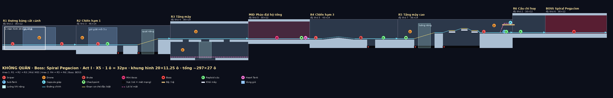

# Không quân — Boss Spiral Pegacion

`x5_pegacion` · chủ đề `wind` · Act I · X5 · tổng ~297×27 ô (9504×864 px)

## Ý tưởng
Chiến dịch trên không: nhảy giữa bốn chiến hạm đang bay. Gió giật theo lịch đẩy về mép boong; luồng khí nâng nối các hạm. Area 1: đường băng, hạm 1, tầng mây; mini-boss pháo đài hộ tống. Area 2: hạm 3 boong nghiêng, hạm 4 có capsule Gaea Body.

## Tham khảo
X5 Spiral Pegacion (không quân), X4 Storm Owl (chiến hạm bay), X8 Gigabolt Man-O-War (trên không).

## Chuẩn kích thước
Khung hình 640×360 px = 20×11.25 ô. Hành lang: trần 1 ô, trong lòng 9 ô, khối trần luôn nằm trong khung; phòng nhảy bệ/vực/nước 11 ô; phòng 2 tầng 17 ô; đấu trường cao 11 ô, rộng 20–30 ô; giếng rộng 12–20 ô. X nhảy cao ~2.6 ô, xa ~5 ô: trên đường chính gờ ≤ 2.5 ô, nhảy xa ≤ 5 ô (lướt-nhảy ≤ 7 ô); cao/xa hơn chỉ bằng đá tường, giáp hoặc cơ chế của màn, và dùng cho bí mật.

## Cấu trúc

- **Area 1** (R1 → R2 → R3): đường băng, hạm 1, tầng mây
- **Mid** (MID): pháo đài hộ tống
- **Area 2** (R4 → R5 → R6): hạm 3 boong nghiêng, hạm 4
- **Boss** (BOSS): boong mở

## Nhịp màn (độ khó)
R1 (2) → R2 (3) → R3 (4) → MID (5) → R4 (5) → R5 (7) → R6 (2) → BOSS (6)

## Kịch bản từng phòng

### R1 – Đường băng cất cánh · đi ngang · độ khó 2
*x 0–36, y 8–20 (36×12 ô) · vào ở sàn y 18, ra ở sàn y 18* · Area 1 · đường băng và hạm 1

Đường băng trên tàu sân bay; máy bay địch (Drone) cất cánh lao thấp theo đường băng. Gió ngang nhẹ.
- **Thông số:** gió ngang −30 px/s
- **Địa hình:** vùng gió x 10–26, y 9–18 (gió −30)
- **Thực thể:** Sniper (5, 18); Drone (18, 15); Sniper (29, 18)

### R2 – Chiến hạm 1 · đi ngang · độ khó 3
*x 36–82, y 8–22 (46×14 ô) · vào ở sàn y 18, ra ở sàn y 15* · Area 1 · đường băng và hạm 1

Boong có tháp pháo; gió giật mỗi 5 s (cờ đỏ báo trước 1 s) đẩy 120 px/s về mép. Cuối hạm là quạt nâng đưa sang hạm 2.
- **Thông số:** gió giật 120 px/s trong 1.5 s, mỗi 5 s; cờ báo trước 1 s
- **Địa hình:** vùng gió x 42–56, y 9–18 (gió giật mỗi 5 s); hố vực (rơi = mất mạng) x 56–59 (rộng 3 ô); hố vực (rơi = mất mạng) x 66–76 (rộng 10 ô); luồng khí nâng x 68–74, y 10–22 (quạt nâng)
- **Thực thể:** Drone (39, 15); Sniper (46.6667, 18); Reploid cứu (51.3333, 18)
- **Đường chính dùng:** luồng khí nâng, nhảy

### R3 – Tầng mây · đi ngang · độ khó 4
*x 82–120, y 6–25 (38×19 ô) · vào ở sàn y 15, ra ở sàn y 15* · Area 1 · đường băng và hạm 1

Hai tầng mây: tầng trên là khối mây cứng trôi chậm (khe 3–4 ô), tầng dưới là lưới an toàn có luồng khí nâng đưa trở lại. Rơi khỏi tầng dưới mới mất mạng.
- **Thông số:** mây trôi 30 px/s; luồng nâng 600 px/s
- **Địa hình:** khối x 82–88, y 15–16; khối x 91–92, y 15–16; khối x 92–97, y 15–16; khối x 101–102, y 15–16; khối x 102–108, y 15–16; khối x 111–112, y 15–16; luồng khí nâng x 96–102, y 16–24
- **Thực thể:** Drone (94.5, 12); Drone (88, 21)
- **Đường chính dùng:** nhảy
- **Lối bí mật:** (82, 24) → (94, 24) → (104, 24) → (108, 24) → (118, 24) → (120, 24)

### MID – Pháo đài hộ tống · đấu trường · độ khó 5
*x 120–150, y 5–17 (30×12 ô) · vào ở sàn y 15, ra ở sàn y 15* · Mid

Mini-boss: pháo đài bay hộ tống 50 HP, bắn tên lửa bám và pháo quét. Checkpoint 1 và Heart Tank trên boong sau khi hạ (dữ liệu game: X=3950).
- **Thông số:** tên lửa bám mỗi 2.5 s
- **Thực thể:** Mini-boss (134, 15) – pháo đài 50 HP; Checkpoint (146, 15); Heart Tank (148, 15) – boong sau

### R4 – Chiến hạm 3 · đi ngang · độ khó 5
*x 150–193, y 5–19 (43×14 ô) · vào ở sàn y 15, ra ở sàn y 15* · Area 2 · hạm 3–4

Boong nghiêng theo nhịp ±8° (nhân vật trượt nhẹ). Khối thép rơi từ cần cẩu. Brute canh giữa boong.
- **Thông số:** boong nghiêng ±8° chu kỳ 4 s; khối rơi mỗi 2 s
- **Địa hình:** dốc x 156–164 (y 15→14); dốc x 164–172 (y 14→15); hố vực (rơi = mất mạng) x 178–182 (rộng 4 ô)
- **Thực thể:** Sniper (153, 15); Brute (175, 15); Reploid cứu (186, 15)
- **Đường chính dùng:** nhảy

### R5 – Tầng mây cao · đi ngang · độ khó 7
*x 193–249, y 5–19 (56×14 ô) · vào ở sàn y 15, ra ở sàn y 12* · Area 2 · hạm 3–4

Cao trào. Cưỡi luồng khí nâng lên boong trên cùng của hạm 4 giữa gió giật; khối mây cứng là bệ nghỉ. Capsule Gaea Body cuối boong trên; Sub-Tank ở khoang cánh. Checkpoint 2 trước luồng nâng.
- **Thông số:** gió giật mỗi 4 s; luồng nâng 600 px/s
- **Địa hình:** hố vực (rơi = mất mạng) x 201–211 (rộng 10 ô); luồng khí nâng x 203–209, y 7–19 (luồng nâng); hố vực (rơi = mất mạng) x 215–233 (rộng 18 ô); khối mây x 218–221, y 11; khối mây x 224–227, y 10; khối mây x 229–232, y 11; bệ / kệ x 244–250, y 7.5
- **Thực thể:** Checkpoint (197, 15); Drone (199, 12); Sniper (235, 12); Drone (240, 9); Capsule giáp (248, 7.5) – Gaea Body (boong trên); Sub-Tank (245, 12) – khoang cánh; Reploid cứu (246, 12)
- **Đường chính dùng:** bệ di động, luồng khí nâng, nhảy
- **Lối bí mật:** (243, 12) → (245, 7.5) → (249, 7.5)

### R6 – Cầu chỉ huy · đi ngang · độ khó 2
*x 249–265, y 2–14 (16×12 ô) · vào ở sàn y 12, ra ở sàn y 12* · Area 2 · hạm 3–4

Phòng nghỉ: Reploid, cửa boss.
- **Thực thể:** Reploid cứu (253, 12)

### BOSS – Spiral Pegacion · đấu trường · độ khó 6
*x 265–295, y 2–14 (30×12 ô) · vào ở sàn y 12, ra ở sàn y 12* · Boss

Đấu trên boong mở; gió xoáy đẩy về mép.
- **Thực thể:** Boss (279, 12)

## Bảng kẻ địch và vật phẩm

| Loại | Phòng | x | y | Ghi chú |
|---|---|---|---|---|
| Sniper | R1 | 5 | 18 |  |
| Drone | R1 | 18 | 15 |  |
| Sniper | R1 | 29 | 18 |  |
| Drone | R2 | 39 | 15 |  |
| Sniper | R2 | 46.6667 | 18 |  |
| Reploid cứu | R2 | 51.3333 | 18 |  |
| Drone | R3 | 94.5 | 12 |  |
| Drone | R3 | 88 | 21 |  |
| Mini-boss | MID | 134 | 15 | pháo đài 50 HP |
| Checkpoint | MID | 146 | 15 |  |
| Heart Tank | MID | 148 | 15 | boong sau |
| Sniper | R4 | 153 | 15 |  |
| Brute | R4 | 175 | 15 |  |
| Reploid cứu | R4 | 186 | 15 |  |
| Checkpoint | R5 | 197 | 15 |  |
| Drone | R5 | 199 | 12 |  |
| Sniper | R5 | 235 | 12 |  |
| Drone | R5 | 240 | 9 |  |
| Capsule giáp | R5 | 248 | 7.5 | Gaea Body (boong trên) |
| Sub-Tank | R5 | 245 | 12 | khoang cánh |
| Reploid cứu | R5 | 246 | 12 |  |
| Reploid cứu | R6 | 253 | 12 |  |
| Boss | BOSS | 279 | 12 |  |

Tổng: 12 kẻ địch thường (Sniper 5, Drone 6, Brute 1), 4 Reploid, 2 checkpoint, Heart Tank 1, Sub-Tank 1, capsule 1.

## Capsule theo dữ liệu game
🛡️ Capsule Gaea Armor — Body Part (X=5940, Y=440 — Boong chiến hạm số 4 cuối Area 2): Sau khi hạ Pháo đài hộ tống ở Mid-Gate và lấy Heart Tank (X=3950), cưỡi quạt nâng khí Updraft (X=4620) nhảy sang bệ bay di động tới boong tàu số 4. 4 Chiến hạm bay + Quạt nâng khí Updraft + Sub-Boss Pháo đài bay + Gaea Body Part Area 1: Chiến đấu trên boong các tuần dương hạm bay giữa bão gió ngược, dùng quạt phản lực Updraft bay qua khoảng không 270px. Mid-Gate: Hạ Pháo đài hộ tống. Area 2: Chuỗi bệ bay di động trên tầng mây lấy Heart Tank và Gaea Body Part.

## Bí mật
| Vật phẩm | Phòng | Cách lấy |
|---|---|---|
| Capsule Gaea Body | R5 | Boong trên cùng hạm 4, cưỡi luồng nâng. |
| Heart Tank | MID | Boong sau khi hạ pháo đài. |
| Sub-Tank | R5 | Khoang cánh hạm 4. |

## Boss
**Spiral Pegacion** · điểm yếu: Dark Hold
- **Bộ chiêu (dữ liệu game):** Wing Spiral: Tạo lốc xoáy gió bay thẳng lên hoặc lướt ngang. Air Charge: Bay vọt lên cao rồi lao chéo xuống với tốc độ cực nhanh. Feather Barrage: Rải lông vũ năng lượng khi bay ngang trần. Overdrive (Phase 2): Tạo cơn bão lốc liên hoàn kết hợp lao kích tốc độ cao.
- **Đấu trường:** boong 30×11 ô không trần, hai mép boong là vực.
- **Pha 2 (dưới 50% HP):** gió xoáy đổi chiều mỗi 4 s và mạnh gấp đôi; boong co lại 3 ô mỗi bên.

## Engine cần bổ sung
- Gió giật theo lịch (cờ báo trước)
- Luồng khí nâng
- Khối mây cứng trôi
- Boong nghiêng theo nhịp
- Khối thép rơi từ cần cẩu

## Hình cần vẽ
- Boong chiến hạm, tháp pháo
- Quạt nâng
- Khối mây
- Cờ báo gió
- Nền trời + mây parallax

## Kiểm tra tự động
Đường chính đã được kiểm tra theo khả năng nhảy (gờ ≤ 2.5 ô, nhảy xa ≤ 5 ô, lướt-nhảy ≤ 7 ô, đi bộ phải có nền) và theo quy ước số lượng.

**Kết quả: đạt.**
