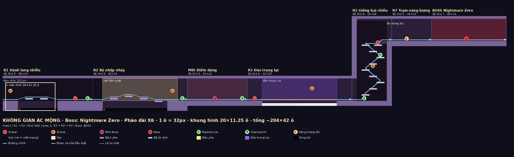

# Không gian ác mộng — Boss Nightmare Zero

`x6_f1_nzero` · chủ đề `shadow` · Pháo đài X6 · tổng ~204×42 ô (6528×1344 px)

## Ý tưởng
Không gian nhiễu tối: tầm nhìn thu hẹp quanh nhân vật (bán kính 220 px), vệt đèn quét làm lộ bệ thật và làm bệ ảo ảnh tan. Bệ ảo ảnh và bệ thật phản ứng ngược nhau với vệt đèn. Cao trào là giếng hai chiều trọng lực.

## Tham khảo
X6 Nightmare Zero stage, X5 Zero Space, X8 Dark Mantis (tối).

## Chuẩn kích thước
Khung hình 640×360 px = 20×11.25 ô. Hành lang: trần 1 ô, trong lòng 9 ô, khối trần luôn nằm trong khung; phòng nhảy bệ/vực/nước 11 ô; phòng 2 tầng 17 ô; đấu trường cao 11 ô, rộng 20–30 ô; giếng rộng 12–20 ô. X nhảy cao ~2.6 ô, xa ~5 ô: trên đường chính gờ ≤ 2.5 ô, nhảy xa ≤ 5 ô (lướt-nhảy ≤ 7 ô); cao/xa hơn chỉ bằng đá tường, giáp hoặc cơ chế của màn, và dùng cho bí mật.

## Cấu trúc

- **Area 1** (R1 → R2): hành lang nhiễu, bệ nhấp nháy
- **Mid** (MID): bóng Nightmare
- **Area 2** (R3 → R5 → R7): đảo trọng lực, giếng hai chiều
- **Boss** (BOSS): không gian tối

## Nhịp màn (độ khó)
R1 (5) → R2 (6) → MID (5) → R3 (6) → R5 (8) → R7 (2) → BOSS (7)

## Kịch bản từng phòng

### R1 – Hành lang nhiễu · đi ngang · độ khó 5
*x 0–36, y 26–40 (36×14 ô) · vào ở sàn y 36, ra ở sàn y 36* · Area 1 · hành lang nhiễu

Tầm nhìn bán kính 220 px; bệ ảo ảnh (viền nhấp nháy) không đứng được. Khe 3 ô trên vực.
- **Thông số:** tầm nhìn 220 px
- **Địa hình:** vùng tối x 0–40, y 27–36 (tầm nhìn 220 px); hố vực (rơi = mất mạng) x 6–22 (rộng 16 ô); bệ ảo ảnh x 9–12, y 35; bệ ảo ảnh x 15–18, y 35
- **Thực thể:** Drone (3, 33); Sniper (29, 36); Reploid cứu (34, 36)
- **Đường chính dùng:** nhảy

### R2 – Bệ nhấp nháy · đi ngang · độ khó 6
*x 36–74, y 26–40 (38×14 ô) · vào ở sàn y 36, ra ở sàn y 36* · Area 1 · hành lang nhiễu

Bệ đổi pha trên vực; vệt đèn quét (2 s một vòng) làm lộ bệ thật – trong vệt đèn bệ ảo biến mất.
- **Thông số:** đèn quét 2 s; bệ pha 1.5 s
- **Địa hình:** đèn pha x 40–70, y 27–36 (vệt đèn quét); hố vực (rơi = mất mạng) x 40–66 (rộng 26 ô); bệ 2 pha x 43–46, y 35; bệ 2 pha x 49–52, y 34; bệ 2 pha x 55–58, y 35; bệ 2 pha x 61–64, y 36
- **Thực thể:** Drone (68, 33); Reploid cứu (72, 36)
- **Đường chính dùng:** nhảy

### MID – Điểm dừng · đấu trường · độ khó 5
*x 74–98, y 26–38 (24×12 ô) · vào ở sàn y 36, ra ở sàn y 36* · Mid

Mini-boss: bóng Nightmare 45 HP chỉ hiện trong vệt đèn. Checkpoint 1.
- **Thông số:** hiện 2 s / ẩn 2 s
- **Thực thể:** Mini-boss (85, 36) – bóng Nightmare 45 HP; Checkpoint (96, 36)

### R3 – Đảo trọng lực · đi ngang · độ khó 6
*x 98–140, y 26–38 (42×12 ô) · vào ở sàn y 36, ra ở sàn y 36* · Area 2 · giếng hai chiều

Đi trên trần qua gai; gai trần có khe 3 ô.
- **Địa hình:** hố gai x 104–134 (rộng 30 ô); đảo trọng lực x 104–134, y 27–36 (đảo trọng lực); gai trần x 104–116; gai trần x 119–134
- **Thực thể:** Sniper (101, 36); Drone (124, 32)
- **Đường chính dùng:** trọng lực đảo

### R5 – Giếng hai chiều · leo dọc · độ khó 8
*x 140–156, y 2–38 (16×36 ô) · vào ở sàn y 36, ra ở sàn y 12* · Area 2 · giếng hai chiều

Cao trào: giếng tối, nửa trái trọng lực thường, nửa phải đảo; bệ thật/ảo đổi theo vệt đèn. Checkpoint 2 ở đáy.
- **Thông số:** vệt đèn quét dọc 3 s
- **Địa hình:** khối x 151–154, y 12–13; đảo trọng lực x 148–154, y 4–36 (nửa phải đảo trọng lực); vùng tối x 142–154, y 4–36; bệ ảo ảnh x 144–147, y 33.5; bệ ảo ảnh x 147–150, y 31; bệ ảo ảnh x 150–153, y 28.5; bệ ảo ảnh x 147–150, y 26; bệ ảo ảnh x 144–147, y 23.5; bệ ảo ảnh x 147–150, y 21; bệ ảo ảnh x 150–153, y 18.5; bệ ảo ảnh x 147–150, y 16; bệ ảo ảnh x 144–147, y 13.5; bệ ảo ảnh x 149–152, y 13.5
- **Thực thể:** Checkpoint (145, 36); Drone (148.5, 23); Reploid cứu (151.5, 18.5); Sniper (150.5, 13.5)
- **Đường chính dùng:** nhảy

### R7 – Trạm năng lượng · đi ngang · độ khó 2
*x 156–172, y 2–14 (16×12 ô) · vào ở sàn y 12, ra ở sàn y 12* · Area 2 · giếng hai chiều

Trạm năng lượng lớn trước boss.
- **Thực thể:** Năng lượng lớn (162, 12) – trạm năng lượng lớn

### BOSS – Nightmare Zero · đấu trường · độ khó 7
*x 172–202, y 2–14 (30×12 ô) · vào ở sàn y 12, ra ở sàn y 12* · Boss

Bản sao Zero dùng Genmu Zero; thắng để mở khóa Zero thật.
- **Thực thể:** Boss (186, 12)

## Bảng kẻ địch và vật phẩm

| Loại | Phòng | x | y | Ghi chú |
|---|---|---|---|---|
| Drone | R1 | 3 | 33 |  |
| Sniper | R1 | 29 | 36 |  |
| Reploid cứu | R1 | 34 | 36 |  |
| Drone | R2 | 68 | 33 |  |
| Reploid cứu | R2 | 72 | 36 |  |
| Mini-boss | MID | 85 | 36 | bóng Nightmare 45 HP |
| Checkpoint | MID | 96 | 36 |  |
| Sniper | R3 | 101 | 36 |  |
| Drone | R3 | 124 | 32 |  |
| Checkpoint | R5 | 145 | 36 |  |
| Drone | R5 | 148.5 | 23 |  |
| Reploid cứu | R5 | 151.5 | 18.5 |  |
| Sniper | R5 | 150.5 | 13.5 |  |
| Năng lượng lớn | R7 | 162 | 12 | trạm năng lượng lớn |
| Boss | BOSS | 186 | 12 |  |

Tổng: 7 kẻ địch thường (Sniper 3, Drone 4, Brute 0), 3 Reploid, 2 checkpoint, Heart Tank 0, Sub-Tank 0, capsule 0.

## Boss
**Nightmare Zero** · điểm yếu: X-Buster / Z-Saber
- **Bộ chiêu (dữ liệu game):** Genmu Zero (sóng kiếm), Shippuuga (lướt chém), Ground Quake (đấm đất).
- **Đấu trường:** 30×11 ô tối.
- **Pha 2 (dưới 50% HP):** tầm nhìn thu còn 160 px; Nightmare Zero xuất hiện từ bóng tối sau lưng.

## Engine cần bổ sung
- Tầm nhìn giới hạn quanh nhân vật
- Bệ ảo ảnh/thật phản ứng với vệt đèn
- Đảo trọng lực theo nửa giếng

## Hình cần vẽ
- Không gian nhiễu tím đen
- Bệ ảo ảnh (viền nhấp nháy)
- Vệt đèn quét

## Kiểm tra tự động
Đường chính đã được kiểm tra theo khả năng nhảy (gờ ≤ 2.5 ô, nhảy xa ≤ 5 ô, lướt-nhảy ≤ 7 ô, đi bộ phải có nền) và theo quy ước số lượng.

**Còn lỗi:**
- Reploid cứu: 3 (chuẩn 4)
