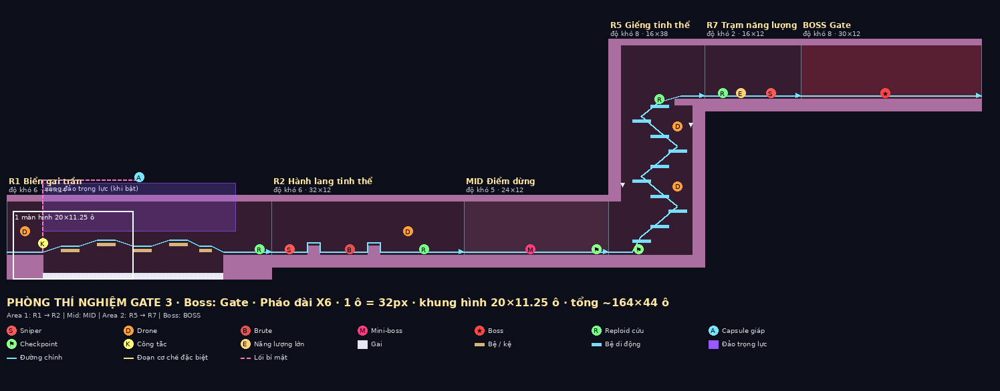

# Phòng thí nghiệm Gate 3 — Boss Gate

`x6_f4_gate` · chủ đề `core` · Pháo đài X6 · tổng ~164×44 ô (5248×1408 px)

## Ý tưởng
Vùng đảo trọng lực bật bằng công tắc ngụy trang giấu Secret Ultimate Armor trên trần biển gai. Hành lang tinh thể Nightmare nổ khi bị bắn; giếng tinh thể là cao trào. Đấu trường Gate có vực giữa sàn.

## Tham khảo
X6 Gate Lab 3 (Ultimate Armor), X5 Zero Space 3 (đảo trọng lực), X8 Sigma Palace.

## Chuẩn kích thước
Khung hình 640×360 px = 20×11.25 ô. Hành lang: trần 1 ô, trong lòng 9 ô, khối trần luôn nằm trong khung; phòng nhảy bệ/vực/nước 11 ô; phòng 2 tầng 17 ô; đấu trường cao 11 ô, rộng 20–30 ô; giếng rộng 12–20 ô. X nhảy cao ~2.6 ô, xa ~5 ô: trên đường chính gờ ≤ 2.5 ô, nhảy xa ≤ 5 ô (lướt-nhảy ≤ 7 ô); cao/xa hơn chỉ bằng đá tường, giáp hoặc cơ chế của màn, và dùng cho bí mật.

## Cấu trúc

- **Area 1** (R1 → R2): trần biển gai, hành lang tinh thể
- **Mid** (MID): tinh thể mẹ
- **Area 2** (R5 → R7): giếng tinh thể
- **Boss** (BOSS): phòng Gate

## Nhịp màn (độ khó)
R1 (6) → R2 (6) → MID (5) → R5 (8) → R7 (2) → BOSS (8)

## Kịch bản từng phòng

### R1 – Biển gai trần · đi ngang · độ khó 6
*x 0–44, y 28–42 (44×14 ô) · vào ở sàn y 38, ra ở sàn y 38* · Area 1 · trần biển gai

Công tắc ngụy trang (viên gạch lệch màu) bật vùng đảo trọng lực X=1150; đi trên trần qua biển gai 36 ô. Secret Ultimate Armor ở hốc trần X=1850 (dữ liệu game). Đường chính đi dưới bằng chuỗi kệ.
- **Địa hình:** hố gai x 6–36 (rộng 30 ô); bệ / kệ x 9–12, y 37; bệ / kệ x 15–18, y 36; bệ / kệ x 21–24, y 37; bệ / kệ x 27–30, y 36; bệ / kệ x 32–34, y 37; đảo trọng lực x 6–38, y 26–34 (vùng đảo trọng lực (khi bật))
- **Thực thể:** Drone (3, 35); Công tắc (6, 37) – công tắc ngụy trang; Capsule giáp (22, 26) – Secret Ultimate Armor (hốc trần); Reploid cứu (42, 38)
- **Đường chính dùng:** nhảy
- **Lối bí mật:** (6, 38) → (6, 26) → (22, 26)

### R2 – Hành lang tinh thể · đi ngang · độ khó 6
*x 44–76, y 28–40 (32×12 ô) · vào ở sàn y 38, ra ở sàn y 38* · Area 1 · trần biển gai

Tinh thể Nightmare nổ khi bị bắn (bán kính 3 ô, 6 sát thương); dùng nổ dây chuyền để diệt Brute.
- **Thông số:** tinh thể nổ 0.4 s sau khi trúng
- **Địa hình:** khối x 50–52, y 36.5–38; khối x 60–62, y 36.5–38
- **Thực thể:** Sniper (47, 38); Brute (57, 38); Drone (66.6667, 35); Reploid cứu (69.3333, 38)
- **Đường chính dùng:** nhảy, rơi xuống

### MID – Điểm dừng · đấu trường · độ khó 5
*x 76–100, y 28–40 (24×12 ô) · vào ở sàn y 38, ra ở sàn y 38* · Mid

Mini-boss: cụm tinh thể mẹ 45 HP. Checkpoint 1.
- **Thông số:** tinh thể con nổ mỗi 2.5 s
- **Thực thể:** Mini-boss (87, 38) – tinh thể mẹ 45 HP; Checkpoint (98, 38)

### R5 – Giếng tinh thể · leo dọc · độ khó 8
*x 100–116, y 2–40 (16×38 ô) · vào ở sàn y 38, ra ở sàn y 12* · Area 2 · giếng tinh thể

Cao trào: thang máy dữ liệu nâng chậm; tinh thể bám vách nổ dây chuyền, Drone bao quanh. Checkpoint 2 ở đáy.
- **Thông số:** tinh thể vách nổ khi bị bắn hoặc chạm
- **Địa hình:** khối x 111–114, y 12–13; gai sàn x 102–102.6; gai sàn x 113.4–114; bệ di động x 104–107, y 35.5; bệ di động x 107–110, y 33; bệ di động x 110–113, y 30.5; bệ di động x 107–110, y 28; bệ di động x 104–107, y 25.5; bệ di động x 107–110, y 23; bệ di động x 110–113, y 20.5; bệ di động x 107–110, y 18; bệ di động x 104–107, y 15.5; bệ di động x 107–110, y 13
- **Thực thể:** Checkpoint (105, 38); Drone (111.5, 27.5); Drone (111.5, 17.5); Reploid cứu (108.5, 13)
- **Đường chính dùng:** nhảy

### R7 – Trạm năng lượng · đi ngang · độ khó 2
*x 116–132, y 2–14 (16×12 ô) · vào ở sàn y 12, ra ở sàn y 12* · Area 2 · giếng tinh thể

Trạm năng lượng lớn trước boss; Reploid cuối.
- **Thực thể:** Reploid cứu (119, 12); Năng lượng lớn (122, 12) – trạm năng lượng lớn; Sniper (127, 12)

### BOSS – Gate · đấu trường · độ khó 8
*x 132–162, y 2–14 (30×12 ô) · vào ở sàn y 12, ra ở sàn y 12* · Boss

Sàn có vực giữa; Gate dùng quả cầu Nightmare.
- **Thực thể:** Boss (146, 12)

## Bảng kẻ địch và vật phẩm

| Loại | Phòng | x | y | Ghi chú |
|---|---|---|---|---|
| Drone | R1 | 3 | 35 |  |
| Công tắc | R1 | 6 | 37 | công tắc ngụy trang |
| Capsule giáp | R1 | 22 | 26 | Secret Ultimate Armor (hốc trần) |
| Reploid cứu | R1 | 42 | 38 |  |
| Sniper | R2 | 47 | 38 |  |
| Brute | R2 | 57 | 38 |  |
| Drone | R2 | 66.6667 | 35 |  |
| Reploid cứu | R2 | 69.3333 | 38 |  |
| Mini-boss | MID | 87 | 38 | tinh thể mẹ 45 HP |
| Checkpoint | MID | 98 | 38 |  |
| Checkpoint | R5 | 105 | 38 |  |
| Drone | R5 | 111.5 | 27.5 |  |
| Drone | R5 | 111.5 | 17.5 |  |
| Reploid cứu | R5 | 108.5 | 13 |  |
| Reploid cứu | R7 | 119 | 12 |  |
| Năng lượng lớn | R7 | 122 | 12 | trạm năng lượng lớn |
| Sniper | R7 | 127 | 12 |  |
| Boss | BOSS | 146 | 12 |  |

Tổng: 7 kẻ địch thường (Sniper 2, Drone 4, Brute 1), 4 Reploid, 2 checkpoint, Heart Tank 0, Sub-Tank 0, capsule 1.

## Capsule theo dữ liệu game
🛡️ Secret Light Capsule Act II — Ultimate Armor (X=1850, Y=320 — Trần biển gai Area 1): Kích hoạt Vùng Đảo Trọng Lực (X=1150) lộn ngược lên trần nhà đi qua biển gai 1,150px để nhận trọn bộ Ultimate Armor (Nova Strike bất tử!). Vùng Đảo Trọng Lực lấy Secret Ultimate Armor -> Đấu trường Gate có vực thẳm giữa sàn! Area 1: Kích hoạt Vùng Đảo Trọng Lực đi ngược trên trần để vượt biển gai 1,150px và mở Secret Capsule ULTIMATE ARMOR. Area 2: Trạm hồi máu đầy trước phòng Gate. Đấu trường Gate có vực thẳm ở giữa sàn kèm 3 bệ lơ lửng!

## Bí mật
| Vật phẩm | Phòng | Cách lấy |
|---|---|---|
| Secret Ultimate Armor | R1 | Bật công tắc ngụy trang, đi trên trần tới hốc X=1850. |

## Boss
**Gate** · điểm yếu: Bắn vỡ Nightmare Orb để mảnh vỡ dội ngược vào Gate
- **Bộ chiêu (dữ liệu game):** Nightmare Orb: Tạo cầu năng lượng nhiều màu; bắn vỡ cầu để mảnh vỡ văng ngược gây sát thương cho Gate. Floor Destruction: Phá hủy bệ đứng trong đấu trường để tạo hố vực. Beam Sweep: Bay lơ lửng bắn tia laser quét chéo. Overdrive (Phase 2): Thả liên tiếp 3 quả cầu Nightmare kết hợp tia laser.
- **Đấu trường:** 30×11 ô, vực 4 ô giữa sàn.
- **Pha 2 (dưới 50% HP):** quả cầu Nightmare phải bắn vỡ để thành mảnh phản đòn (gate-fragment) – cách duy nhất gây sát thương.

## Engine cần bổ sung
- Công tắc ngụy trang bật vùng đảo trọng lực
- Tinh thể Nightmare nổ dây chuyền
- Thang máy dữ liệu
- Boss chỉ trúng bằng mảnh cầu phản đòn

## Hình cần vẽ
- Biển gai trần
- Tinh thể Nightmare
- Gạch công tắc ngụy trang

## Kiểm tra tự động
Đường chính đã được kiểm tra theo khả năng nhảy (gờ ≤ 2.5 ô, nhảy xa ≤ 5 ô, lướt-nhảy ≤ 7 ô, đi bộ phải có nền) và theo quy ước số lượng.

**Kết quả: đạt.**
