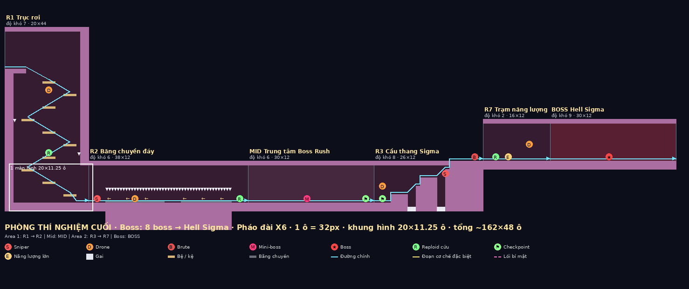

# Phòng thí nghiệm cuối — Boss 8 boss → Hell Sigma

`x6_f5_bossrush` · chủ đề `core` · Pháo đài X6 · tổng ~162×48 ô (5184×1536 px)

## Ý tưởng
Trục rơi đầy gai dẫn xuống băng chuyền đáy có trần gai, rồi trung tâm 8 cổng Boss Rush (đánh lại 8 boss Act II), cuối cùng là cầu thang Sigma và Hell Sigma.

## Tham khảo
X6 Gate Lab 4, X5 Zero Space 4 (boss rush), X1 Sigma Palace (cầu thang).

## Chuẩn kích thước
Khung hình 640×360 px = 20×11.25 ô. Hành lang: trần 1 ô, trong lòng 9 ô, khối trần luôn nằm trong khung; phòng nhảy bệ/vực/nước 11 ô; phòng 2 tầng 17 ô; đấu trường cao 11 ô, rộng 20–30 ô; giếng rộng 12–20 ô. X nhảy cao ~2.6 ô, xa ~5 ô: trên đường chính gờ ≤ 2.5 ô, nhảy xa ≤ 5 ô (lướt-nhảy ≤ 7 ô); cao/xa hơn chỉ bằng đá tường, giáp hoặc cơ chế của màn, và dùng cho bí mật.

## Cấu trúc

- **Area 1** (R1 → R2): trục rơi, băng chuyền đáy
- **Mid** (MID): sảnh 8 cổng Boss Rush
- **Area 2** (R3 → R7): cầu thang Sigma
- **Boss** (BOSS): phòng Hell Sigma

## Nhịp màn (độ khó)
R1 (7) → R2 (6) → MID (6) → R3 (8) → R7 (2) → BOSS (9)

## Kịch bản từng phòng

### R1 – Trục rơi · đi xuống · độ khó 7
*x 0–20, y 2–46 (20×44 ô) · vào ở sàn y 12, ra ở sàn y 44* · Area 1 · trục rơi và băng chuyền

Rơi xuống trục 20 ô rộng: gai hai bên vách, gai nhô ra theo nhịp (đèn báo 0.6 s); lướt ngang trên không để né, kệ nghỉ so le.
- **Thông số:** gai nhô 1 s mỗi 3 s, báo trước 0.6 s
- **Địa hình:** khối x 2–5, y 12–13; gai sàn x 2–2.6; gai sàn x 17.4–18; bệ / kệ x 9–12, y 15; bệ / kệ x 14–17, y 18; bệ / kệ x 9–12, y 21; bệ / kệ x 4–7, y 24; bệ / kệ x 9–12, y 27; bệ / kệ x 14–17, y 30; bệ / kệ x 9–12, y 33; bệ / kệ x 4–7, y 36; bệ / kệ x 9–12, y 39; bệ / kệ x 14–17, y 42
- **Thực thể:** Drone (10.5, 18); Reploid cứu (10.5, 33)
- **Đường chính dùng:** rơi xuống

### R2 – Băng chuyền đáy · đi ngang · độ khó 6
*x 20–58, y 34–46 (38×12 ô) · vào ở sàn y 44, ra ở sàn y 44* · Area 1 · trục rơi và băng chuyền

Băng chuyền ngược + trần gai hạ thấp (khe 3 ô) + laser quét.
- **Thông số:** băng −160 px/s; laser 180 px/s
- **Địa hình:** gai trần x 24–54; băng chuyền x 24–38 (-160 px/s); băng chuyền x 42–54 (-160 px/s)
- **Thực thể:** Sniper (22, 44); Drone (31, 44); Reploid cứu (56, 44)
- **Đường chính dùng:** băng chuyền

### MID – Trung tâm Boss Rush · đấu trường · độ khó 6
*x 58–88, y 34–46 (30×12 ô) · vào ở sàn y 44, ra ở sàn y 44* · Mid

Mini-boss: sảnh 8 cổng (2 hàng × 4), mỗi cổng đánh lại một boss Act II (tính là 1 mini-boss chuỗi). Checkpoint 1 khi vào sảnh; hồi 12 HP sau mỗi trận.
- **Thông số:** hồi 12 HP + 100 WEP sau mỗi trận
- **Thực thể:** Mini-boss (72, 44) – 8 boss Act II; Checkpoint (86, 44)

### R3 – Cầu thang Sigma · đi ngang · độ khó 8
*x 88–114, y 34–46 (26×12 ô) · vào ở sàn y 44, ra ở sàn y 34* · Area 2 · Boss Rush và cầu thang Sigma

Cao trào: cầu thang bậc 2 ô đi lên, virus Sigma đuổi, gai giữa các bậc, sàn sụp ở 3 bậc. Checkpoint 2 ở chân cầu thang.
- **Thông số:** bậc sụp sau 1 s; virus bám 140 px/s
- **Địa hình:** hố gai x 96–98 (rộng 2 ô); hố gai x 103–105 (rộng 2 ô)
- **Thực thể:** Checkpoint (90, 44); Drone (90, 41); Sniper (105, 38); Reploid cứu (112, 34); Brute (112, 34)
- **Đường chính dùng:** nhảy

### R7 – Trạm năng lượng · đi ngang · độ khó 2
*x 114–130, y 24–36 (16×12 ô) · vào ở sàn y 34, ra ở sàn y 34* · Area 2 · Boss Rush và cầu thang Sigma

Trạm năng lượng lớn trước Hell Sigma; Reploid cuối.
- **Thực thể:** Reploid cứu (117, 34); Năng lượng lớn (120, 34) – trạm năng lượng lớn; Drone (125, 31)

### BOSS – Hell Sigma · đấu trường · độ khó 9
*x 130–160, y 24–36 (30×12 ô) · vào ở sàn y 34, ra ở sàn y 34* · Boss

Ba pha: thân, đầu, lõi; sàn sụp và virus.
- **Thực thể:** Boss (144, 34)

## Bảng kẻ địch và vật phẩm

| Loại | Phòng | x | y | Ghi chú |
|---|---|---|---|---|
| Drone | R1 | 10.5 | 18 |  |
| Reploid cứu | R1 | 10.5 | 33 |  |
| Sniper | R2 | 22 | 44 |  |
| Drone | R2 | 31 | 44 |  |
| Reploid cứu | R2 | 56 | 44 |  |
| Mini-boss | MID | 72 | 44 | 8 boss Act II |
| Checkpoint | MID | 86 | 44 |  |
| Checkpoint | R3 | 90 | 44 |  |
| Drone | R3 | 90 | 41 |  |
| Sniper | R3 | 105 | 38 |  |
| Reploid cứu | R3 | 112 | 34 |  |
| Brute | R3 | 112 | 34 |  |
| Reploid cứu | R7 | 117 | 34 |  |
| Năng lượng lớn | R7 | 120 | 34 | trạm năng lượng lớn |
| Drone | R7 | 125 | 31 |  |
| Boss | BOSS | 144 | 34 |  |

Tổng: 7 kẻ địch thường (Sniper 2, Drone 4, Brute 1), 4 Reploid, 2 checkpoint, Heart Tank 0, Sub-Tank 0, capsule 0.

## Boss
**8 boss → Hell Sigma**
- **Bộ chiêu (dữ liệu game):** Virus Rain, Hand Crush, Head Beam, Core Laser (3 pha).
- **Đấu trường:** 30×11 ô, pha 3 sàn chỉ còn 3 bệ.
- **Pha 2 (dưới 50% HP):** sàn sụp từng mảng còn 3 bệ, virus bay theo vòng; pha 3 lõi Sigma bắn laser quét toàn sân.

## Engine cần bổ sung
- Gai nhô theo nhịp trong trục rơi
- Trần gai hạ thấp
- Sảnh 8 cổng Boss Rush (hồi máu giữa trận)
- Cầu thang bậc sụp + virus đuổi

## Hình cần vẽ
- Trục rơi gai
- Sảnh 8 cổng
- Cầu thang Sigma
- Hell Sigma (3 pha)

## Kiểm tra tự động
Đường chính đã được kiểm tra theo khả năng nhảy (gờ ≤ 2.5 ô, nhảy xa ≤ 5 ô, lướt-nhảy ≤ 7 ô, đi bộ phải có nền) và theo quy ước số lượng.

**Kết quả: đạt.**
