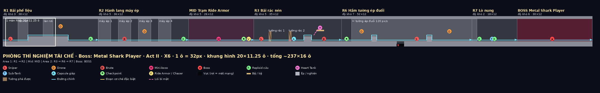

# Phòng thí nghiệm tái chế — Boss Metal Shark Player

`x6_shark` · chủ đề `metal` · Act II · X6 · tổng ~237×16 ô (7584×512 px)

## Ý tưởng
Nhà máy tái chế phế liệu. Trần máy ép toàn phòng hạ xuống theo nhịp (đèn đỏ báo trước), khối rác rơi theo làn từ băng tải trên cao. Giữa màn có Ride Armor để đục tường rác giấu capsule Shadow Foot. Đoạn tự cuộn gốc làm lại thành hầm tường ép đuổi chậm, người chơi tự chạy.

## Tham khảo
X6 Metal Shark Player (nhà máy tái chế, trần ép), X8 Earthrock Trilobite (bị vật lớn đuổi), X4 Ride Armor (đục tường).

## Chuẩn kích thước
Khung hình 640×360 px = 20×11.25 ô. Hành lang: trần 1 ô, trong lòng 9 ô, khối trần luôn nằm trong khung; phòng nhảy bệ/vực/nước 11 ô; phòng 2 tầng 17 ô; đấu trường cao 11 ô, rộng 20–30 ô; giếng rộng 12–20 ô. X nhảy cao ~2.6 ô, xa ~5 ô: trên đường chính gờ ≤ 2.5 ô, nhảy xa ≤ 5 ô (lướt-nhảy ≤ 7 ô); cao/xa hơn chỉ bằng đá tường, giáp hoặc cơ chế của màn, và dùng cho bí mật.

## Cấu trúc

- **Area 1** (R1 → R2): bãi phế liệu, hành lang máy ép
- **Mid** (MID): cần cẩu nam châm
- **Area 2** (R3 → R6 → R7): bãi rác nén, hầm tường ép
- **Boss** (BOSS): hố phế liệu

## Nhịp màn (độ khó)
R1 (3) → R2 (5) → MID (5) → R3 (5) → R6 (7) → R7 (2) → BOSS (6)

## Kịch bản từng phòng

### R1 – Bãi phế liệu · đi ngang · độ khó 3
*x 0–38, y 2–14 (38×12 ô) · vào ở sàn y 12, ra ở sàn y 12* · Area 1 · bãi phế liệu

Khối sắt rơi từ băng tải trên cao theo 3 làn (bóng đen báo trước 0.8 s). Núi phế liệu là bậc.
- **Thông số:** khối rơi mỗi 1.5 s, luân phiên 3 làn
- **Địa hình:** ép / nghiền x 6–10, y 3–12 (làn rơi); ép / nghiền x 16–20, y 3–10 (làn rơi)
- **Thực thể:** Sniper (3, 12); Drone (23, 7); Reploid cứu (35, 12)
- **Đường chính dùng:** nhảy, rơi xuống

### R2 – Hành lang máy ép · đi ngang · độ khó 5
*x 38–74, y 2–14 (36×12 ô) · vào ở sàn y 12, ra ở sàn y 12* · Area 1 · bãi phế liệu

Bốn trần máy ép thủy lực hạ toàn phòng theo nhịp lệch pha; hốc an toàn 2 ô giữa các máy. Brute đứng trong hốc.
- **Thông số:** máy ép: chờ 1.6 s, ép 0.3 s, nâng 0.8 s; lệch pha 0.6 s
- **Địa hình:** ép / nghiền x 38–43, y 3–12 (máy ép 1); ép / nghiền x 46–51, y 3–12 (máy ép 2); ép / nghiền x 54–59, y 3–12 (máy ép 3); ép / nghiền x 62–67, y 3–12 (máy ép 4)
- **Thực thể:** Brute (48.5, 12); Drone (56.5, 9); Reploid cứu (72, 12)

### MID – Trạm Ride Armor · đấu trường · độ khó 5
*x 74–100, y 2–14 (26×12 ô) · vào ở sàn y 12, ra ở sàn y 12* · Mid

Mini-boss: cần cẩu nam châm 45 HP ném khối sắt. Checkpoint 1 và Ride Armor Pod (X=3240 dữ liệu game).
- **Thông số:** ném khối sắt mỗi 2 s
- **Thực thể:** Mini-boss (86, 12) – cần cẩu 45 HP; Checkpoint (96, 12); Ride Armor / Chaser (98, 12) – Ride Armor Pod

### R3 – Bãi rác nén · đi ngang · độ khó 5
*x 100–135, y 2–14 (35×12 ô) · vào ở sàn y 12, ra ở sàn y 12* · Area 2 · bãi rác nén và hầm

Cưỡi Ride Armor đục hai tường rác. Tường thứ hai (X=4950) giấu khoang capsule Shadow Foot. Heart Tank trên núi rác phía trên.
- **Thông số:** tường rác 12 HP, chỉ Ride Armor
- **Địa hình:** tường phá được x 106, y 8–12; tường phá được x 114, y 8–12; khối x 120–123, y 10–12; bệ / kệ x 125–128, y 7.5
- **Thực thể:** Sniper (103, 12); Capsule giáp (116, 12) – Shadow Foot (sau tường 2); Heart Tank (126.5, 7.5) – núi rác; Brute (128, 12)
- **Đường chính dùng:** nhảy, rơi xuống
- **Lối bí mật:** (114, 12) → (116, 12); (124, 10) → (126, 7.5)

### R6 – Hầm tường ép đuổi · đi ngang · độ khó 7
*x 135–187, y 2–14 (52×12 ô) · vào ở sàn y 12, ra ở sàn y 12* · Area 2 · bãi rác nén và hầm

Cao trào: tường ép đuổi từ trái 120 px/s (chậm hơn tốc độ chạy) – không tự cuộn, người chơi tự chạy. Khối sắt chắn phải bắn vỡ (6 HP), hố 3 ô. Checkpoint 2 ở đầu hầm.
- **Thông số:** tường ép 120 px/s; khối chắn 6 HP
- **Địa hình:** ép / nghiền x 139–189, y 3–12 (← tường ép đuổi 120 px/s); khối x 147–149, y 10–12; hố vực (rơi = mất mạng) x 157–160 (rộng 3 ô); khối x 169–171, y 10–12
- **Thực thể:** Checkpoint (137, 12); Drone (143, 9); Sniper (165, 12); Drone (178, 9)
- **Đường chính dùng:** nhảy, rơi xuống

### R7 – Lò nung · đi ngang · độ khó 2
*x 187–205, y 2–14 (18×12 ô) · vào ở sàn y 12, ra ở sàn y 12* · Area 2 · bãi rác nén và hầm

Phòng nghỉ: Sub-Tank trên băng tải dừng, Reploid, cửa boss.
- **Thực thể:** Reploid cứu (190, 12); Sub-Tank (195, 12) – băng tải dừng; Reploid cứu (196, 12)

### BOSS – Metal Shark Player · đấu trường · độ khó 6
*x 205–235, y 2–14 (30×12 ô) · vào ở sàn y 12, ra ở sàn y 12* · Boss

Boss lặn dưới nền phế liệu; khối sắt rơi từ trần.
- **Thực thể:** Boss (219, 12)

## Bảng kẻ địch và vật phẩm

| Loại | Phòng | x | y | Ghi chú |
|---|---|---|---|---|
| Sniper | R1 | 3 | 12 |  |
| Drone | R1 | 23 | 7 |  |
| Reploid cứu | R1 | 35 | 12 |  |
| Brute | R2 | 48.5 | 12 |  |
| Drone | R2 | 56.5 | 9 |  |
| Reploid cứu | R2 | 72 | 12 |  |
| Mini-boss | MID | 86 | 12 | cần cẩu 45 HP |
| Checkpoint | MID | 96 | 12 |  |
| Ride Armor / Chaser | MID | 98 | 12 | Ride Armor Pod |
| Sniper | R3 | 103 | 12 |  |
| Capsule giáp | R3 | 116 | 12 | Shadow Foot (sau tường 2) |
| Heart Tank | R3 | 126.5 | 7.5 | núi rác |
| Brute | R3 | 128 | 12 |  |
| Checkpoint | R6 | 137 | 12 |  |
| Drone | R6 | 143 | 9 |  |
| Sniper | R6 | 165 | 12 |  |
| Drone | R6 | 178 | 9 |  |
| Reploid cứu | R7 | 190 | 12 |  |
| Sub-Tank | R7 | 195 | 12 | băng tải dừng |
| Reploid cứu | R7 | 196 | 12 |  |
| Boss | BOSS | 219 | 12 |  |

Tổng: 9 kẻ địch thường (Sniper 3, Drone 4, Brute 2), 4 Reploid, 2 checkpoint, Heart Tank 1, Sub-Tank 1, capsule 1.

## Capsule theo dữ liệu game
🛡️ Capsule Shadow Armor — Foot Part (X=5080, Y=620 — Khoang ép phế liệu Area 2): Lên Ride Armor Pod (X=3240) ở Mid-Gate, đục thủng tường rác thứ 2 (X=4950) giữa 2 máy ép thủy lực. 4 Trần Máy Ép Thủy Lực -> Ride Armor phá bãi rác lấy Shadow Foot -> Đường hầm Auto-Scroll Area 1: Nhà máy tái chế với 2 trần máy ép thủy lực sọc vàng-đen dập liên hồi xen kẽ hố trú ẩn. Mid-Gate: Hạ Mini-Boss ép trần và lên Ride Armor. Area 2: Dùng Ride Armor đục xuyên tường rác khổng lồ lấy Shadow Foot Part.

## Bí mật
| Vật phẩm | Phòng | Cách lấy |
|---|---|---|
| Capsule Shadow Foot | R3 | Ride Armor đục tường rác thứ 2. |
| Heart Tank | R3 | Núi rác phía trên. |
| Sub-Tank | R7 | Băng tải dừng. |

## Boss
**Metal Shark Player** · điểm yếu: Meteor Rain / Ensuizan
- **Bộ chiêu (dữ liệu game):** Metal Anchor: Phóng mỏ neo sắt rơi xuống đất và nảy lên gây sát thương lớn. Floor Swim: Lặn xuống sàn thép, để lộ vây lưng lao tới rồi nhảy vọt lên. Maverick Clone Summon: Hồi sinh bản sao bóng ma của các Maverick cũ. Overdrive (Phase 2): Gọi mưa mỏ neo sắt kết hợp triệu hồi bản sao liên tục.
- **Đấu trường:** hố phế liệu 30×11 ô, nền cát sắt.
- **Pha 2 (dưới 50% HP):** trần ép hạ 3 ô trong 2 s mỗi 10 s; boss lặn nhanh gấp đôi.

## Engine cần bổ sung
- Trần ép toàn phòng theo nhịp
- Khối rơi theo làn và lịch
- Ride Armor đục tường rác
- Tường ép đuổi (người chơi tự chạy)

## Hình cần vẽ
- Bãi phế liệu, núi sắt vụn
- Trần máy ép thủy lực
- Tường rác nén
- Băng tải trên cao

## Kiểm tra tự động
Đường chính đã được kiểm tra theo khả năng nhảy (gờ ≤ 2.5 ô, nhảy xa ≤ 5 ô, lướt-nhảy ≤ 7 ô, đi bộ phải có nền) và theo quy ước số lượng.

**Còn lỗi:**
- số kẻ địch thường 9 (chuẩn 11–14)
