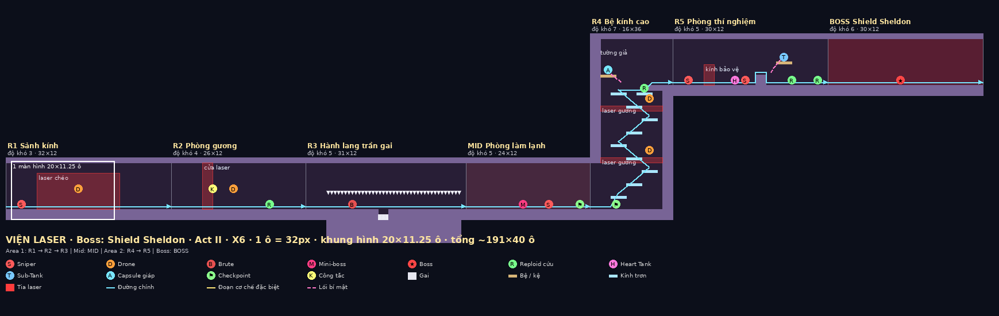

# Viện Laser — Boss Shield Sheldon

`x6_sheldon` · chủ đề `shadow` · Act II · X6 · tổng ~191×40 ô (6112×1280 px)

## Ý tưởng
Viện nghiên cứu băng-laser: sàn và vách kính trơn (gia tốc thấp, trượt dài), tia laser đi theo đường gương, tường giả giấu đường lên tầng trên.

## Tham khảo
X6 Shield Sheldon / Laser Institute, X5 Shining Hotarunicus, X2 Crystal Snail (kính).

## Chuẩn kích thước
Khung hình 640×360 px = 20×11.25 ô. Hành lang: trần 1 ô, trong lòng 9 ô, khối trần luôn nằm trong khung; phòng nhảy bệ/vực/nước 11 ô; phòng 2 tầng 17 ô; đấu trường cao 11 ô, rộng 20–30 ô; giếng rộng 12–20 ô. X nhảy cao ~2.6 ô, xa ~5 ô: trên đường chính gờ ≤ 2.5 ô, nhảy xa ≤ 5 ô (lướt-nhảy ≤ 7 ô); cao/xa hơn chỉ bằng đá tường, giáp hoặc cơ chế của màn, và dùng cho bí mật.

## Cấu trúc

- **Area 1** (R1 → R2 → R3): sảnh kính, phòng gương, hành lang trần gai
- **Mid** (MID): phòng làm lạnh
- **Area 2** (R4 → R5): bệ kính cao, phòng thí nghiệm
- **Boss** (BOSS): phòng gương

## Nhịp màn (độ khó)
R1 (3) → R2 (4) → R3 (5) → MID (5) → R4 (7) → R5 (5) → BOSS (6)

## Kịch bản từng phòng

### R1 – Sảnh kính · đi ngang · độ khó 3
*x 0–32, y 26–38 (32×12 ô) · vào ở sàn y 36, ra ở sàn y 36* · Area 1 · sảnh kính

Sàn kính trơn (gia tốc ×0.3, trượt 1.5 ô khi dừng). Gương chiếu laser chéo cố định.
- **Thông số:** sàn trơn: gia tốc ×0.3
- **Địa hình:** tia laser x 6–22, y 29–36 (laser chéo)
- **Thực thể:** Sniper (3, 36); Drone (14, 33)

### R2 – Phòng gương · đi ngang · độ khó 4
*x 32–58, y 26–38 (26×12 ô) · vào ở sàn y 36, ra ở sàn y 36* · Area 1 · sảnh kính

Bắn gương xoay 45° để đẩy tia về bộ thu, mở cửa X=2950 (dữ liệu game). Reploid trong lồng sau cửa.
- **Thông số:** gương xoay 45° mỗi phát bắn
- **Địa hình:** tia laser x 38–40, y 27–36 (cửa laser)
- **Thực thể:** Công tắc (40, 33) – gương xoay; Drone (44, 33); Reploid cứu (51, 36)

### R3 – Hành lang trần gai · đi ngang · độ khó 5
*x 58–89, y 26–38 (31×12 ô) · vào ở sàn y 36, ra ở sàn y 36* · Area 1 · sảnh kính

Trần gai thấp (khe 3 ô) + sàn trơn: nhảy cao là trúng gai. Brute trượt trên kính.
- **Thông số:** khe trần 3 ô
- **Địa hình:** gai trần x 62–88; hố gai x 72–74 (rộng 2 ô)
- **Thực thể:** Brute (67, 36)
- **Đường chính dùng:** nhảy

### MID – Phòng làm lạnh · đấu trường · độ khó 5
*x 89–113, y 26–38 (24×12 ô) · vào ở sàn y 36, ra ở sàn y 36* · Mid

Mini-boss: tinh thể làm lạnh 45 HP phản đạn thường, chỉ đạn nạp xuyên. Checkpoint 1.
- **Thông số:** bắn băng tỏa 6 hướng mỗi 2 s
- **Thực thể:** Mini-boss (100, 36) – tinh thể 45 HP; Checkpoint (111, 36); Sniper (105, 36)

### R4 – Bệ kính cao · leo dọc · độ khó 7
*x 113–129, y 2–38 (16×36 ô) · vào ở sàn y 36, ra ở sàn y 12* · Area 2 · tầng thí nghiệm

Cao trào: leo bệ kính băng trơn (đứng lâu trượt khỏi mép), laser ngang đi theo gương ở hai tầng. Tường giả bên trái ở tầng trên (đi xuyên được) → capsule Shadow Head. Checkpoint 2 ở đáy.
- **Thông số:** bệ kính trơn; laser gương bật 2 s / tắt 2 s
- **Địa hình:** khối x 124–127, y 12–13; tia laser x 115–127, y 26–27 (laser gương); tia laser x 115–127, y 16–17 (laser gương); kính trơn x 117–120, y 33.5; kính trơn x 120–123, y 31; kính trơn x 123–126, y 28.5; kính trơn x 120–123, y 26; kính trơn x 117–120, y 23.5; kính trơn x 120–123, y 21; kính trơn x 123–126, y 18.5; kính trơn x 120–123, y 16; kính trơn x 117–120, y 13.5; kính trơn x 122–125, y 13.5; bệ / kệ x 115–118, y 10
- **Thực thể:** Checkpoint (118, 36); Drone (124.5, 25.5); Drone (124.5, 15.5); Reploid cứu (123.5, 13.5); Capsule giáp (116.5, 10) – Shadow Head
- **Đường chính dùng:** nhảy
- **Lối bí mật:** (119, 12) → (116.5, 10)

### R5 – Phòng thí nghiệm · đi ngang · độ khó 5
*x 129–159, y 2–14 (30×12 ô) · vào ở sàn y 12, ra ở sàn y 12* · Area 2 · tầng thí nghiệm

Kính bảo vệ phản đạn thường; Heart Tank sau tấm kính phải bắn đạn nạp. Sub-Tank trên kệ thiết bị.
- **Thông số:** kính bảo vệ 3 phát đạn nạp
- **Địa hình:** tia laser x 135–137, y 8–12 (kính bảo vệ); khối x 145–147, y 10–12; bệ / kệ x 149–152, y 7.5
- **Thực thể:** Sniper (132, 12); Heart Tank (141, 12) – sau kính; Sniper (143, 12); Sub-Tank (150.5, 7.5) – kệ thiết bị; Reploid cứu (152, 12); Reploid cứu (157, 12)
- **Đường chính dùng:** nhảy, rơi xuống
- **Lối bí mật:** (148, 10) → (150, 7.5)

### BOSS – Shield Sheldon · đấu trường · độ khó 6
*x 159–189, y 2–14 (30×12 ô) · vào ở sàn y 12, ra ở sàn y 12* · Boss

Boss phản đạn bằng khiên; gương ở 4 góc làm đạn dội lại.
- **Thực thể:** Boss (173, 12)

## Bảng kẻ địch và vật phẩm

| Loại | Phòng | x | y | Ghi chú |
|---|---|---|---|---|
| Sniper | R1 | 3 | 36 |  |
| Drone | R1 | 14 | 33 |  |
| Công tắc | R2 | 40 | 33 | gương xoay |
| Drone | R2 | 44 | 33 |  |
| Reploid cứu | R2 | 51 | 36 |  |
| Brute | R3 | 67 | 36 |  |
| Mini-boss | MID | 100 | 36 | tinh thể 45 HP |
| Checkpoint | MID | 111 | 36 |  |
| Sniper | MID | 105 | 36 |  |
| Checkpoint | R4 | 118 | 36 |  |
| Drone | R4 | 124.5 | 25.5 |  |
| Drone | R4 | 124.5 | 15.5 |  |
| Reploid cứu | R4 | 123.5 | 13.5 |  |
| Capsule giáp | R4 | 116.5 | 10 | Shadow Head |
| Sniper | R5 | 132 | 12 |  |
| Heart Tank | R5 | 141 | 12 | sau kính |
| Sniper | R5 | 143 | 12 |  |
| Sub-Tank | R5 | 150.5 | 7.5 | kệ thiết bị |
| Reploid cứu | R5 | 152 | 12 |  |
| Reploid cứu | R5 | 157 | 12 |  |
| Boss | BOSS | 173 | 12 |  |

Tổng: 9 kẻ địch thường (Sniper 4, Drone 4, Brute 1), 4 Reploid, 2 checkpoint, Heart Tank 1, Sub-Tank 1, capsule 1.

## Capsule theo dữ liệu game
🛡️ Capsule Shadow Armor — Head Part (X=4620, Y=340 — Tầng trên Area 2 [YT 01:15:35]): Bắn công tắc X=2950 mở cửa, leo lên bệ kính băng cao X=4380 và đi xuyên bức tường giả X=4450. Bệ kính băng trơn + Tia Laser gương + Tường giả Shadow Head + Hành lang trần gai Area 1: Viện nghiên cứu Laser với bệ kính băng trơn trượt và hệ thống tia laser gương. Area 2: Tường giả đi xuyên ở tầng trên giấu Light Capsule Shadow Head Part.

## Bí mật
| Vật phẩm | Phòng | Cách lấy |
|---|---|---|
| Capsule Shadow Head | R4 | Đi xuyên tường giả tầng trên giếng. |
| Heart Tank | R5 | Bắn đạn nạp vỡ kính bảo vệ. |
| Sub-Tank | R5 | Kệ thiết bị. |

## Boss
**Shield Sheldon** · điểm yếu: Metal Anchor / Rakukojin
- **Bộ chiêu (dữ liệu game):** Guard Shell: Dựng khiên năng lượng phản xạ đạn bắn tới. Shell Toss: Ném 4 mảnh vỏ sò bay bao vây rồi khép góc. Laser Reflection: Bắn tia laser dội qua các mảnh vỏ sò. Overdrive (Phase 2): Tạo kết giới vỏ sò xoay kín và bắn laser liên hoàn.
- **Đấu trường:** phòng 30×11 ô, gương ở 4 góc.
- **Pha 2 (dưới 50% HP):** gương xoay theo nhịp 3 s: đạn dội theo góc mới; sàn kính trơn hơn.

## Engine cần bổ sung
- Sàn/vách kính trơn
- Laser theo đường gương, gương xoay bằng đạn
- Tường giả đi xuyên
- Kính bảo vệ cần đạn nạp

## Hình cần vẽ
- Sảnh kính băng
- Gương xoay + bộ thu laser
- Tường giả (cùng tileset)
- Tấm kính bảo vệ

## Kiểm tra tự động
Đường chính đã được kiểm tra theo khả năng nhảy (gờ ≤ 2.5 ô, nhảy xa ≤ 5 ô, lướt-nhảy ≤ 7 ô, đi bộ phải có nền) và theo quy ước số lượng.

**Còn lỗi:**
- số kẻ địch thường 9 (chuẩn 11–14)
