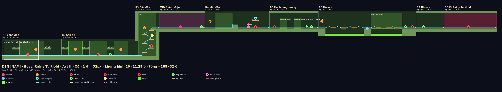

# Đền Inami — Boss Rainy Turtloid

`x6_turtloid` · chủ đề `nature` · Act II · X6 · tổng ~285×32 ô (9120×1024 px)

## Ý tưởng
Ngôi đền cổ dưới mưa axit xanh: mưa đến theo đợt (8 s mưa / 6 s tạnh), đứng ngoài mưa mất 1 HP mỗi 0.5 s; mái che trụ đá là chỗ trú. Area 1: cổng đền, sân đá, bậc đền với công tắc mở cổng. Area 2: mái đền có capsule Shadow Body, hành lang tượng phun axit, hồ axit cao trào.

## Tham khảo
X6 Rainy Turtloid / Inami Temple (mưa axit), X4 Web Spider (rừng/đền), X8 Bamboo Pandamonium.

## Chuẩn kích thước
Khung hình 640×360 px = 20×11.25 ô. Hành lang: trần 1 ô, trong lòng 9 ô, khối trần luôn nằm trong khung; phòng nhảy bệ/vực/nước 11 ô; phòng 2 tầng 17 ô; đấu trường cao 11 ô, rộng 20–30 ô; giếng rộng 12–20 ô. X nhảy cao ~2.6 ô, xa ~5 ô: trên đường chính gờ ≤ 2.5 ô, nhảy xa ≤ 5 ô (lướt-nhảy ≤ 7 ô); cao/xa hơn chỉ bằng đá tường, giáp hoặc cơ chế của màn, và dùng cho bí mật.

## Cấu trúc

- **Area 1** (R1 → R2 → R3): cổng, sân đá, bậc đền
- **Mid** (MID): chính điện
- **Area 2** (R4 → R5 → R6 → R7): mái đền, hành lang tượng, hồ axit
- **Boss** (BOSS): sân đền

## Nhịp màn (độ khó)
R1 (3) → R2 (4) → R3 (4) → MID (5) → R4 (5) → R5 (5) → R6 (7) → R7 (2) → BOSS (6)

## Kịch bản từng phòng

### R1 – Cổng đền · đi ngang · độ khó 3
*x 0–34, y 18–30 (34×12 ô) · vào ở sàn y 28, ra ở sàn y 28* · Area 1 · sân đền

Mưa axit bắt đầu; mái che đầu tiên dạy cách trú (bảng: đứng dưới mái khi trời mưa).
- **Thông số:** mưa 8 s / tạnh 6 s; 1 HP mỗi 0.5 s khi dính mưa
- **Địa hình:** khối x 6–10, y 23–24; mưa axit x 10–24, y 19–28 (mưa axit 8s/6s); khối x 24–28, y 23–24
- **Thực thể:** Sniper (14.6667, 28); Drone (19.3333, 25)

### R2 – Sân đá · đi ngang · độ khó 4
*x 34–76, y 18–30 (42×12 ô) · vào ở sàn y 28, ra ở sàn y 28* · Area 1 · sân đền

Sân rộng 40 ô giữa các mái che cách nhau 8–10 ô: phải chạy hết quãng trong 6 s tạnh. Nightmare Virus bay chậm (Drone). Reploid dưới mái thứ 3.
- **Thông số:** khoảng cách mái che 8–10 ô (chạy 250 px/s ≈ 1.2 s)
- **Địa hình:** khối x 34–38, y 23–24; mưa axit x 38–46, y 19–28; khối x 46–50, y 23–24; mưa axit x 50–60, y 19–28; khối x 60–64, y 23–24; mưa axit x 64–72, y 19–28
- **Thực thể:** Drone (42, 25); Sniper (55, 28); Reploid cứu (62, 28); Drone (68, 25)

### R3 – Bậc đền · leo dọc · độ khó 4
*x 76–90, y 2–30 (14×28 ô) · vào ở sàn y 28, ra ở sàn y 12* · Area 1 · sân đền

Leo bậc đá có mái hiên che mưa từng tầng; công tắc #1 trên bậc giữa mở cổng đền phía trên.
- **Thông số:** mưa rơi trong giếng; mái hiên che từng kệ
- **Địa hình:** khối x 85–88, y 12–13; mưa axit x 78–88, y 3–28 (mưa); bệ / kệ x 80–83, y 25.5; bệ / kệ x 84–87, y 23; bệ / kệ x 80–83, y 20.5; bệ / kệ x 84–87, y 18; bệ / kệ x 80–83, y 15.5; bệ / kệ x 84–87, y 13
- **Thực thể:** Công tắc (86, 17) – công tắc #1; Sniper (85.5, 23); Drone (81.5, 12.5)
- **Đường chính dùng:** nhảy

### MID – Chính điện · đấu trường · độ khó 5
*x 90–116, y 2–14 (26×12 ô) · vào ở sàn y 12, ra ở sàn y 12* · Mid

Trong nhà, hết mưa. Mini-boss: tượng hộ pháp 45 HP phun axit vòng cung. Checkpoint 1 sau trận.
- **Thông số:** phun axit vòng cung mỗi 2 s
- **Thực thể:** Mini-boss (102, 12) – tượng hộ pháp 45 HP; Checkpoint (114, 12)

### R4 – Mái đền · đi ngang · độ khó 5
*x 116–153, y 2–14 (37×12 ô) · vào ở sàn y 12, ra ở sàn y 12* · Area 2 · mái đền và hồ axit

Đi trên mái tầng 2: capsule Shadow Body (X=3820 trong dữ liệu game) ở mái cao phía trên Heart Tank. Ngói trơn ở mép mái.
- **Thông số:** mưa 8 s / tạnh 6 s
- **Địa hình:** mưa axit x 122–132, y 3–12; khối x 132–135, y 10–12; bệ / kệ x 140–143, y 9.5; bệ / kệ x 143–147, y 7
- **Thực thể:** Drone (119, 9); Heart Tank (141, 12) – dưới mái cao; Capsule giáp (145, 7) – Shadow Body (mái cao); Sniper (145, 12)
- **Đường chính dùng:** nhảy, rơi xuống
- **Lối bí mật:** (141, 12) → (141, 9.5) → (144, 7)

### R5 – Hành lang tượng · đi ngang · độ khó 5
*x 153–181, y 2–14 (28×12 ô) · vào ở sàn y 12, ra ở sàn y 12* · Area 2 · mái đền và hồ axit

Tượng đá hai bên phun axit theo nhịp lệch pha (vệt xanh báo trước). Cổng Alt Path (nhánh Nightmare Zero) ở giữa hành lang. Checkpoint 2 ở cuối.
- **Thông số:** tượng phun 1 s mỗi 3 s, lệch pha 1.5 s
- **Địa hình:** mưa axit x 159–163, y 6–12 (tượng phun); mưa axit x 167–171, y 6–12 (tượng phun)
- **Thực thể:** Brute (156, 12); Reploid cứu (174, 12); Checkpoint (177, 12)

### R6 – Hồ axit · đi ngang · độ khó 7
*x 181–237, y 2–16 (56×14 ô) · vào ở sàn y 12, ra ở sàn y 12* · Area 2 · mái đền và hồ axit

Cao trào: hồ axit với lá sen nổi (chìm sau 1.5 s), mưa đổ liên tục ở nửa sau. Sub-Tank dưới mặt hồ ở vũng cạn (lướt xuống lấy rồi nhảy lên).
- **Thông số:** lá sen chìm sau 1.5 s; mưa liên tục; axit 4 sát thương
- **Địa hình:** hố hồ axit x 185–207 (rộng 22 ô); khúc gỗ trôi x 188–191, y 11; khúc gỗ trôi x 194–197, y 12; khúc gỗ trôi x 200–203, y 11; mưa axit x 211–229, y 3–12 (mưa liên tục); hố hồ axit x 211–229 (rộng 18 ô); khúc gỗ trôi x 214–217, y 11; khúc gỗ trôi x 220–223, y 11; khúc gỗ trôi x 225–227, y 12
- **Thực thể:** Drone (183, 9); Sub-Tank (209, 13) – vũng cạn dưới mặt hồ; Reploid cứu (231, 12); Sniper (235, 12)
- **Đường chính dùng:** bệ di động, nhảy

### R7 – Hồ sen · đi ngang · độ khó 2
*x 237–253, y 2–14 (16×12 ô) · vào ở sàn y 12, ra ở sàn y 12* · Area 2 · mái đền và hồ axit

Phòng nghỉ trong nhà thủy tạ: Reploid cuối, cửa boss.
- **Thực thể:** Reploid cứu (241, 12)

### BOSS – Rainy Turtloid · đấu trường · độ khó 6
*x 253–283, y 2–14 (30×12 ô) · vào ở sàn y 12, ra ở sàn y 12* · Boss

Mưa axit theo đợt trong đấu trường; mai rùa phản đạn khi thu mình.
- **Thực thể:** Boss (267, 12)

## Bảng kẻ địch và vật phẩm

| Loại | Phòng | x | y | Ghi chú |
|---|---|---|---|---|
| Sniper | R1 | 14.6667 | 28 |  |
| Drone | R1 | 19.3333 | 25 |  |
| Drone | R2 | 42 | 25 |  |
| Sniper | R2 | 55 | 28 |  |
| Reploid cứu | R2 | 62 | 28 |  |
| Drone | R2 | 68 | 25 |  |
| Công tắc | R3 | 86 | 17 | công tắc #1 |
| Sniper | R3 | 85.5 | 23 |  |
| Drone | R3 | 81.5 | 12.5 |  |
| Mini-boss | MID | 102 | 12 | tượng hộ pháp 45 HP |
| Checkpoint | MID | 114 | 12 |  |
| Drone | R4 | 119 | 9 |  |
| Heart Tank | R4 | 141 | 12 | dưới mái cao |
| Capsule giáp | R4 | 145 | 7 | Shadow Body (mái cao) |
| Sniper | R4 | 145 | 12 |  |
| Brute | R5 | 156 | 12 |  |
| Reploid cứu | R5 | 174 | 12 |  |
| Checkpoint | R5 | 177 | 12 |  |
| Drone | R6 | 183 | 9 |  |
| Sub-Tank | R6 | 209 | 13 | vũng cạn dưới mặt hồ |
| Reploid cứu | R6 | 231 | 12 |  |
| Sniper | R6 | 235 | 12 |  |
| Reploid cứu | R7 | 241 | 12 |  |
| Boss | BOSS | 267 | 12 |  |

Tổng: 12 kẻ địch thường (Sniper 5, Drone 6, Brute 1), 4 Reploid, 2 checkpoint, Heart Tank 1, Sub-Tank 1, capsule 1.

## Capsule theo dữ liệu game
🛡️ Capsule Shadow Armor — Body Part (X=3820, Y=440 — Mái đền tầng cao Area 2): Sau khi bắn công tắc #1 mở cổng đền, nhảy lên mái che tầng 2 (X=3740) phía trên Heart Tank. Mưa Axit xanh + 8 Mái che trụ đá + Capsule Shadow Body + Alt Path Nightmare Zero Area 1: Ngôi đền cổ chìm trong Mưa Axit định kỳ, di chuyển qua các mái che trụ đá và bắn công tắc mở cổng đền. Area 2: Tầng cao giấu Shadow Body Part và Heart Tank; tầng dưới vào cổng Alt Path đánh Nightmare Zero.

## Bí mật
| Vật phẩm | Phòng | Cách lấy |
|---|---|---|
| Capsule Shadow Body | R4 | Mái tầng cao phía trên Heart Tank. |
| Heart Tank | R4 | Dưới mái cao. |
| Sub-Tank | R6 | Vũng cạn dưới mặt hồ. |
| Alt Path Nightmare Zero | R5 | Cổng giữa hành lang tượng. |

## Boss
**Rainy Turtloid** · điểm yếu: Ice Burst / Hyoroga
- **Bộ chiêu (dữ liệu game):** Meteor Rain: Bắn loạt cầu nước lên trời rồi rơi thẳng đứng xuống như mưa sao băng. Shell Spin: Rút vào mai rùa xoay tròn lao dội tường khắp phòng. Back Crystal Shield: 2 viên pha lê trên lưng chặn đạn cho đến khi bị phá vỡ. Overdrive (Phase 2): Xoay mai tốc độ cực đại kèm mưa axit.
- **Đấu trường:** sân 30×11 ô có 2 mái che nhỏ.
- **Pha 2 (dưới 50% HP):** mưa không tạnh; mái che sụp lần lượt (báo trước bằng vết nứt).

## Engine cần bổ sung
- Mưa axit theo đợt, sát thương theo thời gian
- Mái che an toàn
- Tượng phun axit theo nhịp
- Lá sen chìm dần
- Cổng nhánh Alt Path

## Hình cần vẽ
- Đền Inami: mái ngói, trụ đá, tượng hộ pháp
- Mưa axit xanh (hạt + vệt)
- Hồ axit + lá sen

## Kiểm tra tự động
Đường chính đã được kiểm tra theo khả năng nhảy (gờ ≤ 2.5 ô, nhảy xa ≤ 5 ô, lướt-nhảy ≤ 7 ô, đi bộ phải có nền) và theo quy ước số lượng.

**Kết quả: đạt.**
