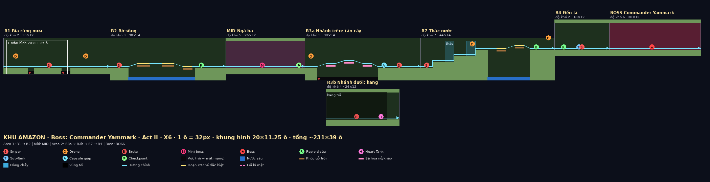

# Khu Amazon — Boss Commander Yammark

`x6_yammark` · chủ đề `nature` · Act II · X6 · tổng ~231×39 ô (7392×1248 px)

## Ý tưởng
Rừng mưa Amazon. Area 1: bìa rừng, bờ sông với khúc gỗ trôi. Ngã ba ở mini-boss tách hai nhánh: nhánh trên tán cây có capsule Blade Foot, nhánh dưới hang có Heart Tank; hai nhánh nhập lại trước thác nước cao trào.

## Tham khảo
X6 Commander Yammark (rừng Amazon), X4 Web Spider (rừng), X2 Wire Sponge (cây).

## Chuẩn kích thước
Khung hình 640×360 px = 20×11.25 ô. Hành lang: trần 1 ô, trong lòng 9 ô, khối trần luôn nằm trong khung; phòng nhảy bệ/vực/nước 11 ô; phòng 2 tầng 17 ô; đấu trường cao 11 ô, rộng 20–30 ô; giếng rộng 12–20 ô. X nhảy cao ~2.6 ô, xa ~5 ô: trên đường chính gờ ≤ 2.5 ô, nhảy xa ≤ 5 ô (lướt-nhảy ≤ 7 ô); cao/xa hơn chỉ bằng đá tường, giáp hoặc cơ chế của màn, và dùng cho bí mật.

## Cấu trúc

- **Area 1** (R1 → R2): bìa rừng, bờ sông
- **Mid** (MID): ngã ba
- **Area 2** (R3a → R3b → R7 → R4): nhánh trên/dưới, thác nước
- **Boss** (BOSS): đền lá

## Nhịp màn (độ khó)
R1 (2) → R2 (3) → MID (5) → R3a (5) → R3b (4) → R7 (7) → R4 (2) → BOSS (6)

## Kịch bản từng phòng

### R1 – Bìa rừng mưa · đi ngang · độ khó 2
*x 0–35, y 8–20 (35×12 ô) · vào ở sàn y 18, ra ở sàn y 18* · Area 1 · bìa rừng và sông

Côn trùng máy (Drone) bay theo đàn; cây gãy làm cầu qua khe nhỏ.
- **Địa hình:** hố vực (rơi = mất mạng) x 8–10 (rộng 2 ô); hố vực (rơi = mất mạng) x 19–22 (rộng 3 ô)
- **Thực thể:** Drone (4, 15); Sniper (15, 18); Drone (27, 15)
- **Đường chính dùng:** nhảy

### R2 – Bờ sông · đi ngang · độ khó 3
*x 35–73, y 8–22 (38×14 ô) · vào ở sàn y 18, ra ở sàn y 18* · Area 1 · bìa rừng và sông

Khúc gỗ trôi trên sông (về phải 60 px/s) làm bệ di động; Reploid trên tảng đá giữa sông.
- **Thông số:** gỗ trôi +60 px/s
- **Địa hình:** hố nước sâu x 41–63 (rộng 22 ô); khúc gỗ trôi x 44–48, y 17; khúc gỗ trôi x 52–56, y 17; khúc gỗ trôi x 59–62, y 18
- **Thực thể:** Sniper (38, 18); Reploid cứu (65, 18)
- **Đường chính dùng:** bệ di động, nhảy

### MID – Ngã ba · đấu trường · độ khó 5
*x 73–99, y 8–20 (26×12 ô) · vào ở sàn y 18, ra ở sàn y 18* · Mid

Mini-boss: tổ chuồn chuồn máy 45 HP. Checkpoint 1 sau trận; ngã ba tách nhánh trên (tán cây) và nhánh dưới (hang).
- **Thông số:** thả 3 chuồn chuồn mỗi 4 s
- **Thực thể:** Mini-boss (85, 18) – tổ chuồn chuồn 45 HP; Checkpoint (97, 18)

### R3a – Nhánh trên: tán cây · đi ngang · độ khó 5
*x 99–137, y 8–22 (38×14 ô) · vào ở sàn y 18, ra ở sàn y 18* · Area 2 · hai nhánh và thác

Lá lớn làm bệ nảy, bệ hoa nở/khép (2 s/2 s). Capsule Blade Foot ở X=4550 (dữ liệu game).
- **Thông số:** hoa nở 2 s / khép 2 s
- **Địa hình:** hố vực (rơi = mất mạng) x 103–123 (rộng 20 ô); bệ hoa nở/khép x 106–109, y 17; bệ hoa nở/khép x 112–115, y 16; bệ hoa nở/khép x 118–121, y 17
- **Thực thể:** Drone (101, 15); Capsule giáp (125, 18) – Blade Foot; Sniper (130, 18)
- **Đường chính dùng:** nhảy

### R3b – Nhánh dưới: hang · đi ngang · độ khó 4
*x 106–130, y 25–37 (24×12 ô) · vào ở sàn y 35, ra ở sàn y 35* · Area 2 · hai nhánh và thác

Hang tối với côn trùng phát sáng soi đường; Heart Tank cuối hang. Brute canh lối ra.
- **Thông số:** vùng tối: chỉ thấy quanh côn trùng sáng
- **Địa hình:** vùng tối x 106–126, y 26–35 (hang tối)
- **Thực thể:** Brute (116, 35); Heart Tank (124, 35) – cuối hang

### R7 – Thác nước · đi ngang · độ khó 7
*x 137–181, y 8–22 (44×14 ô) · vào ở sàn y 18, ra ở sàn y 12* · Area 2 · hai nhánh và thác

Cao trào: hai nhánh nhập lại; leo bậc đá cạnh thác, nước đổ đẩy xuống ở các khe; khúc gỗ trôi xuống thác. Checkpoint 2.
- **Thông số:** thác đẩy xuống 120 px/s trong khe; gỗ rơi mỗi 2 s
- **Địa hình:** dòng chảy x 145–148, y 9–16 (thác); dòng chảy x 152–155, y 9–14; hố nước sâu x 159–173 (rộng 14 ô); khúc gỗ trôi x 162–165, y 12; khúc gỗ trôi x 168–171, y 11
- **Thực thể:** Checkpoint (139, 18); Sniper (139, 18); Drone (154, 11); Reploid cứu (175, 12); Drone (179, 9)
- **Đường chính dùng:** bệ di động, nhảy

### R4 – Đền lá · đi ngang · độ khó 2
*x 181–199, y 2–14 (18×12 ô) · vào ở sàn y 12, ra ở sàn y 12* · Area 2 · hai nhánh và thác

Hai nhánh hội tụ; Sub-Tank trên bàn thờ lá, Reploid, cửa boss.
- **Thực thể:** Reploid cứu (184, 12); Sub-Tank (189, 12) – bàn thờ lá; Sniper (190, 12)

### BOSS – Commander Yammark · đấu trường · độ khó 6
*x 199–229, y 2–14 (30×12 ô) · vào ở sàn y 12, ra ở sàn y 12* · Boss

Boss gọi 3 chuồn chuồn vệ tinh xoay quanh.
- **Thực thể:** Boss (213, 12)

## Bảng kẻ địch và vật phẩm

| Loại | Phòng | x | y | Ghi chú |
|---|---|---|---|---|
| Drone | R1 | 4 | 15 |  |
| Sniper | R1 | 15 | 18 |  |
| Drone | R1 | 27 | 15 |  |
| Sniper | R2 | 38 | 18 |  |
| Reploid cứu | R2 | 65 | 18 |  |
| Mini-boss | MID | 85 | 18 | tổ chuồn chuồn 45 HP |
| Checkpoint | MID | 97 | 18 |  |
| Drone | R3a | 101 | 15 |  |
| Capsule giáp | R3a | 125 | 18 | Blade Foot |
| Sniper | R3a | 130 | 18 |  |
| Brute | R3b | 116 | 35 |  |
| Heart Tank | R3b | 124 | 35 | cuối hang |
| Checkpoint | R7 | 139 | 18 |  |
| Sniper | R7 | 139 | 18 |  |
| Drone | R7 | 154 | 11 |  |
| Reploid cứu | R7 | 175 | 12 |  |
| Drone | R7 | 179 | 9 |  |
| Reploid cứu | R4 | 184 | 12 |  |
| Sub-Tank | R4 | 189 | 12 | bàn thờ lá |
| Sniper | R4 | 190 | 12 |  |
| Boss | BOSS | 213 | 12 |  |

Tổng: 11 kẻ địch thường (Sniper 5, Drone 5, Brute 1), 3 Reploid, 2 checkpoint, Heart Tank 1, Sub-Tank 1, capsule 1.

## Capsule theo dữ liệu game
🛡️ Capsule Blade Armor — Foot Part (X=4550, Y=360 — Nhánh trên Area 2 [YT 21:52]): Tại ngã ba Mid-Checkpoint (3350px), nhảy lên tầng tán cây phía trên (X=3650) để lấy mảnh chân Blade Armor. Rừng 2 tầng tách nhánh tại Mid-Checkpoint (Trên: Blade Foot | Dưới: Hang Heart Tank) Area 1: Rừng Amazon rậm rạp với bệ nấm bật nhảy và bọ Nightmare. Tại Mid-Checkpoint (3350px), bản đồ tách thành 2 tầng độc lập dài 1,500px: Tầng trên lấy Blade Foot Part; Tầng dưới lấy Heart Tank.

## Bí mật
| Vật phẩm | Phòng | Cách lấy |
|---|---|---|
| Capsule Blade Foot | R3a | Nhánh trên. |
| Heart Tank | R3b | Cuối hang nhánh dưới. |
| Sub-Tank | R4 | Bàn thờ lá. |

## Boss
**Commander Yammark** · điểm yếu: Ray Arrow / Rekkoha
- **Bộ chiêu (dữ liệu game):** Yammar Option: Triệu hồi 3 chuồn chuồn mini xoay quanh người bắn đạn hỗ trợ. Swoop Dive: Bay vọt lên cao rồi lao chéo cắt ngang màn hình. Spread Shot: Bắn loạt đạn xanh hình quạt từ trên không. Overdrive (Phase 2): Liên tục thả đàn chuồn chuồn và đổi độ cao bất ngờ.
- **Đấu trường:** đền lá 30×11 ô.
- **Pha 2 (dưới 50% HP):** mưa rừng làm sàn trơn; chuồn chuồn vệ tinh tách ra lao thẳng.

## Engine cần bổ sung
- Khúc gỗ trôi
- Bệ hoa nở/khép
- Ngã ba nhánh (camera theo nhánh)
- Vùng tối có nguồn sáng di động
- Thác nước đẩy xuống

## Hình cần vẽ
- Rừng mưa nhiều lớp
- Khúc gỗ, sông
- Hoa nở/khép
- Hang tối + côn trùng sáng
- Thác nước

## Kiểm tra tự động
Đường chính đã được kiểm tra theo khả năng nhảy (gờ ≤ 2.5 ô, nhảy xa ≤ 5 ô, lướt-nhảy ≤ 7 ô, đi bộ phải có nền) và theo quy ước số lượng.

**Còn lỗi:**
- Reploid cứu: 3 (chuẩn 4)
