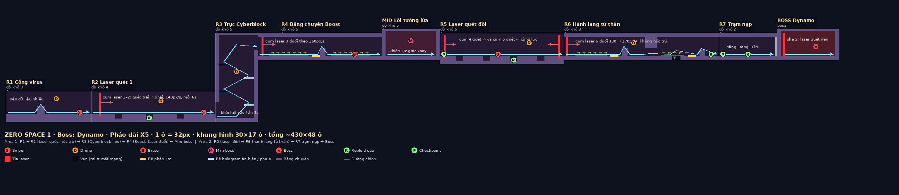

# Màn: ZERO SPACE 1 (Zero Space 1 — Boss Dynamo)

Bản thiết kế để duyệt trước khi dựng. Sơ đồ: `maps/x5_f1_dynamo.png`.
Màn này thay cho `x5_f1_dynamo` hiện tại. Boss Dynamo, 6 cụm laser tử thần, trụ Cyberblock, bệ Boost và băng chuyền vẫn giữ. Màn pháo đài không có capsule, Heart Tank, Sub-Tank (theo dữ liệu game); thêm 4 Reploid và trạm nạp lớn.

---

## 0. Công cụ và quy ước

Dùng chung với màn mẫu (`../lo-nham-thach-kich-ban.md`, mục 0): LDtk dựng bản đồ, Pixelorama vẽ tile, Krita vẽ nền parallax. 1 ô = 32px, khung hình 30×17 ô, các lớp `Collision` / `Tiles` / `Decor` / `Foreground` / `Entities`.

---

## 1. Ý tưởng tổng

Lối vào không gian virus Zero. Toàn màn xoay quanh **6 cụm laser tử thần** quét ngang: đầu tiên trốn trong hốc, rồi chạy nhanh hơn laser, cuối cùng là chạy liên tục không chỗ trú.

- **Area 1 – Cổng virus:** tím-xanh nhiễu, lưới mã. Laser quét có hốc trú, Cyberblock nhấp nháy, laser đuổi có Boost.
- **Area 2 – Lõi không gian:** tối hơn, laser đỏ rực. Laser đôi ngược chiều, rồi hành lang tử thần dài 80 ô.
- **Điểm nhấn trải nghiệm:** nằm hốc tránh laser → leo Cyberblock → chạy Boost trước laser → mini-boss lõi tường lửa → chọn hốc giữa hai laser ngược chiều → chạy hết hành lang tử thần → boss
- **Đường cong độ khó:** 3 → 4 → 5 → 5 → (mini-boss) → 6 → 8 → 2 → boss (thang 10).
- **Thời lượng mục tiêu:** khoảng 5–6 phút lần đầu, khoảng 2.5 phút khi đã quen.

Các mẫu thiết kế tham khảo (không chép bản đồ gốc):

- **X5, Zero Space 1:** cụm laser tử thần quét toàn màn, hốc trú ẩn, khuyên dùng Falcon/Fourth.
- **X6, màn Gate Lab:** tường nguy hiểm đuổi theo người chơi.
- **X8 16-bit demake:** đoạn đuổi do người chơi tự điều khiển, camera bám người chơi.
- **X Corrupted:** pháo đài kết hợp nhiều cơ chế đã học, không dạy lại.

---

## 2. Kịch bản từng phòng

Tọa độ tính theo ô, gốc (0,0) ở góc trên trái thế giới, y tăng xuống dưới.

### R1 – Cổng virus (x 0–44, y 40–56) · độ khó 3
- **Mục đích:** bước vào không gian virus Zero. Không có phần dạy: pháo đài giả định người chơi đã thạo.
- **Địa hình:** nền dữ liệu 44 ô, mặt sàn ở y 52, một **khối Cyberblock** cao 4 ô.
- **Địch:** 1 Drone, 1 Sniper.
- **Trang trí:** lưới mã nhị phân trôi, khối pixel vỡ, màu tím-xanh nhiễu.
- **Ghi chú:** màn pháo đài không có capsule, Heart Tank hay Sub-Tank. Bù lại có 4 Reploid và trạm nạp năng lượng lớn. Nên dùng giáp Falcon hoặc Fourth để lướt qua các cụm laser.

### R2 – Laser quét 1 (x 44–108, y 40–56) · độ khó 4
- **Mục đích:** giới thiệu **cụm laser tử thần**: một bức tường laser cao hết màn hình quét ngang.
- **Địa hình:** hành lang 64 ô, 3 **hốc trú** sâu 2.5 ô trong sàn, cách nhau 16 ô.
- **Cơ chế:**
  - Laser sinh ra ở mép trái, quét sang phải 140px/giây, mỗi 6 giây một lần (cụm 1 rồi cụm 2).
  - Chạm laser là mất 1/2 máu. Nằm trong hốc thì laser quét qua đầu.
  - Đèn đỏ ở mép trái nháy 1 giây trước khi laser xuất hiện.
- **Địch:** 1 Drone, 1 Sniper. Laser **không** gây sát thương cho địch.
- **Vật phẩm:** Reploid #1 trong hốc thứ hai.

### R3 – Trục Cyberblock (x 108–130, y 10–56) · độ khó 5
- **Mục đích:** đoạn dọc trên các **Cyberblock** nhấp nháy.
- **Địa hình:** trục rộng 18 ô, cao 42 ô (từ y 54 lên y 17). 4 Cyberblock làm bệ.
- **Cơ chế:** khối hiện 2 giây, ẩn 1 giây. Hai vách đá tường được, nhưng có vệt dữ liệu nhiễu: chạm vào thì bị đẩy ra 1 ô (không mất máu).
- **Địch:** 1 Drone.

### R4 – Băng chuyền Boost (x 130–194, y 10–24) · độ khó 5
- **Mục đích:** chạy nhanh hơn laser nhờ **băng chuyền xuôi chiều** và **tấm Boost**.
- **Địa hình:** hành lang 64 ô, trần ở y 12, sàn ở y 22.
- **Cơ chế:**
  - Cụm laser 3 **đuổi theo** người chơi 160px/giây ngay khi vào phòng.
  - Băng chuyền đẩy sang phải 100px/giây. Tấm Boost cho tốc độ tối đa 1.5 giây.
  - Một Cyberblock chắn giữa đường: nhảy qua mất đà, lướt-nhảy thì giữ đà.
  - Không có hốc trú: phải chạy tới cửa phòng sau (laser dừng ở cửa).
- **Địch:** 1 Brute cuối phòng, đứng ngay trên băng chuyền.

### Mini-boss – Lõi tường lửa (x 194–224, y 8–24) · độ khó 5
- **Đấu trường 26 ô**, kín, hai vách đá tường được.
- **Lõi tường lửa** là khối lục giác lơ lửng, bao quanh bởi 6 tấm khiên dữ liệu xoay.
- **Đòn đánh:**
  - Bắn tia quét ngang hết sân (giống cụm laser thu nhỏ): nhảy lên vách.
  - Ném tấm khiên ra như đĩa bay rồi thu về.
- **Điểm yếu:** lõi trống khi một tấm khiên vừa bay ra.
- **Phần thưởng:** mở cửa khu laser đôi. Hạ không mất máu thì được thưởng Souls.

### R5 – Laser quét đôi (x 224–288, y 10–26) · độ khó 6
- **Checkpoint 1** ở đầu phòng.
- **Mục đích:** hai laser quét **ngược chiều nhau** cùng lúc.
- **Địa hình:** hành lang 64 ô, 4 hốc trú.
- **Cơ chế:**
  - Cụm 4 quét từ trái, cụm 5 quét từ phải, gặp nhau ở giữa phòng. Chu kỳ 7 giây.
  - Một số lần hai laser gặp nhau **ngay trên một hốc**: đó là hốc duy nhất an toàn với cả hai lần quét.
  - Người chơi phải đọc vị trí giao nhau để chọn hốc.
- **Địch:** 1 Sniper, 1 Drone.
- **Vật phẩm:** Reploid #2 trong hốc thứ ba.

### R6 – Hành lang tử thần (x 288–368, y 10–24) · độ khó 8
- **Mục đích:** cao trào của màn. Chạy trước **cụm laser 6** suốt 80 ô, không có chỗ trú.
- **Cơ chế:**
  - Laser đuổi theo 130px/giây, tăng lên 170px/giây ở nửa sau.
  - 2 tấm Boost, 1 đoạn băng chuyền xuôi và 1 đoạn **băng chuyền ngược** (đẩy lùi 90px/giây) ngay trước một hố nhỏ.
  - Cyberblock thấp (nhảy) và Cyberblock treo (lướt dưới) xen kẽ.
- **Địch:** 1 Drone. Đứng lại bắn nó là bị laser bắt kịp: phải lướt qua.
- **Vật phẩm:** Reploid #3 ngay cửa ra. Chạy tới đây là an toàn.
- **Giáp hỗ trợ:** Falcon lướt trên không xa; Fourth lơ lửng qua hố.

### R7 – Trạm nạp (x 368–398, y 10–24) · độ khó 2
- **Checkpoint 2** ở đầu phòng.
- Phòng nghỉ trước boss: Reploid #4, **nạp năng lượng lớn** (đầy máu), cửa boss.

### BOSS – Dynamo (x 398–430, y 8–24)
- **Đấu trường 28 ô**, kín, hai vách đá tường được.
- **Pha 1** (100–50% HP): bộ chiêu hiện có (ném lưỡi đôi, chém, hồi máu bằng mảnh năng lượng).
- **Pha 2** (dưới 50% HP):
  - **Cụm laser quét nền** chạy ngang sân mỗi 8 giây. Dynamo nhảy qua và đánh người chơi đúng lúc phải né laser.
- Điểm yếu giữ nguyên theo dữ liệu game.

---

## 3. Bảng vật phẩm và kẻ địch

| Loại | Số lượng | Vị trí |
|---|---|---|
| Sniper | 3 | R1, R2, R5 |
| Drone | 5 | R1, R2, R3, R5, R6 |
| Brute | 1 | R4 |
| Mini-boss | 1 | MID |
| Reploid cứu | 4 | R2, R5, R6, R7 |
| Checkpoint | 2 | R5, R7 |

Tổng 9 kẻ địch thường (bản cũ: 20 con xếp đều), đặt có chủ đích theo mục đích từng phòng.

---

## 4. Những gì engine cần bổ sung

1. Laser quét toàn chiều cao: chạy theo lịch hoặc đuổi theo người chơi; không gây sát thương cho địch.
2. Hốc trú trong sàn (laser đi qua phía trên).
3. Cyberblock nhấp nháy (bệ ẩn hiện) và Cyberblock cố định.
4. Tấm Boost, băng chuyền xuôi/ngược.
5. Vệt dữ liệu nhiễu trên vách đẩy người chơi ra.
6. Mini-boss Lõi tường lửa có khiên xoay.

## 5. Danh sách hình cần vẽ

- **Tileset "Không gian virus" (Area 1):** 47 ô viền lưới dữ liệu tím, hốc trú, Cyberblock (3 khung).
- **Tileset "Lõi" (Area 2):** 47 ô viền tối có mạch đỏ.
- **Vật thể:** tường laser (4 khung), đèn báo, tấm Boost, băng chuyền dữ liệu.
- **Nền:** mã nhị phân trôi và khối pixel vỡ (2 lớp parallax cho cả màn).

**Hướng phối hợp:** như màn mẫu — dựng bằng khối màu tạm theo sơ đồ để chơi thử, chốt cảm giác rồi mới thay tile thật.
