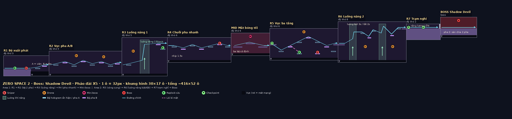

# Màn: ZERO SPACE 2 (Zero Space 2 — Boss Shadow Devil)

Bản thiết kế để duyệt trước khi dựng. Sơ đồ: `maps/x5_f2_shadow.png`.
Màn này thay cho `x5_f2_shadow` hiện tại. Boss Shadow Devil, vực không đáy toàn màn, bệ Cyber nhấp nháy 2 pha, 2 luồng khí nâng và trạm nghỉ giữa màn vẫn giữ. Không có capsule/Heart Tank/Sub-Tank (theo dữ liệu game); thêm 4 Reploid, 1 mini-boss và trạm nạp lớn.

---

## 0. Công cụ và quy ước

Dùng chung với màn mẫu (`../lo-nham-thach-kich-ban.md`, mục 0): LDtk dựng bản đồ, Pixelorama vẽ tile, Krita vẽ nền parallax. 1 ô = 32px, khung hình 30×17 ô, các lớp `Collision` / `Tiles` / `Decor` / `Foreground` / `Entities`.

---

## 1. Ý tưởng tổng

Thử thách nhảy chính xác: **cả màn là vực không đáy**. Người chơi chỉ có bệ Cyber 2 pha và luồng khí nâng. Không có địch mạnh, nhưng mỗi lần lỡ nhịp là mất mạng.

- **Area 1 – Vực đầu:** bệ 2 pha nhịp 2 giây, luồng nâng, rồi nhịp 1.5 giây.
- **Area 2 – Vực sâu:** vòng cung 3 tầng, luồng nâng bật/tắt lệch nhịp với bệ.
- **Điểm nhấn trải nghiệm:** học nhịp A/B → chuỗi 8 bệ → bay luồng nâng → nhịp nhanh → mini-boss trên 3 bệ → vòng cung → luồng nâng bật/tắt → boss trên sàn 2 pha
- **Đường cong độ khó:** 3 → 5 → 5 → 6 → (mini-boss) → 6 → 8 → 2 → boss (thang 10).
- **Thời lượng mục tiêu:** khoảng 5–7 phút lần đầu (nhiều lần chết), khoảng 2.5 phút khi đã quen.

Các mẫu thiết kế tham khảo (không chép bản đồ gốc):

- **X5, Zero Space 2:** vực không đáy toàn màn, 10 bệ Cyber nhấp nháy 2 pha, 2 luồng khí nâng, trạm nghỉ ở mid-gate.
- **X4, màn Cyber Peacock:** bệ dữ liệu ẩn hiện trong không gian mạng.
- **X5, màn Spiral Pegacion:** luồng khí nâng giữa vực.
- **X Corrupted:** hai nhịp không khớp nhau buộc người chơi chờ thời điểm cả hai cùng thuận.

---

## 2. Kịch bản từng phòng

Tọa độ tính theo ô, gốc (0,0) ở góc trên trái thế giới, y tăng xuống dưới.

### R1 – Bệ xuất phát (x 0–40, y 36–54) · độ khó 3
- **Mục đích:** giới thiệu **bệ Cyber 2 pha**: bệ pha A và bệ pha B thay phiên nhau hiện.
- **Địa hình:** mỏm đá cuối cùng (24 ô) trước vực không đáy. Sau mỏm này, cả màn không có mặt đất.
- **Cơ chế – bệ 2 pha:**
  - Pha A hiện 2 giây thì pha B hiện 2 giây, luân phiên. Bệ sắp đổi pha thì chớp trắng 0.4 giây.
  - Trên sơ đồ: bệ viền rỗng là pha A, bệ tím đặc là pha B.
- **Địch:** 1 Sniper ở mép vực.
- **Vật phẩm:** Reploid #1 ở đầu mỏm đá.
- **Ghi chú:** pháo đài không có capsule, Heart Tank, Sub-Tank. Mang vũ khí Tri-Thunder để khắc chế mắt đỏ của Shadow Devil.

### R2 – Vực pha A/B (x 40–104, y 32–54) · độ khó 5
- **Mục đích:** chuỗi bệ 2 pha dài đầu tiên.
- **Địa hình:** vực không đáy dài 64 ô. 8 bệ xen kẽ A/B, cách nhau 8 ô.
- **Cơ chế:** mỗi cú nhảy phải rời bệ cũ trước khi nó tắt và đáp lên bệ mới đúng lúc nó hiện. Nhịp 2 giây đủ cho một cú nhảy và một nhịp nghỉ.
- **Địch:** 2 Drone. Bị bắn trúng giữa không trung là lỡ nhịp.

### R3 – Luồng nâng 1 (x 104–144, y 20–54) · độ khó 5
- **Mục đích:** đi lên bằng **luồng khí nâng** giữa vực.
- **Địa hình:** khoảng không cao 30 ô, một luồng nâng rộng 8 ô ở giữa.
- **Cơ chế:** vào luồng thì bay lên 150px/giây. Lướt ngang ra khỏi luồng ở đúng độ cao để đáp lên bệ pha B phía trên phải.
- **Địch:** 1 Drone canh chân luồng.
- **Vật phẩm:** Reploid #2 trên bệ pha A cao nhất.

### R4 – Chuỗi pha nhanh (x 144–200, y 20–42) · độ khó 6
- **Mục đích:** tăng nhịp: bệ đổi pha mỗi **1.5 giây**.
- **Địa hình:** 7 bệ trên vực 56 ô.
- **Cơ chế:** nhịp nhanh hơn nên không còn nhịp nghỉ. Một số bệ chỉ rộng 3 ô.
- **Địch:** 1 Sniper đứng trên bệ pha B thứ ba: bệ tắt thì nó rơi theo, nên có thể chờ thay vì bắn.

### Mini-boss – Mắt bóng tối (x 200–234, y 16–36) · độ khó 6
- **Đấu trường trên 3 bệ cố định** giữa vực, không vách.
- **Mắt bóng tối** là một con mắt lớn lơ lửng, mảnh vỡ của Shadow Devil.
- **Đòn đánh:**
  - Bắn tia xuống một bệ, làm bệ đó tắt 3 giây.
  - Thả 4 khối bóng tối rơi chéo.
  - Nhìn chằm chằm: đứng trong tầm nhìn 1 giây là bị đẩy về phía mép.
- **Điểm yếu:** con ngươi đỏ (Tri-Thunder gây sát thương gấp đôi).
- **Phần thưởng:** mở trạm nghỉ giữa màn. Hạ không mất máu thì được thưởng Souls.

### R5 – Vực ba tầng (x 234–294, y 12–40) · độ khó 6
- **Checkpoint 1** ở đầu phòng.
- **Mục đích:** đường đi hình vòng cung: lên đỉnh giữa vực rồi xuống bên kia.
- **Địa hình:** vực 60 ô, 7 bệ xếp thành vòng cung, thêm 2 bệ ở tầng thấp.
- **Cơ chế:** nhịp 2 giây. Tầng thấp an toàn hơn (bệ rộng hơn) nhưng có địch.
- **Địch:** 1 Drone trên đỉnh vòng cung, 1 Sniper ở tầng thấp.
- **Vật phẩm:** Reploid #3 ở tầng thấp.

### R6 – Luồng nâng 2 (x 294–354, y 6–42) · độ khó 8
- **Mục đích:** cao trào của màn. **Luồng nâng bật/tắt** kết hợp bệ 2 pha nhỏ.
- **Địa hình:** vực 60 ô, cao 34 ô. 2 luồng nâng, 5 bệ rộng 3 ô.
- **Cơ chế:**
  - Luồng nâng bật 3 giây, tắt 2 giây. Đang bay mà luồng tắt là rơi.
  - Bệ 2 pha nhịp 2 giây, không khớp nhịp với luồng nâng: người chơi phải chờ cả hai thứ cùng thuận.
- **Địch:** 2 Drone canh chân luồng.
- **Giáp hỗ trợ:** Falcon bay tự do qua gần hết phòng.

### R7 – Trạm nghỉ (x 354–384, y 8–22) · độ khó 2
- **Checkpoint 2** ở đầu phòng.
- Bệ đá nổi duy nhất trong màn: Reploid #4, **nạp năng lượng lớn**, cửa boss.

### BOSS – Shadow Devil (x 384–416, y 2–20)
- **Đấu trường 32 ô** trên một bệ nổi, không vách.
- **Pha 1** (100–50% HP): bộ chiêu hiện có (tách khối, ghép lại, mắt đỏ bắn tia).
- **Pha 2** (dưới 50% HP):
  - **Sàn đấu trường chia thành 2 nửa pha A/B**, mỗi nửa hiện 3 giây.
  - Các khối của Shadow Devil rơi xuống đúng nửa đang hiện.
- Điểm yếu giữ nguyên theo dữ liệu game.

---

## 3. Bảng vật phẩm và kẻ địch

| Loại | Số lượng | Vị trí |
|---|---|---|
| Sniper | 3 | R1, R4, R5 |
| Drone | 6 | R2 ×2, R3, R5, R6 ×2 |
| Mini-boss | 1 | MID |
| Reploid cứu | 4 | R1, R3, R5, R7 |
| Checkpoint | 2 | R5, R7 |

Tổng 9 kẻ địch thường (bản cũ: 20 con xếp đều), đặt có chủ đích theo mục đích từng phòng.

---

## 4. Những gì engine cần bổ sung

1. Bệ 2 pha: nhóm A và nhóm B luân phiên hiện, có chớp báo trước, nhịp chỉnh được theo phòng.
2. Luồng khí nâng có thể bật/tắt theo nhịp.
3. Vực không đáy toàn màn (camera khóa trong từng phòng).
4. Mini-boss Mắt bóng tối: làm tắt bệ, đẩy người chơi.
5. Sàn boss chia 2 pha.

## 5. Danh sách hình cần vẽ

- **Tileset "Vực Cyber":** bệ Cyber pha A (viền sáng) và pha B (đặc), 3 khung mỗi loại (hiện, chớp, ẩn).
- **Vật thể:** luồng khí nâng (4 khung), mắt bóng tối, bệ đá nổi trạm nghỉ.
- **Nền:** vực tím sâu, tinh vân dữ liệu (2 lớp parallax).

**Hướng phối hợp:** như màn mẫu — dựng bằng khối màu tạm theo sơ đồ để chơi thử, chốt cảm giác rồi mới thay tile thật.
