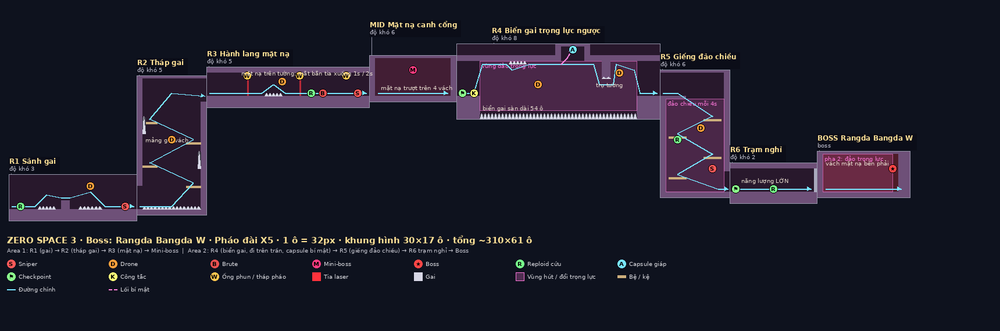

# Màn: ZERO SPACE 3 (Zero Space 3 — Boss Rangda Bangda W)

Bản thiết kế để duyệt trước khi dựng. Sơ đồ: `maps/x5_f3_rangda.png`.
Màn này thay cho `x5_f3_rangda` hiện tại. Boss Rangda Bangda W, biển gai sàn, vùng đảo trọng lực, trụ tường và capsule bí mật Black Zero / Ultimate X5 vẫn giữ. Không có Heart Tank/Sub-Tank (theo dữ liệu game); thêm 4 Reploid, 1 mini-boss và trạm nạp lớn.

---

## 0. Công cụ và quy ước

Dùng chung với màn mẫu (`../lo-nham-thach-kich-ban.md`, mục 0): LDtk dựng bản đồ, Pixelorama vẽ tile, Krita vẽ nền parallax. 1 ô = 32px, khung hình 30×17 ô, các lớp `Collision` / `Tiles` / `Decor` / `Foreground` / `Entities`.

---

## 1. Ý tưởng tổng

Tầng thứ ba của không gian Zero. Sàn toàn gai, nên **trần trở thành sàn**: người chơi học đảo trọng lực để đi lộn ngược, và đó cũng là cách duy nhất để thấy hốc capsule bí mật.

- **Area 1 – Tháp gai:** gai trên sàn và vách, mặt nạ Rangda trên tường.
- **Area 2 – Biển gai:** đi trên trần qua 54 ô gai, rồi giếng có trọng lực tự đảo chiều.
- **Điểm nhấn trải nghiệm:** né gai sàn → leo tháp tránh mảng gai vách → tắt mắt mặt nạ → mini-boss mặt nạ → đảo trọng lực đi trên trần → lách dưới trụ tường → rơi vào hốc capsule bí mật → giếng đảo chiều → boss
- **Đường cong độ khó:** 3 → 5 → 5 → (mini-boss) → 8 → 6 → 2 → boss (thang 10).
- **Thời lượng mục tiêu:** khoảng 5–6 phút lần đầu, khoảng 2.5 phút khi đã quen.

Các mẫu thiết kế tham khảo (không chép bản đồ gốc):

- **X5, Zero Space 3:** tháp né gai, vùng đảo trọng lực vượt biển gai 1.650px, trụ tường, capsule bí mật Black Zero / Ultimate.
- **X6, Gate Lab 3:** đảo trọng lực đi trên trần để lấy capsule bí mật.
- **X8, màn Gravity Antonion:** đảo trọng lực theo nhịp.
- **X Corrupted:** bí mật chỉ "nhìn thấy" khi đang dùng cơ chế chính (hốc trên trần thành hố khi đi lộn ngược).

---

## 2. Kịch bản từng phòng

Tọa độ tính theo ô, gốc (0,0) ở góc trên trái thế giới, y tăng xuống dưới.

### R1 – Sảnh gai (x 0–44, y 48–64) · độ khó 3
- **Mục đích:** mở đầu pháo đài: **gai sàn dày đặc**, chạm gai là mất mạng (trừ giáp Shadow/Ultimate).
- **Địa hình:** sảnh 44 ô, mặt sàn ở y 60, 2 bãi gai (6 và 8 ô) cách nhau bởi một bệ đá.
- **Địch:** 1 Drone, 1 Sniper.
- **Vật phẩm:** Reploid #1 ở đầu sảnh.
- **Ghi chú:** pháo đài không có Heart Tank/Sub-Tank. Màn này giữ **capsule bí mật** Black Zero / Ultimate Armor X5 (theo dữ liệu game).

### R2 – Tháp gai (x 44–68, y 14–62) · độ khó 5
- **Mục đích:** leo dọc giữa **vách có mảng gai**.
- **Địa hình:** tháp rộng 20 ô, cao 44 ô (từ y 60 lên y 18). 4 kệ zigzag.
- **Bẫy:** mảng gai trên vách ở đúng chỗ đá tường thuận tay: phải đổi bên hoặc dùng kệ. Đáy tháp là rãnh gai.
- **Địch:** 1 Drone.

### R3 – Hành lang mặt nạ (x 68–124, y 11–25) · độ khó 5
- **Mục đích:** báo trước boss: **mặt nạ Rangda** gắn trên tường bắn tia từ mắt.
- **Địa hình:** hành lang 56 ô, trần ở y 13, sàn ở y 21, một bãi gai 6 ô.
- **Bẫy:** 3 mặt nạ, mắt bắn tia thẳng xuống sàn 1 giây mỗi 2 giây, lệch pha. Bắn vào mắt 3 phát thì mặt nạ tắt hẳn.
- **Địch:** 1 Drone, 1 Brute, 1 Sniper.
- **Vật phẩm:** Reploid #2 giữa mặt nạ 2 và 3.

### Mini-boss – Mặt nạ canh cổng (x 124–154, y 7–23) · độ khó 6
- **Đấu trường 26 ô**, kín.
- **Mặt nạ canh cổng** trượt vòng quanh 4 mặt đấu trường (sàn, vách, trần).
- **Đòn đánh:**
  - Bắn tia mắt thẳng góc với mặt nó đang bám.
  - Lao ngang qua sân khi đổi mặt.
- **Điểm yếu:** con mắt, chỉ mở khi mặt nạ dừng ở góc.
- **Phần thưởng:** mở đường vào biển gai. Hạ không mất máu thì được thưởng Souls.

### R4 – Biển gai trọng lực ngược (x 154–224, y 3–29) · độ khó 8
- **Checkpoint 1** ở đầu phòng.
- **Mục đích:** cao trào của màn. **Đi lộn ngược trên trần** qua biển gai dài 54 ô (khoảng 1.700px).
- **Địa hình:** sàn là biển gai liền. Trần ở y 9 là đường đi duy nhất.
- **Cơ chế – đảo trọng lực:**
  - Bắn **công tắc** ở mép vực thì trọng lực trong vùng đảo ngược: người chơi "rơi" lên trần và đi trên trần.
  - Trần có một mảng gai 6 ô: nhảy (xuống dưới) qua nó.
  - **Trụ tường** treo từ trần chắn ngang (x ≈ 204–207). Phải bắn công tắc lần nữa (từ trên trần bắn được) để rơi xuống, lách dưới trụ, rồi đảo lại lên trần trước khi chạm biển gai. Có khoảng 0.8 giây.
  - Cuối vùng, trọng lực tự trở lại bình thường.
- **Địch:** 2 Drone, miễn đảo trọng lực.
- **Lối phụ (Capsule bí mật Black Zero / Ultimate Armor X5):**
  - Trên trần có một **hốc lõm lên** (x 188–198, y 3–9). Khi đang đi lộn ngược, hốc này là một cái "hố" trên đường đi.
  - "Rơi" vào hốc thì gặp capsule bí mật (x ≈ 194, y ≈ 5).
  - Điều kiện mở capsule giữ nguyên theo dữ liệu game.

### R5 – Giếng đảo chiều (x 224–248, y 12–56) · độ khó 6
- **Mục đích:** đoạn dọc đi xuống, nhưng **trọng lực tự đảo chiều mỗi 4 giây**.
- **Địa hình:** giếng rộng 20 ô, sâu 34 ô. 4 kệ zigzag.
- **Cơ chế:** khi trọng lực ngược, người chơi rơi lên. Phải đứng trên mặt **dưới** của kệ để chờ trọng lực đổi lại. Mặt dưới mỗi kệ được tô viền khác màu để dễ nhận ra.
- **Địch:** 1 Drone, 1 Sniper đứng trên kệ cuối (nó cũng bị đảo chiều).
- **Vật phẩm:** Reploid #3 trên kệ thứ hai.

### R6 – Trạm nghỉ (x 248–278, y 44–58) · độ khó 2
- **Checkpoint 2** ở đầu phòng.
- Phòng nghỉ trước boss: Reploid #4, **nạp năng lượng lớn**, cửa boss.

### BOSS – Rangda Bangda W (x 278–310, y 40–56)
- **Đấu trường 28 ô**. Vách phải là **mặt nạ khổng lồ** (2 mắt, 1 mũi).
- **Pha 1** (100–50% HP): bộ chiêu hiện có (2 mắt bắn, mũi phun, tường khép lại).
- **Pha 2** (dưới 50% HP):
  - **Trọng lực đảo chiều mỗi 6 giây**: người chơi lúc đứng sàn, lúc đứng trần. Hai mắt đổi chỗ lên trên/xuống dưới theo.
- Điểm yếu giữ nguyên theo dữ liệu game.

---

## 3. Bảng vật phẩm và kẻ địch

| Loại | Số lượng | Vị trí |
|---|---|---|
| Sniper | 3 | R1, R3, R5 |
| Drone | 6 | R1, R2, R3, R4 ×2, R5 |
| Brute | 1 | R3 |
| Ống phun / tháp pháo | 3 | R3 ×3 |
| Mini-boss | 1 | MID |
| Reploid cứu | 4 | R1, R3, R5, R6 |
| Capsule bí mật Black Zero / Ultimate Armor X5 | 1 | R4 |
| Công tắc | 1 | R4 |
| Checkpoint | 2 | R4, R6 |

Tổng 10 kẻ địch thường (bản cũ: 20 con xếp đều), đặt có chủ đích theo mục đích từng phòng.

---

## 4. Những gì engine cần bổ sung

1. Vùng đảo trọng lực: bật/tắt bằng công tắc (bắn được từ trên trần), hoặc tự đảo theo nhịp.
2. Gai sàn/vách/trần: chạm là mất mạng (giáp Shadow/Ultimate miễn theo dữ liệu game).
3. Mặt nạ trên tường bắn tia theo nhịp, phá được.
4. Mini-boss Mặt nạ canh cổng trượt quanh 4 mặt đấu trường.
5. Boss có vùng đảo trọng lực theo nhịp ở pha 2.

## 5. Danh sách hình cần vẽ

- **Tileset "Tháp gai":** 47 ô viền tím đen, gai sàn/vách/trần, kệ có mặt dưới tô viền.
- **Vật thể:** mặt nạ Rangda trên tường (mắt 3 khung), công tắc trọng lực, hiệu ứng đảo chiều (lớp phủ màn hình).
- **Nền:** không gian virus tím đỏ và mặt nạ khổng lồ mờ xa (2 lớp parallax).

**Hướng phối hợp:** như màn mẫu — dựng bằng khối màu tạm theo sơ đồ để chơi thử, chốt cảm giác rồi mới thay tile thật.
