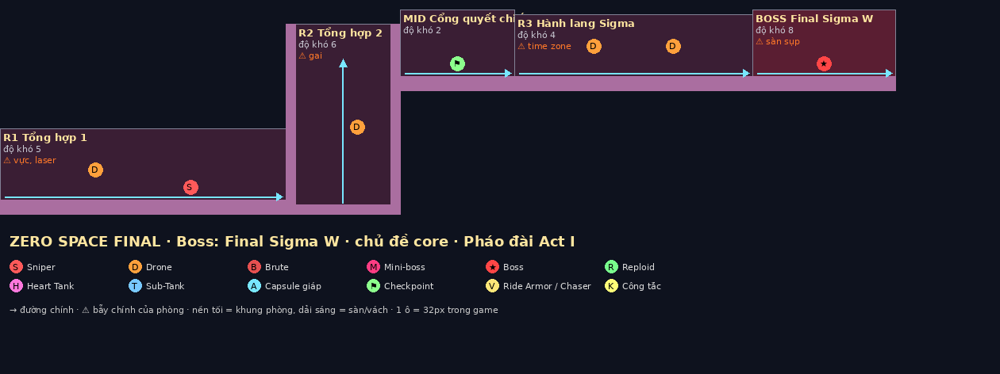

# Zero Space Final — Boss Final Sigma W

`x5_f4_sigma` · chủ đề `core` · Pháo đài Act I · tổng chiều ngang khoảng 188 ô (6016px)

## Ý tưởng
Màn cuối Act I gom các cơ chế đã gặp: bệ di động, trọng lực biến thiên, laser, rồi phòng quyết chiến Sigma.

## Tham khảo
X5 Final Sigma W, X4/X6 final (hành lang tổng hợp + boss nhiều pha).

## Nhịp màn
R1 (5) → R2 (6) → MID (2) → R3 (4) → BOSS (8)

## Kịch bản từng phòng

### R1 – Tổng hợp 1 (60×18 ô, đi ngang) · độ khó 5
Bệ di động trên vực + laser quét (nhắc Zero Space 1–2).
- **Bẫy:** vực, laser
- **Đặt trong phòng:** Drone, Sniper

### R2 – Tổng hợp 2 (24×40 ô, leo dọc) · độ khó 6
Giếng trọng lực biến thiên + gai (nhắc Zero Space 3).
- **Bẫy:** gai
- **Đặt trong phòng:** Drone

### MID – Cổng quyết chiến (24×17 ô, đi ngang) · độ khó 2
Checkpoint, phòng nạp đầy năng lượng.
- **Đặt trong phòng:** Checkpoint

### R3 – Hành lang Sigma (50×16 ô, đi ngang) · độ khó 4
Virus Sigma bay theo người chơi, vùng làm chậm.
- **Bẫy:** time zone
- **Đặt trong phòng:** Drone, Drone

### BOSS – Final Sigma W (30×17 ô, đấu trường) · độ khó 8
Hai pha: thân Sigma + đầu Sigma khổng lồ; sàn sụp từng mảng ở pha 2.
- **Bẫy:** sàn sụp
- **Đặt trong phòng:** Boss

## Cơ chế mới cần engine
- Sàn sụp từng mảng trong trận boss

## Hình ảnh / element
terrain-core, native-cyberblock, mmx5 virus sprites có sẵn.
