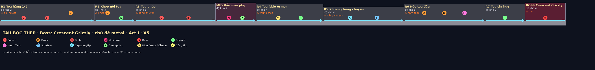

# Tàu bọc thép — Boss Crescent Grizzly

`x5_grizzly` · chủ đề `metal` · Act I · X5 · tổng chiều ngang khoảng 420 ô (13440px)

## Ý tưởng
Đoàn tàu 8 toa chạy giữa sa mạc. Người chơi chạy dọc nóc và xuyên qua bên trong toa, gió ngược đẩy lùi khi ở trên nóc. Toa sau tách ra khỏi đoàn theo thời gian.

## Tham khảo
X5 Crescent Grizzly (tàu bọc thép), X8 Earthrock Trilobite (bị đuổi bởi vật thể lớn), X2 Overdrive Ostrich (tốc độ).

## Nhịp màn
R1 (2) → R2 (3) → R3 (3) → MID (5) → R4 (4) → R5 (4) → R6 (5) → R7 (2) → BOSS (6)

## Kịch bản từng phòng

### R1 – Toa hàng 1–2 (70×16 ô, đi ngang) · độ khó 2
Nóc toa có gió ngược (-55px/s); xuống trong toa thì hết gió nhưng trần thấp và có Sniper.
- **Bẫy:** gió ngược
- **Đặt trong phòng:** Sniper, Sniper, Drone

### R2 – Khớp nối toa (30×16 ô, đi ngang) · độ khó 3
Khớp nối tách ra sau 6 giây đứng gần: phải nhảy qua khe đang rộng dần.
- **Bẫy:** khớp tách
- **Đặt trong phòng:** Drone, Reploid

### R3 – Toa pháo (60×16 ô, đi ngang) · độ khó 3
Tháp pháo trên nóc bắn đạn cong; chui vào trong toa né. Băng chuyền hàng hóa chạy ngược.
- **Bẫy:** băng chuyền
- **Đặt trong phòng:** Sniper, Brute

### MID – Đầu máy phụ (30×17 ô, đấu trường) · độ khó 5
Sub-boss Đầu máy (truck) chặn đường; hạ nó mới mở toa tiếp. Checkpoint sau trận.
- **Đặt trong phòng:** Mini-boss, Checkpoint

### R4 – Toa Ride Armor (50×16 ô, đi ngang) · độ khó 4
Ride Armor Pod; đấm vỡ thùng hàng thép mở khoang băng chuyền phía dưới.
- **Bẫy:** thùng thép
- **Đặt trong phòng:** Ride Armor / Chaser, Reploid

### R5 – Khoang băng chuyền (60×14 ô, đi ngang) · độ khó 4
Đi bên trong toa 5–6 bằng Ride Armor; capsule Falcon Foot ở toa 6.
- **Bẫy:** băng chuyền
- **Đặt trong phòng:** Capsule giáp, Sub-Tank

### R6 – Nóc toa đầu (60×16 ô, đi ngang) · độ khó 5
Gió mạnh nhất, đường hầm đá phía trước: phải nằm xuống/lướt dưới khi tàu chui hầm (cảnh báo chớp đỏ).
- **Bẫy:** hầm thấp
- **Đặt trong phòng:** Drone, Drone, Heart Tank

### R7 – Toa chỉ huy (30×16 ô, đi ngang) · độ khó 2
Phòng nghỉ, Reploid, cửa boss.
- **Đặt trong phòng:** Reploid

### BOSS – Crescent Grizzly (30×17 ô, đấu trường) · độ khó 6
Đấu trên nóc toa chỉ huy có gió ngang đổi chiều mỗi pha.
- **Bẫy:** gió
- **Đặt trong phòng:** Boss

## Bí mật và vật phẩm
| Vật phẩm | Phòng | Cách lấy |
|---|---|---|
| Capsule Falcon Foot | R5 | Cần Ride Armor từ R4. |
| Heart Tank | R6 | Nóc toa đầu, nhảy khi tàu ra khỏi hầm. |
| Sub-Tank | R5 | Cuối khoang băng chuyền. |

## Cơ chế mới cần engine
- Khớp nối toa tách theo thời gian
- Hầm thấp quét qua nóc tàu (phải cúi/lướt)

## Hình ảnh / element
terrain-metal/cap-metal, native-deck cho nóc toa, mmx5_truckbackgroundtiles cho nền tàu chạy, mmx5_destructablewalls cho thùng hàng.
