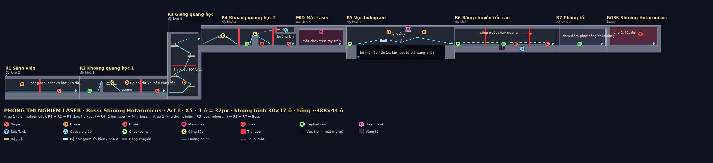

# Màn: PHÒNG THÍ NGHIỆM LASER (Laser Institute — Boss Shining Hotarunicus)

Bản thiết kế để duyệt trước khi dựng. Sơ đồ: `maps/x5_hotarunicus.png`.
Màn này thay cho `x5_hotarunicus` hiện tại. Boss, capsule Falcon Body, công tắc quang học, tường laser và bệ hologram vẫn giữ; thêm 4 Reploid, Heart Tank, Sub-Tank và thay địa hình.

---

## 0. Công cụ và quy ước

Dùng chung với màn mẫu (`../lo-nham-thach-kich-ban.md`, mục 0): LDtk dựng bản đồ, Pixelorama vẽ tile, Krita vẽ nền parallax. 1 ô = 32px, khung hình 30×17 ô, các lớp `Collision` / `Tiles` / `Decor` / `Foreground` / `Entities`.

---

## 1. Ý tưởng tổng

Viện nghiên cứu quang học đang chạy thử nghiệm. Màn này là **câu đố ánh sáng**: tường laser chặn đường cho tới khi bắn đúng công tắc, rồi tới vực không đáy chỉ có bệ hologram nhấp nháy.

- **Area 1 – Viện nghiên cứu:** trắng lạnh, kính, màn hình. Dạy tường laser theo nhịp, công tắc quang học, tia xoay.
- **Area 2 – Khu thử nghiệm:** tối, ánh xanh hologram. Cao trào là vực hologram, rồi băng chuyền có cổng quét.
- **Điểm nhấn trải nghiệm:** né hàng rào laser → bắn công tắc mở đường → leo giếng có tia xoay → giải câu đố 2 lớp laser → mini-boss trên ray trần → vượt vực hologram → băng chuyền xuôi chiều → boss trong bóng tối
- **Đường cong độ khó:** 2 → 3 → 4 → 4 → (mini-boss) → 7 → 6 → 2 → boss (thang 10).
- **Thời lượng mục tiêu:** khoảng 6–7 phút lần đầu, khoảng 3 phút khi đã quen.

Các mẫu thiết kế tham khảo (không chép bản đồ gốc):

- **X5, màn Shining Hotarunicus:** công tắc quang học, tường laser, capsule giáp trong buồng kín cần lướt trên không.
- **X4, màn Web Spider / X6, màn Shield Sheldon:** bệ ẩn hiện và gương phản xạ.
- **X8, màn Optic Sunflower:** viện quang học, ánh sáng làm cơ chế chính. Bản 16-bit demake được khen nhiều nhất ở màn này.
- **X Corrupted:** bệ bí mật chỉ hiện khi bệ khác ẩn (đọc ngược nhịp của cơ chế chính).

---

## 2. Kịch bản từng phòng

Tọa độ tính theo ô, gốc (0,0) ở góc trên trái thế giới, y tăng xuống dưới.

### R1 – Sảnh viện (x 0–44, y 30–44) · độ khó 2
- **Mục đích:** giới thiệu **tia laser đỏ**: chạm là mất 1/4 máu và bị đẩy lùi.
- **Địa hình:** sảnh 44 ô, trần ở y 32, sàn ở y 40.
- **Bẫy:** 1 hàng rào laser chắn hết chiều cao, bật 2 giây, tắt 1 giây. Có tiếng "vù" khi sắp bật.
- **Địch:**
  - 1 Drone bay trước hàng rào.
  - 1 Sniper sau hàng rào: bắn được xuyên qua laser, nhưng người chơi thì không.
- **Trang trí:** ống nghiệm, màn hình chạy chữ, đèn trắng lạnh.

### R2 – Khoang quang học 1 (x 44–96, y 30–44) · độ khó 3
- **Mục đích:** dạy **công tắc quang học**: bắn vào công tắc thì tường laser liên quan tắt hẳn.
- **Địa hình:**
  - Khoang 52 ô. Tường laser đỏ ở x ≈ 80 chắn đường, **không có nhịp tắt**.
  - Công tắc nằm trên kệ cao (y 35), phía trên một cột thấp. Đá tường cột để lên.
  - Một tấm gương xoay giữa phòng hắt tia laser của Sniper đi lệch: đứng đúng chỗ thì đạn địch bật lại phía nó.
- **Địch:**
  - 1 Drone canh kệ công tắc.
  - 1 Sniper sau tường laser.
- **Vật phẩm:** Reploid #1 ở đầu khoang.

### R3 – Giếng quang học (x 96–116, y 4–44) · độ khó 4
- **Mục đích:** đoạn dọc, né **tia laser xoay**.
- **Địa hình:** giếng rộng 16 ô, cao 34 ô (từ y 42 lên y 8). 4 kệ nghỉ.
- **Bẫy – tia xoay:**
  - Một đầu phát laser ở tâm giếng (y ≈ 24) phóng tia dài 7 ô, quay 90° mỗi giây.
  - Leo qua tầng giữa phải canh lúc tia nằm dọc. Đá tường sát vách thì tia không với tới được, nhưng vách đối diện thì có.
- **Địch:** 1 Drone đầu giếng.
- **Giáp hỗ trợ:** Gaea bám tường, đứng chờ tia quay qua dễ hơn.

### R4 – Khoang quang học 2 (x 116–172, y 0–16) · độ khó 4
- **Mục đích:** câu đố 2 lớp laser, và capsule giáp nằm trong buồng kín.
- **Địa hình:**
  - Khoang 56 ô, 2 tường laser chắn đường (x ≈ 138 và x ≈ 158).
  - **Công tắc #1** trên kệ cao trước tường 1. **Công tắc #2** trên nóc một khối thép giữa hai tường.
  - Phía trên góc phải là **buồng kín** (x 160–172, y 1–4), cửa buồng cũng là một tia laser.
- **Cơ chế:** bắn công tắc #2 thì tắt cả tường 2 **và** cửa buồng kín, nhưng chỉ trong **5 giây**. Bắn công tắc #1 thì tường 1 tắt hẳn.
- **Địch:**
  - 1 Brute giữa hai tường.
  - 1 Sniper cuối khoang.
- **Vật phẩm:** Reploid #2 sau tường 1.
- **Lối phụ (Capsule Falcon Body):**
  - Đứng trên khối thép, bắn công tắc #2, rồi nhảy và **lướt trên không** sang trái vào buồng kín trước khi cửa laser bật lại.
  - Nhảy thường không tới, nên bắt buộc phải lướt trên không.

### Mini-boss – Mắt Laser (x 172–202, y 0–16) · độ khó 5
- **Đấu trường 26 ô**, kín. Trần có một đường ray chạy suốt chiều ngang.
- **Mắt Laser** chạy trên ray trần.
- **Đòn đánh:**
  - Quét tia laser thẳng xuống, chạy theo người chơi chậm hơn một nhịp: chạy liên tục là né được.
  - Bắn 3 tia chéo hình quạt.
  - Dừng giữa ray và quét cả sàn (đèn đỏ báo trước 1 giây): đá tường lên vách để né.
- **Điểm yếu:** con ngươi mở ra sau mỗi lần quét sàn.
- **Phần thưởng:** mở cửa vào khu hologram. Hạ không mất máu thì được thưởng Souls.

### R5 – Vực hologram (x 202–266, y 0–20) · độ khó 7
- **Checkpoint 1** ở đầu phòng.
- **Mục đích:** cao trào của màn. Đi qua vực không đáy chỉ trên các bệ hologram nhấp nháy.
- **Địa hình:** vực rộng 52 ô (khoảng 1.660px), không có sàn. Rơi là mất mạng.
- **Cơ chế – bệ hologram:**
  - 5 bệ, mỗi bệ **hiện 2 giây, ẩn 1 giây**.
  - Các bệ bật lần lượt từ trái sang phải thành một làn sóng: đi đúng nhịp thì luôn có bệ dưới chân.
  - 0.3 giây trước khi ẩn, bệ chớp trắng.
- **Địch:** 2 Drone. Đạn của chúng không đẩy lùi, nhưng buộc người chơi phải nhảy lệch nhịp.
- **Lối phụ (Heart Tank):**
  - Có **bệ thứ 6 ẩn** phía trên bệ 3 (x ≈ 237, y ≈ 3). Bệ này chỉ hiện trong lúc bệ 3 đang ẩn.
  - Phải nhảy từ bệ 3 ngay lúc nó tắt, đáp lên bệ 6, lấy Heart Tank, rồi rơi xuống bệ 4.
  - Giáp Falcon bay ngang qua được cả vực.

### R6 – Băng chuyền tốc cao (x 266–326, y 0–16) · độ khó 6
- **Checkpoint 2** ở đầu phòng.
- **Mục đích:** băng chuyền **xuôi chiều** (đẩy sang phải 140px/giây) làm người chơi đi quá nhanh, trong khi phải né cổng quét.
- **Địa hình:** hành lang 60 ô, 2 đoạn băng chuyền dài 22 ô.
- **Bẫy – cổng quét laser:**
  - 2 tia laser đứng chạy ngang qua lại trên mỗi đoạn băng chuyền, 100px/giây.
  - Băng chuyền đẩy người chơi lao vào tia. Phải nhảy qua tia (tia chỉ cao 10 ô, trần thấp nên nhảy sát) hoặc chạy ngược băng chuyền để giữ khoảng cách.
- **Địch:**
  - 1 Brute đứng cuối băng chuyền thứ hai: băng chuyền đẩy người chơi vào nó.
  - 1 Sniper cuối phòng.
- **Vật phẩm:** Reploid #3 giữa hai đoạn băng chuyền.
- **Lối phụ (Sub-Tank):** giữa hai đoạn băng chuyền có khe 4 ô rơi xuống **ống kỹ thuật** dưới sàn. Sub-Tank ở giữa ống. Cuối ống có thang lên lại.

### R7 – Phòng tối (x 326–356, y 0–16) · độ khó 2
- Phòng nghỉ trước boss: Reploid #4, nạp năng lượng nhỏ, cửa boss.
- Phòng tối hoàn toàn, chỉ có đàn đom đóm máy bay chậm làm đèn. Báo hiệu cơ chế của trận boss.

### BOSS – Shining Hotarunicus (x 356–388, y 0–16)
- **Đấu trường 28 ô**, kín, hai vách đá tường được.
- **Pha 1** (100–50% HP): bộ chiêu hiện có (tia laser, đạn sáng, phân thân).
- **Pha 2** (dưới 50% HP):
  - **Tắt đèn toàn sân.** Chỉ thấy boss khi nó phát sáng trước mỗi đòn (0.8 giây) và quầng sáng nhỏ quanh X.
  - Đạn nạp đầy của X chiếu sáng đường bay của nó.
- Điểm yếu giữ nguyên theo dữ liệu game.

---

## 3. Bảng vật phẩm và kẻ địch

| Loại | Số lượng | Vị trí |
|---|---|---|
| Sniper | 4 | R1, R2, R4, R6 |
| Drone | 5 | R1, R2, R3, R5 ×2 |
| Brute | 2 | R4, R6 |
| Mini-boss | 1 | MID |
| Reploid cứu | 4 | R2, R4, R6, R7 |
| Heart Tank | 1 | R5 |
| Sub-Tank | 1 | R6 |
| Capsule Falcon Body | 1 | R4 |
| Công tắc | 3 | R2, R4 ×2 |
| Checkpoint | 2 | R5, R6 |

Tổng 11 kẻ địch thường (bản cũ: 20 con xếp đều), đặt có chủ đích theo mục đích từng phòng.

---

## 4. Những gì engine cần bổ sung

1. Tia laser: tường đứng có nhịp bật/tắt, hoặc chỉ tắt bằng công tắc (có hẹn giờ hoặc vĩnh viễn).
2. Công tắc quang học: bắn trúng thì bật một nhóm đối tượng theo id.
3. Tia laser xoay quanh tâm.
4. Bệ hologram: hiện/ẩn theo nhịp, lệch pha theo thứ tự; bệ ẩn chỉ hiện khi bệ khác ẩn.
5. Cổng quét laser chạy ngang.
6. Vùng tối: che khung hình, chỉ chừa quầng sáng quanh X và vật phát sáng.
7. Mini-boss Mắt Laser chạy trên ray trần.

## 5. Danh sách hình cần vẽ

- **Tileset "Viện" (Area 1):** 47 ô viền thép trắng, kính, khung màn hình.
- **Tileset "Khu thử nghiệm" (Area 2):** 47 ô viền tối, ô lưới kỹ thuật, ống kỹ thuật dưới sàn.
- **Vật thể:** đầu phát laser (tường và xoay, 4 khung), công tắc quang học (2 trạng thái), gương, bệ hologram (3 khung: hiện, chớp, ẩn), cổng quét.
- **Nền:** Area 1: phòng thí nghiệm kính và ống nghiệm (2 lớp parallax). Area 2: lưới hologram và đom đóm máy (2 lớp).

**Hướng phối hợp:** như màn mẫu — dựng bằng khối màu tạm theo sơ đồ để chơi thử, chốt cảm giác rồi mới thay tile thật.
