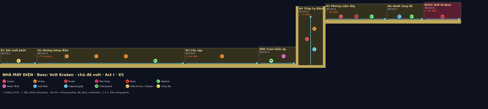

# Nhà máy điện — Boss Volt Kraken

`x5_kraken` · chủ đề `volt` · Act I · X5 · tổng chiều ngang khoảng 374 ô (11968px)

## Ý tưởng
Nửa đầu là chặng Ride Chaser tốc độ cao xuyên nhà máy, nửa sau leo tháp tụ điện bằng bệ đẩy và đá tường.

## Tham khảo
X5 Volt Kraken (Ride Chaser), X2 Overdrive Ostrich, X8 Gigabolt Man-O-War (tránh lỗi: không auto-scroll, người chơi điều tốc độ).

## Nhịp màn
R1 (1) → R2 (4) → R3 (5) → MID (2) → R4 (5) → R5 (4) → R6 (2) → BOSS (6)

## Kịch bản từng phòng

### R1 – Bãi xuất phát (30×16 ô, đi ngang) · độ khó 1
Lên Ride Chaser; bảng hướng dẫn nhảy/bắn khi đang chạy.
- **Đặt trong phòng:** Ride Armor / Chaser

### R2 – Đường băng điện (120×16 ô, đi ngang) · độ khó 4
Ride Chaser: dốc nhảy, cột điện phóng tia ngang (hồ quang), Drone lao từ phía sau. Vòng tăng tốc trên mặt đường.
- **Bẫy:** hồ quang
- **Đặt trong phòng:** Drone, Drone, Drone, Reploid

### R3 – Cầu sập (60×16 ô, đi ngang) · độ khó 5
Ride Chaser: cầu sập dần sau lưng, phải giữ tốc độ; nhảy cuối cầu để vào nhà máy.
- **Bẫy:** cầu sập
- **Đặt trong phòng:** Drone

### MID – Trạm biến áp (30×17 ô, đi ngang) · độ khó 2
Xuống xe, checkpoint. Heart Tank trên nóc trạm (đá tường).
- **Đặt trong phòng:** Checkpoint, Heart Tank

### R4 – Tháp tụ điện (24×50 ô, leo dọc) · độ khó 5
Leo tháp: bệ đẩy Thruster bật theo nhịp, tia điện quét ngang mỗi tầng. Falcon Arm ở đỉnh tháp.
- **Bẫy:** tia điện
- **Đặt trong phòng:** Drone, Sniper, Capsule giáp

### R5 – Phòng cuộn dây (50×16 ô, đi ngang) · độ khó 4
Sàn nhiễm điện bật/tắt theo nhịp 1.2s; Reploid kẹt giữa hai cuộn dây.
- **Bẫy:** sàn điện
- **Đặt trong phòng:** Sniper, Brute, Reploid

### R6 – Hành lang lõi (30×16 ô, đi ngang) · độ khó 2
Phòng nghỉ, Sub-Tank trong hốc tường, cửa boss.
- **Đặt trong phòng:** Sub-Tank, Reploid

### BOSS – Volt Kraken (30×17 ô, đấu trường) · độ khó 6
Đấu trường có 4 cột thu sét; pha 2 Kraken nạp điện các cột thành bẫy.
- **Bẫy:** cột điện
- **Đặt trong phòng:** Boss

## Bí mật và vật phẩm
| Vật phẩm | Phòng | Cách lấy |
|---|---|---|
| Capsule Falcon Arm | R4 | Đỉnh tháp tụ điện. |
| Heart Tank | MID | Nóc trạm biến áp. |
| Sub-Tank | R6 | Hốc tường cần lướt vào. |

## Cơ chế mới cần engine
- Ride Chaser chạy tự do (không tự cuộn)
- Sàn điện theo nhịp
- Bệ đẩy Thruster

## Hình ảnh / element
terrain-volt/cap-volt, x5_hoverbike cho Ride Chaser, mmx5_cyberblock cho bệ đẩy, fx-volt cho hồ quang.
