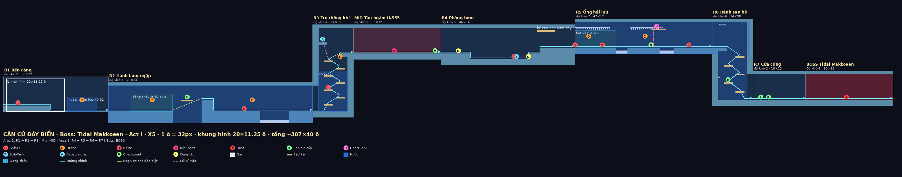

# Căn cứ đáy biển — Boss Tidal Makkoeen

`x5_makkoeen` · chủ đề `water` · Act I · X5 · tổng ~307×40 ô (9824×1280 px)

## Ý tưởng
Căn cứ chìm dưới biển. Trong nước trọng lực còn 0.32: nhảy cao gần 3 lần, rơi chậm. Area 1 đi từ bến cảng xuống hành lang ngập và leo trụ thông khí; mini-boss tàu ngầm U-555. Area 2 có phòng bơm rút nước (mất nhảy cao để mở lối dưới đáy), ống hải lưu hút về tua-bin và rãnh san hô đi xuống.

## Tham khảo
X5 Tidal Makkoeen (căn cứ đáy biển), X1 Launch Octopus (dưới nước), X6 Rainy Turtloid (công tắc mực nước).

## Chuẩn kích thước
Khung hình 640×360 px = 20×11.25 ô. Hành lang: trần 1 ô, trong lòng 9 ô, khối trần luôn nằm trong khung; phòng nhảy bệ/vực/nước 11 ô; phòng 2 tầng 17 ô; đấu trường cao 11 ô, rộng 20–30 ô; giếng rộng 12–20 ô. X nhảy cao ~2.6 ô, xa ~5 ô: trên đường chính gờ ≤ 2.5 ô, nhảy xa ≤ 5 ô (lướt-nhảy ≤ 7 ô); cao/xa hơn chỉ bằng đá tường, giáp hoặc cơ chế của màn, và dùng cho bí mật.

## Cấu trúc

- **Area 1** (R1 → R2 → R3): cảng và hành lang ngập
- **Mid** (MID): tàu ngầm U-555
- **Area 2** (R4 → R5 → R6 → R7): đáy biển: bơm, ống hải lưu, rãnh san hô
- **Boss** (BOSS): đấu trường nửa ngập

## Nhịp màn (độ khó)
R1 (2) → R2 (3) → R3 (4) → MID (5) → R4 (5) → R5 (7) → R6 (6) → R7 (2) → BOSS (6)

## Kịch bản từng phòng

### R1 – Bến cảng · đi ngang · độ khó 2
*x 0–36, y 22–34 (36×12 ô) · vào ở sàn y 32, ra ở sàn y 34* · Area 1 · cảng và hành lang ngập

Trên mặt nước, sàn gỗ cảng. Sóng đẩy nhẹ người chơi về trái ở mép bến. Bậc xuống mặt nước dạy cảm giác trọng lực nhẹ.
- **Thông số:** sóng đẩy −30 px/s ở mép bến
- **Địa hình:** nước x 22–32, y 29–34 (nước: trọng lực ×0.32)
- **Thực thể:** Sniper (5, 32); Drone (27, 31)
- **Đường chính dùng:** rơi xuống

### R2 – Hành lang ngập · đi ngang · độ khó 3
*x 36–106, y 24–38 (70×14 ô) · vào ở sàn y 34, ra ở sàn y 34* · Area 1 · cảng và hành lang ngập

Ngập hoàn toàn. Dòng chảy ngang →60 px/s giúp nhảy xa. Kệ trên trần chỉ với tới nhờ nhảy nước. Cá máy (Drone nước) bơi zigzag. Reploid trên kệ giữa.
- **Thông số:** dòng chảy +60 px/s; nhảy trong nước cao ~7 ô
- **Địa hình:** nước x 36–106, y 25–38; dòng chảy x 44–58, y 28–34 (dòng chảy → 60 px/s); bệ / kệ x 61–65, y 30; hố gai x 88–98 (rộng 10 ô)
- **Thực thể:** Drone (51, 31); Reploid cứu (63, 30); Sniper (82.6667, 34); Drone (85.3333, 31)
- **Đường chính dùng:** nước (nhảy cao), rơi xuống

### R3 – Trụ thông khí · leo dọc · độ khó 4
*x 106–120, y 4–36 (14×32 ô) · vào ở sàn y 34, ra ở sàn y 14* · Area 1 · cảng và hành lang ngập

Giếng nước dọc: trọng lực nhẹ giúp đá tường lên trụ X≈2350 (dữ liệu game). Mặt nước ở giữa giếng; phía trên khô, kệ so le 2.5 ô. Capsule Falcon Head trong hốc trần bên trái: nhảy nước từ kệ cao nhất.
- **Thông số:** mặt nước ở y giữa giếng; trên mặt nước trọng lực bình thường
- **Địa hình:** khối x 115–118, y 14–15; nước x 108–118, y 20–34 (nước); bệ / kệ x 110–113, y 31.5; bệ / kệ x 114–117, y 29; bệ / kệ x 110–113, y 26.5; bệ / kệ x 114–117, y 24; bệ / kệ x 110–113, y 21.5; bệ / kệ x 114–117, y 19; bệ / kệ x 110–113, y 16.5; khối x 108–111, y 10–11
- **Thực thể:** Sniper (111.5, 26.5); Drone (115.5, 16); Capsule giáp (109.5, 10) – Falcon Head (hốc trần)
- **Đường chính dùng:** nhảy
- **Lối bí mật:** (111.5, 16.5) → (109.5, 10)

### MID – Tàu ngầm U-555 · đấu trường · độ khó 5
*x 120–150, y 4–16 (30×12 ô) · vào ở sàn y 14, ra ở sàn y 14* · Mid

Mini-boss: tàu ngầm U-555 nổi giữa hầm, phóng ngư lôi bám đuổi. Mỗi lần mất 1/3 máu, nước hạ 2 ô để lộ lõi. Checkpoint 1 sau trận.
- **Thông số:** ngư lôi mỗi 2 s; nước hạ 2 ô mỗi 1/3 máu
- **Thực thể:** Mini-boss (134, 14) – U-555 50 HP; Checkpoint (148, 14)

### R4 – Phòng bơm · đi ngang · độ khó 5
*x 150–196, y 4–18 (46×14 ô) · vào ở sàn y 14, ra ở sàn y 12* · Area 2 · đáy biển

Hai công tắc bơm. Bắn công tắc 1: rút nước → lộ lối dưới đáy có Sub-Tank nhưng mất nhảy cao (kệ trên không tới được). Bắn công tắc 2: bơm lại. Đường chính: đi khi nước rút, Brute đứng ở đáy.
- **Thông số:** rút/bơm mất 3 s; nước rút: trọng lực bình thường
- **Địa hình:** bệ / kệ x 183–189, y 6
- **Thực thể:** Công tắc (156, 14) – công tắc 1: rút nước; Brute (175, 16); Sub-Tank (176, 16) – đáy lộ ra khi rút nước; Công tắc (180, 16) – công tắc 2: bơm lại; Sniper (196, 12)
- **Đường chính dùng:** nhảy, rơi xuống
- **Lối bí mật:** (184, 12) → (184, 6) → (192, 6)

### R5 – Ống hải lưu · đi ngang · độ khó 7
*x 196–243, y 2–14 (47×12 ô) · vào ở sàn y 12, ra ở sàn y 12* · Area 2 · đáy biển

Cao trào. Ống nước dài hút về tua-bin bên phải (dòng −60→−90 px/s tăng dần). Gai trần ở ba đoạn: nhảy nước quá cao là trúng. Hai đoạn vực gai dưới đáy. Heart Tank trong hốc trên trần sau tua-bin cánh 1 (dừng được bằng cách bắn tua-bin).
- **Thông số:** dòng hút về phải 60→90 px/s; tua-bin dừng 3 s khi trúng 3 phát
- **Địa hình:** nước x 196–256, y 3–14; gai trần x 196–208; dòng chảy x 196–210, y 6–12 (hút về tua-bin →); hố gai x 210–214 (rộng 4 ô); gai trần x 215–225; bệ / kệ x 222–227, y 5.5; hố gai x 225–230 (rộng 5 ô)
- **Thực thể:** Drone (200.667, 9); Sniper (205.333, 12); Drone (220, 9); Checkpoint (222, 12); Heart Tank (224, 5.5) – hốc trần; Brute (235, 12)
- **Đường chính dùng:** nhảy
- **Lối bí mật:** (223, 12) → (223, 5.5) → (226, 5.5)

### R6 – Rãnh san hô · đi xuống · độ khó 6
*x 243–257, y 2–32 (14×30 ô) · vào ở sàn y 12, ra ở sàn y 30* · Area 2 · đáy biển

Đi xuống rãnh san hô: kệ san hô so le, gai san hô hai bên vách, dòng kéo xuống 40 px/s. Reploid kẹt trên kệ giữa.
- **Thông số:** dòng kéo xuống 40 px/s
- **Địa hình:** khối x 245–248, y 12–13; nước x 245–255, y 3–30 (nước); gai sàn x 245–245.6; bệ / kệ x 251–254, y 15; bệ / kệ x 247–250, y 18; bệ / kệ x 251–254, y 21; bệ / kệ x 247–250, y 24; bệ / kệ x 251–254, y 27
- **Thực thể:** Reploid cứu (248.5, 24)
- **Đường chính dùng:** rơi xuống

### R7 – Cửa cống · đi ngang · độ khó 2
*x 257–275, y 20–32 (18×12 ô) · vào ở sàn y 30, ra ở sàn y 30* · Area 2 · đáy biển

Phòng nghỉ trong cống khô: năng lượng nhỏ, Reploid cuối, cửa boss.
- **Thực thể:** Reploid cứu (259.667, 30); Reploid cứu (262.333, 30)

### BOSS – Tidal Makkoeen · đấu trường · độ khó 6
*x 275–305, y 20–32 (30×12 ô) · vào ở sàn y 30, ra ở sàn y 30* · Boss

Đấu trường nửa ngập: Makkoeen trượt trên mặt nước, lặn né đạn.
- **Thực thể:** Boss (289, 30)

## Bảng kẻ địch và vật phẩm

| Loại | Phòng | x | y | Ghi chú |
|---|---|---|---|---|
| Sniper | R1 | 5 | 32 |  |
| Drone | R1 | 27 | 31 |  |
| Drone | R2 | 51 | 31 |  |
| Reploid cứu | R2 | 63 | 30 |  |
| Sniper | R2 | 82.6667 | 34 |  |
| Drone | R2 | 85.3333 | 31 |  |
| Sniper | R3 | 111.5 | 26.5 |  |
| Drone | R3 | 115.5 | 16 |  |
| Capsule giáp | R3 | 109.5 | 10 | Falcon Head (hốc trần) |
| Mini-boss | MID | 134 | 14 | U-555 50 HP |
| Checkpoint | MID | 148 | 14 |  |
| Công tắc | R4 | 156 | 14 | công tắc 1: rút nước |
| Brute | R4 | 175 | 16 |  |
| Sub-Tank | R4 | 176 | 16 | đáy lộ ra khi rút nước |
| Công tắc | R4 | 180 | 16 | công tắc 2: bơm lại |
| Sniper | R4 | 196 | 12 |  |
| Drone | R5 | 200.667 | 9 |  |
| Sniper | R5 | 205.333 | 12 |  |
| Drone | R5 | 220 | 9 |  |
| Checkpoint | R5 | 222 | 12 |  |
| Heart Tank | R5 | 224 | 5.5 | hốc trần |
| Brute | R5 | 235 | 12 |  |
| Reploid cứu | R6 | 248.5 | 24 |  |
| Reploid cứu | R7 | 259.667 | 30 |  |
| Reploid cứu | R7 | 262.333 | 30 |  |
| Boss | BOSS | 289 | 30 |  |

Tổng: 13 kẻ địch thường (Sniper 5, Drone 6, Brute 2), 4 Reploid, 2 checkpoint, Heart Tank 1, Sub-Tank 1, capsule 1.

## Capsule theo dữ liệu game
🛡️ Capsule Falcon Armor — Head Part (X=2580, Y=440 — Tầng trần Area 1): Tận dụng trọng lực nước nhẹ (0.32) để nhảy siêu cao bám vào trụ tường X=2350, nhảy lên bệ trần khoang tàu ngầm để mở Capsule mảnh đầu Falcon. Trọng lực nước 0.32 + Sub-Boss Tàu ngầm U-555 + Hốc trần lấy Falcon Head Area 1: Bến cảng ngập nước trọng lực thấp (0.32), nhảy siêu cao né thủy lôi trôi nổi và leo lên hốc trần lấy Falcon Head Part. Mid-Gate: Chạm trán tàu ngầm tuần tra U-555. Area 2: Đường ống áp suất đáy biển giấu Heart Tank.

## Bí mật
| Vật phẩm | Phòng | Cách lấy |
|---|---|---|
| Capsule Falcon Head | R3 | Nhảy nước từ kệ cao nhất vào hốc trần bên trái giếng. |
| Sub-Tank | R4 | Rút nước bằng công tắc 1, đáy phòng lộ ra. |
| Heart Tank | R5 | Bắn dừng tua-bin, nhảy nước lên hốc trần. |

## Boss
**Tidal Makkoeen** · điểm yếu: Crescent Shot / C-Sword
- **Bộ chiêu (dữ liệu game):** Gel Shaver: Phóng mảnh băng lướt sát mặt sàn tốc độ cao. Water Jet Dive: Phóng vọt xuyên ngang màn hình kèm xoáy nước đẩy lùi. Ice Block Drop: Tạo khối băng lớn rơi từ trên trần xuống ép góc. Overdrive (Phase 2): Bắn mưa mảnh băng 360 độ kết hợp lướt liên tục.
- **Đấu trường:** hồ 30×11 ô, nước ngập nửa dưới (trọng lực nhẹ dưới mặt nước).
- **Pha 2 (dưới 50% HP):** nước dâng ngập toàn sân: cả trận chuyển sang trọng lực nhẹ, Makkoeen lướt liên tục.

## Engine cần bổ sung
- Vùng nước: trọng lực 0.32, nhảy cao
- Mực nước thay đổi theo công tắc (3 s)
- Dòng chảy đẩy/hút
- Tua-bin dừng khi trúng đạn

## Hình cần vẽ
- Bến cảng gỗ, ống thép rỉ
- Bề mặt nước động + bọt
- Công tắc bơm
- Tua-bin
- Kệ san hô + gai san hô
- Tàu ngầm U-555 (có sẵn: submarine)

## Kiểm tra tự động
Đường chính đã được kiểm tra theo khả năng nhảy (gờ ≤ 2.5 ô, nhảy xa ≤ 5 ô, lướt-nhảy ≤ 7 ô, đi bộ phải có nền) và theo quy ước số lượng.

**Kết quả: đạt.**
