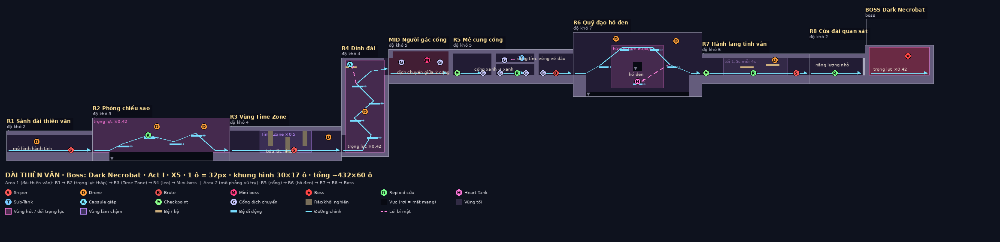

# Màn: ĐÀI THIÊN VĂN (Planetarium — Boss Dark Necrobat)

Bản thiết kế để duyệt trước khi dựng. Sơ đồ: `maps/x5_necrobat.png`.
Màn này thay cho `x5_necrobat` hiện tại. Boss, capsule Gaea Head, trọng lực thấp 0.42, vùng Time Zone và cổng dịch chuyển vẫn giữ; thêm 4 Reploid, Heart Tank, Sub-Tank và thay địa hình.

---

## 0. Công cụ và quy ước

Dùng chung với màn mẫu (`../lo-nham-thach-kich-ban.md`, mục 0): LDtk dựng bản đồ, Pixelorama vẽ tile, Krita vẽ nền parallax. 1 ô = 32px, khung hình 30×17 ô, các lớp `Collision` / `Tiles` / `Decor` / `Foreground` / `Entities`.

---

## 1. Ý tưởng tổng

Một đài thiên văn đang chạy mô phỏng vũ trụ. Màn này **đổi luật vật lý**: trọng lực thấp, thời gian chậm, cổng dịch chuyển, rồi hố đen hút người chơi về tâm.

- **Area 1 – Đài thiên văn:** tím đậm, đèn sao, đồng thau. Dạy trọng lực thấp, vùng làm chậm, leo bằng bệ quỹ đạo.
- **Area 2 – Phòng mô phỏng vũ trụ:** đen, tinh vân, lưới tọa độ. Cổng dịch chuyển, hố đen, đèn tắt từng đợt.
- **Điểm nhấn trải nghiệm:** nhảy bổng trong trọng lực thấp → luồn búa trong vùng làm chậm → leo bằng bệ quỹ đạo → mini-boss dịch chuyển → giải mê cung cổng → vòng quanh hố đen → hành lang tối → boss
- **Đường cong độ khó:** 2 → 3 → 4 → 4 → (mini-boss) → 5 → 7 → 6 → 2 → boss (thang 10).
- **Thời lượng mục tiêu:** khoảng 6–7 phút lần đầu, khoảng 3 phút khi đã quen.

Các mẫu thiết kế tham khảo (không chép bản đồ gốc):

- **X5, màn Dark Necrobat:** đài thiên văn, trọng lực thấp, capsule Gaea Head trên bệ cao.
- **X4, màn Split Mushroom / X8, màn Dark Mantis:** vùng tối theo nhịp, địch chỉ tấn công lúc tối.
- **X6, màn Infinity Mijinion:** vật thể bay theo quỹ đạo quanh tâm.
- **X8, màn Gravity Antonion:** đổi luật vật lý làm cơ chế chính của màn.
- **X Corrupted:** cổng dịch chuyển giữ nguyên quán tính, dùng để mở lối phụ.

---

## 2. Kịch bản từng phòng

Tọa độ tính theo ô, gốc (0,0) ở góc trên trái thế giới, y tăng xuống dưới.

### R1 – Sảnh đài thiên văn (x 0–40, y 50–64) · độ khó 2
- **Mục đích:** mở đầu yên tĩnh. Ánh sao chiếu trên trần báo hiệu chủ đề vũ trụ.
- **Địa hình:** sảnh 40 ô, trần ở y 52, sàn ở y 60.
- **Địch:**
  - 1 Drone dạng dơi máy, bay vòng rồi lao xuống.
  - 1 Sniper cuối sảnh.
- **Trang trí:** mô hình hành tinh treo trần, kính viễn vọng, bảng chiêm tinh.

### R2 – Phòng chiếu sao (x 40–104, y 44–64) · độ khó 3
- **Mục đích:** giới thiệu **trọng lực thấp** (×0.42): nhảy cao và xa hơn, nhưng rơi chậm nên dễ bị bắn.
- **Địa hình:**
  - Mái vòm chiếu sao dài 64 ô. Giữa phòng là vực rộng 48 ô.
  - **4 bệ thiên thể** trôi theo quỹ đạo elip nhỏ (bán kính 2–3 ô, chu kỳ 4 giây).
  - Bệ trôi chậm nên dễ đáp, nhưng phải tính hướng trôi.
- **Địch:** 2 Drone dơi. Trong trọng lực thấp, bị bắn trúng thì bị đẩy lùi xa hơn bình thường.
- **Vật phẩm:** Reploid #1 trên bệ thứ hai.

### R3 – Vùng Time Zone (x 104–156, y 48–64) · độ khó 4
- **Mục đích:** giới thiệu **vùng làm chậm** (Time Zone). Bên trong vùng, mọi thứ chậm còn một nửa, kể cả người chơi.
- **Địa hình:** hành lang 52 ô, trần ở y 50, sàn ở y 60.
- **Bẫy – búa lắc:**
  - 3 búa lắc từ trần xuống, rất nhanh (chu kỳ 0.8 giây). Bên ngoài vùng làm chậm thì gần như không qua được.
  - Vùng Time Zone phủ đúng đoạn búa: búa chậm còn chu kỳ 1.6 giây, đủ để luồn qua.
- **Địch:**
  - 1 Sniper đứng trong vùng: đạn của nó chậm nên dễ né, nhưng người chơi cũng chậm.
  - 1 Drone ngoài vùng ở cuối hành lang.
- **Mẹo:** đạn của X bay ra khỏi vùng thì nhanh lại. Đứng trong vùng bắn ra ngoài là lợi thế.

### R4 – Đỉnh đài (x 156–178, y 16–62) · độ khó 4
- **Mục đích:** đoạn dọc trong trọng lực thấp. Leo bằng bệ quỹ đạo thay vì đá tường.
- **Địa hình:**
  - Giếng rộng 18 ô, cao 43 ô (từ y 60 lên y 17).
  - 4 bệ thiên thể trôi lên xuống 3 ô, chu kỳ 3 giây.
  - Vách đá tường được, nhưng trọng lực thấp làm mỗi cú đá tường bay xa ra khỏi vách: khó leo thẳng hơn bình thường.
- **Địch:** 1 Drone dơi.
- **Lối phụ (Capsule Gaea Head):**
  - Kệ capsule sát trần bên trái (x ≈ 158, y ≈ 20), cao hơn lối ra.
  - Đứng trên bệ thứ tư lúc nó lên cao nhất rồi nhảy hết lực: trọng lực thấp vừa đủ đưa lên tới kệ.
  - Nhảy lúc bệ đang xuống là thiếu khoảng 2 ô.

### Mini-boss – Người gác cổng (x 178–208, y 12–28) · độ khó 5
- **Đấu trường 26 ô**, hai cổng dịch chuyển lơ lửng ở hai bên.
- **Người gác cổng** là một khối cầu tinh vân, dịch chuyển qua lại giữa hai cổng.
- **Đòn đánh:**
  - Hiện ra từ một cổng và bắn chùm 6 sao theo vòng tròn.
  - Mở hố đen nhỏ 2 giây giữa sân, hút người chơi về tâm (đá tường ra vách để chống lại).
  - Chui vào một cổng, ra ở cổng kia và lao ngang.
- **Điểm yếu:** chỉ trúng đạn trong 1 giây ngay khi vừa ra khỏi cổng.
- **Phần thưởng:** mở cửa vào khu cổng dịch chuyển. Hạ không mất máu thì được thưởng Souls.

### R5 – Mê cung cổng (x 208–264, y 12–28) · độ khó 5
- **Checkpoint 1** ở đầu phòng.
- **Mục đích:** câu đố nhẹ bằng **cổng dịch chuyển**, đồng thời là chỗ nghỉ sau mini-boss.
- **Địa hình:** 3 buồng nối nhau, ngăn bởi 2 vách kín. Chỉ đi qua được bằng cổng.
- **Cơ chế:**
  - Cổng cùng màu nối với nhau. Cổng xanh ở buồng 1 dẫn sang buồng 2, cổng xanh ở buồng 2 dẫn sang buồng 3.
  - **Cổng tím** ở buồng 2 trông giống lối đi tiếp, nhưng đưa về đầu phòng.
  - Đi qua cổng giữ nguyên tốc độ và hướng: lao vào cổng bằng lướt thì ra khỏi cổng vẫn lướt.
- **Địch:** 1 Brute ở buồng 3.
- **Vật phẩm:** Reploid #2 ở buồng 2.
- **Lối phụ (Sub-Tank):** buồng 2 có gác lửng phía trên, chỉ vào được bằng cách lướt vào cổng tím từ trên cao thì ra ở cửa gác lửng.

### R6 – Quỹ đạo hố đen (x 264–324, y 4–34) · độ khó 7
- **Mục đích:** cao trào của màn. Đi vòng quanh một **hố đen** đang hút người chơi vào.
- **Địa hình:**
  - Phòng mô phỏng vũ trụ rộng 60 ô, cao 26 ô. Không có sàn giữa hai bệ đầu và cuối.
  - **5 bệ quỹ đạo** quay quanh hố đen theo vòng tròn bán kính 9 ô, ngược chiều kim đồng hồ, mỗi vòng 12 giây.
- **Cơ chế – hố đen:**
  - Hút mọi thứ về tâm, lực **80px/giây** ở rìa vùng, mạnh dần khi lại gần.
  - Chạm lõi là mất mạng.
  - Người chơi phải đi qua nửa trên của quỹ đạo, nhảy theo hướng bệ đang trôi.
  - Đạn bay qua vùng hút cũng bị bẻ cong.
- **Địch:** 2 Drone dơi. Dơi miễn lực hút.
- **Lối phụ (Heart Tank):**
  - Nằm trên bệ quỹ đạo thấp nhất, ngay dưới hố đen (x ≈ 294, y ≈ 27). Bệ này đi qua nửa dưới, nơi lực hút kéo người chơi lên phía lõi.
  - Nhảy xuống bệ đúng lúc nó đi qua đáy, lấy Heart Tank, rồi lướt ra ngoài theo hướng tiếp tuyến.
  - Giáp Gaea nặng hơn, ít bị hút hơn.

### R7 – Hành lang tinh vân (x 324–374, y 14–28) · độ khó 6
- **Checkpoint 2** ở đầu phòng.
- **Mục đích:** kết hợp: tối từng đợt, trọng lực thường trở lại (đổi cảm giác sau cả màn trọng lực thấp).
- **Địa hình:** hành lang 50 ô, 2 kệ treo giữa.
- **Cơ chế – mạch tối:** đèn tắt 1.5 giây mỗi 4 giây. Lúc tối chỉ thấy đường viền kệ và đèn mắt địch.
- **Địch:**
  - 1 Drone dơi, chỉ tấn công lúc tối.
  - 1 Sniper cuối hành lang.
- **Vật phẩm:** Reploid #3 giữa hành lang.

### R8 – Cửa đài quan sát (x 374–400, y 14–28) · độ khó 2
- Phòng nghỉ trước boss: Reploid #4, nạp năng lượng nhỏ, cửa boss.

### BOSS – Dark Necrobat (x 400–432, y 10–28)
- **Đấu trường 28 ô** dưới mái vòm, trọng lực thấp ×0.42.
- **Pha 1** (100–50% HP): bộ chiêu hiện có (dơi con, sóng âm, hút máu).
- **Pha 2** (dưới 50% HP):
  - **Dark Hold:** định thân người chơi 1 giây (màn hình đảo màu báo trước 0.5 giây).
  - Mái vòm tắt đèn từng đợt như R7, Necrobat chỉ hiện bóng.
- Điểm yếu giữ nguyên theo dữ liệu game.

---

## 3. Bảng vật phẩm và kẻ địch

| Loại | Số lượng | Vị trí |
|---|---|---|
| Sniper | 3 | R1, R3, R7 |
| Drone | 8 | R1, R2 ×2, R3, R4, R6 ×2, R7 |
| Brute | 1 | R5 |
| Mini-boss | 1 | MID |
| Reploid cứu | 4 | R2, R5, R7, R8 |
| Heart Tank | 1 | R6 |
| Sub-Tank | 1 | R5 |
| Capsule Gaea Head | 1 | R4 |
| Cổng dịch chuyển | 7 | MID ×2, R5 ×5 |
| Checkpoint | 2 | R5, R7 |

Tổng 12 kẻ địch thường (bản cũ: 20 con xếp đều), đặt có chủ đích theo mục đích từng phòng.

---

## 4. Những gì engine cần bổ sung

1. Vùng trọng lực tùy chỉnh (hệ số theo vùng).
2. Vùng làm chậm thời gian: chậm người chơi, địch, bẫy và đạn bên trong vùng.
3. Bệ quỹ đạo: di chuyển theo vòng tròn hoặc elip quanh một tâm.
4. Cổng dịch chuyển theo cặp màu, giữ nguyên vận tốc.
5. Hố đen: lực hút về tâm tăng theo khoảng cách, bẻ cong đạn.
6. Mạch tối theo nhịp; Dark Hold định thân người chơi.
7. Mini-boss Người gác cổng.

## 5. Danh sách hình cần vẽ

- **Tileset "Đài thiên văn" (Area 1):** 47 ô viền đá tím, đồng thau, mái vòm.
- **Tileset "Mô phỏng vũ trụ" (Area 2):** 47 ô viền đen có lưới tọa độ phát sáng.
- **Vật thể:** bệ thiên thể (4 khung xoay), búa lắc, cổng dịch chuyển (2 màu, 4 khung), hố đen (4 khung), vùng Time Zone (viền sáng).
- **Nền:** Area 1: bầu trời sao chiếu trên mái vòm (2 lớp parallax). Area 2: tinh vân và thiên hà xa (2 lớp).

**Hướng phối hợp:** như màn mẫu — dựng bằng khối màu tạm theo sơ đồ để chơi thử, chốt cảm giác rồi mới thay tile thật.
