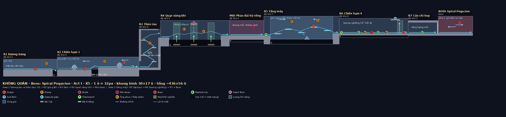

# Màn: KHÔNG QUÂN (Reploid Air Force — Boss Spiral Pegacion)

Bản thiết kế để duyệt trước khi dựng. Sơ đồ: `maps/x5_pegacion.png`.
Màn này thay cho `x5_pegacion` hiện tại. Boss, capsule Gaea Body, quạt nâng khí Updraft, bệ bay và sub-boss pháo đài hộ tống vẫn giữ; thêm 4 Reploid, Sub-Tank và thay địa hình. Heart Tank giữ trên đỉnh luồng khí nâng.

---

## 0. Công cụ và quy ước

Dùng chung với màn mẫu (`../lo-nham-thach-kich-ban.md`, mục 0): LDtk dựng bản đồ, Pixelorama vẽ tile, Krita vẽ nền parallax. 1 ô = 32px, khung hình 30×17 ô, các lớp `Collision` / `Tiles` / `Decor` / `Foreground` / `Entities`.

---

## 1. Ý tưởng tổng

Hạm đội không quân Reploid bay giữa tầng mây. Màn này là **gió**: gió giật, gió đổi chiều, luồng khí nâng. Không có vực có đáy: rơi là mất. Người chơi học đọc gió như đọc nhịp bẫy.

- **Area 1 – Boong tàu và thân tàu:** trời xanh, thép xám, mây dưới chân. Dạy gió giật, nhảy giữa hai tàu, luồng khí nâng.
- **Area 2 – Tầng mây:** hoàng hôn, mây dày. Bệ bay trong gió đổi chiều, rồi boong nghiêng có luồng khí lên capsule.
- **Điểm nhấn trải nghiệm:** chạy đường băng → nhảy giữa hai tàu trong gió giật → leo thân tàu → bay qua quạt nâng khí → mini-boss trên boong không vách → nhảy bệ bay trong gió đổi chiều → boong nghiêng → boss trên nóc tàu
- **Đường cong độ khó:** 2 → 3 → 4 → 5 → (mini-boss) → 7 → 6 → 2 → boss (thang 10).
- **Thời lượng mục tiêu:** khoảng 6–7 phút lần đầu, khoảng 3 phút khi đã quen.

Các mẫu thiết kế tham khảo (không chép bản đồ gốc):

- **X5, màn Spiral Pegacion:** hạm đội bay, quạt nâng khí, pháo đài hộ tống làm sub-boss, capsule trên boong tàu cuối.
- **X (SNES), màn Storm Eagle:** đấu trường trên nóc tàu không vách, gió đẩy ra mép.
- **X6, màn Commander Yammark / X8, màn Gigabolt Man-O-War:** bệ bay theo đường cố định trên khoảng không.
- **X8 16-bit demake:** dựng lại đoạn bay trên tàu thành màn chơi thường, không tự cuộn.
- **X Corrupted:** luồng nâng chỉ bật theo nhịp của một cơ chế khác (boong nghiêng).

---

## 2. Kịch bản từng phòng

Tọa độ tính theo ô, gốc (0,0) ở góc trên trái thế giới, y tăng xuống dưới.

### R1 – Đường băng (x 0–50, y 40–56) · độ khó 2
- **Mục đích:** mở đầu trên **tàu sân bay đang bay** giữa trời. Rơi khỏi mép là mất mạng.
- **Địa hình:**
  - Đường băng dài 46 ô, mặt sàn ở y 50.
  - Cuối đường băng là mép tàu. Phải nhảy sang chiến hạm 1 ở thấp hơn một chút.
- **Địch:**
  - 1 Sniper giữa đường băng.
  - 1 Drone dạng máy bay nhỏ, bay vòng rồi bổ nhào.
- **Gió:** gió nhẹ, chỉ làm hiệu ứng (mây bay, cờ phần phật), không đẩy.
- **Trang trí:** máy bay đậu, đèn hiệu đường băng, mây trôi dưới chân.

### R2 – Chiến hạm 1 (x 50–126, y 38–56) · độ khó 3
- **Mục đích:** dạy **gió giật**: gió không thổi liên tục mà giật từng đợt, phải đọc tín hiệu.
- **Địa hình:**
  - Boong chiến hạm 1 dài 32 ô, rồi khe 6 ô, rồi boong chiến hạm 2 cao hơn 2 ô.
  - Hai tháp pháo đã hỏng làm vật che chắn.
- **Bẫy – gió giật:**
  - Mỗi 5 giây có một đợt gió ngược thổi 2 giây, đẩy lùi 90px/giây.
  - Cờ trên cột buồm dựng thẳng 1 giây trước mỗi đợt.
  - Nhảy qua khe giữa hai tàu đúng lúc gió giật thì rơi.
- **Địch:**
  - 1 Sniper trên boong 1.
  - 1 Sniper trên nóc tháp pháo boong 2.
  - 1 Drone lượn trên khe.
- **Vật phẩm:** Reploid #1 cuối boong 2.

### R3 – Thân tàu (x 126–146, y 12–50) · độ khó 4
- **Mục đích:** đoạn dọc bên trong thân tàu, không gió: chỗ nghỉ nhịp giữa các boong.
- **Địa hình:** khoang thông gió rộng 16 ô, cao 34 ô (từ y 48 lên y 14). 4 kệ nghỉ.
- **Bẫy – quạt tản nhiệt:** quạt đặt ngang giữa khoang, cánh quay chạm là mất máu. Quạt dừng 1.5 giây mỗi 3 giây, chỉ lúc đó mới leo qua được.
- **Địch:** 1 Drone gần lối ra.
- **Lối ra:** cửa sập trên boong phía trên, mở ra khu quạt nâng khí.

### R4 – Quạt nâng khí (x 146–210, y 4–28) · độ khó 5
- **Mục đích:** vượt khoảng không 48 ô bằng **luồng khí nâng**.
- **Địa hình:** bệ xuất phát và bệ đích, giữa là khoảng trời không đáy.
- **Cơ chế – quạt nâng khí:**
  - 3 quạt lớn thổi thẳng lên, nâng người chơi 160px/giây khi ở trong luồng.
  - Thả trôi trong luồng thì lơ lửng. Lướt ngang ra khỏi luồng thì rơi chậm dần sang luồng kế tiếp.
  - Khoảng cách giữa các luồng là 10 ô: phải lướt trên không mới tới.
- **Địch:** 2 Drone bay cắt ngang giữa các luồng. Bị bắn trúng giữa không trung là rơi khỏi luồng.
- **Lối phụ (Heart Tank):**
  - Luồng giữa nâng cao hơn hai luồng kia, lên tới một bệ nhỏ trên đỉnh (x ≈ 177, y ≈ 7).
  - Giữ nguyên trong luồng tới đỉnh thì đáp lên bệ, lấy Heart Tank.
  - Lên quá cao thì mất đà sang luồng thứ ba, phải rơi về luồng giữa rồi đi tiếp.

### Mini-boss – Pháo đài hộ tống (x 210–242, y 4–24) · độ khó 5
- **Đấu trường là boong một tàu hộ tống**, dài 32 ô, **không có vách**. Rơi là mất mạng.
- **Pháo đài hộ tống** bay sát bên phải boong, chỉ lộ tháp pháo và lõi động cơ.
- **Đòn đánh:**
  - Tháp pháo bắn loạt 3 đạn thẳng.
  - Thả 2 drone nhỏ bám theo người chơi.
  - Bật động cơ thổi gió ngang đẩy người chơi về mép trái (2 giây, có tiếng rú báo trước).
- **Điểm yếu:** lõi động cơ, chỉ mở khi đang thổi gió. Phải vừa chống gió vừa bắn.
- **Phần thưởng:** mở đường lên tầng mây. Hạ không mất máu thì được thưởng Souls.

### R5 – Tầng mây (x 242–312, y 0–26) · độ khó 7
- **Checkpoint 1** ở đầu phòng.
- **Mục đích:** cao trào của màn. Nhảy trên các bệ bay trong gió đổi chiều.
- **Địa hình:** khoảng trời rộng 58 ô giữa hai boong, chỉ có **5 bệ bay** (rộng 5 ô).
- **Cơ chế:**
  - Bệ bay qua lại theo đường ngang 6 ô, mỗi bệ một tốc độ (60–100px/giây).
  - **Gió ngang đổi chiều mỗi 4 giây**, đẩy 70px/giây. Mũi tên trên HUD báo chiều gió sắp tới 1 giây trước.
  - Nhảy xuôi gió thì xa, nhảy ngược gió thì hụt.
- **Địch:**
  - 2 Drone bay vòng.
  - 1 Sniper đứng trên bệ bay thứ tư: phải hạ nó trước khi nhảy lên.
- **Lối phụ (Sub-Tank):**
  - Một bệ mây cứng nằm thấp dưới bệ thứ ba (x ≈ 280, y ≈ 21), gần sát vùng rơi.
  - Thả người xuống từ bệ thứ ba lúc gió đang thổi về phía bệ mây, rồi đá lên lại bệ thứ ba khi nó bay qua.
  - Giáp Falcon bay tự do: lấy an toàn.

### R6 – Chiến hạm 4 (x 312–376, y 2–20) · độ khó 6
- **Checkpoint 2** ở đầu phòng.
- **Mục đích:** kết hợp mọi thứ: boong nghiêng, tháp pháo, gió, và luồng khí nâng cuối cùng.
- **Địa hình:**
  - Boong chiến hạm 4 dài 64 ô, mặt boong ở y 16.
  - **Boong nghiêng 15° sang trái mỗi 4 giây** (giữ nghiêng 1.5 giây rồi trở lại). Người chơi trượt xuống phía trái 100px/giây khi boong nghiêng.
- **Bẫy:** 2 **tháp pháo** trên boong, bắn đạn cong. Bắn hạ được bằng 4 viên đạn thường.
- **Địch:**
  - 1 Brute giữa boong: khi boong nghiêng nó trượt về phía người chơi.
  - 1 Sniper cuối boong.
- **Vật phẩm:** Reploid #2 và #3 trên boong.
- **Lối phụ (Capsule Gaea Body):**
  - Cuối boong có **luồng khí nâng** của ống xả động cơ, thổi lên bệ ăng-ten (x ≈ 360, y ≈ 3).
  - Luồng chỉ bật khi boong đang nghiêng. Đứng sẵn trong luồng thì bị trượt ra khỏi luồng, nên phải lướt vào đúng lúc boong bắt đầu nghiêng.

### R7 – Cầu chỉ huy (x 376–404, y 4–18) · độ khó 2
- Phòng nghỉ trước boss: Reploid #4, nạp năng lượng nhỏ, cửa boss lên nóc tàu chỉ huy.

### BOSS – Spiral Pegacion (x 404–436, y 0–18)
- **Đấu trường là nóc tàu chỉ huy dài 32 ô**, **không vách**, rơi là mất mạng.
- **Pha 1** (100–50% HP): bộ chiêu hiện có (lốc xoáy, lao chéo, bão cánh).
- **Pha 2** (dưới 50% HP):
  - Pegacion bay vòng quanh tàu, tạo **gió đẩy ra mép**: luôn đẩy người chơi về phía mép gần hơn, 60px/giây.
  - Đứng giữa sân thì gió từ hai phía triệt tiêu: đây là chỗ an toàn, nhưng Pegacion hay lao vào đúng giữa.
- Điểm yếu giữ nguyên theo dữ liệu game.

---

## 3. Bảng vật phẩm và kẻ địch

| Loại | Số lượng | Vị trí |
|---|---|---|
| Sniper | 5 | R1, R2 ×2, R5, R6 |
| Drone | 7 | R1, R2, R3, R4 ×2, R5 ×2 |
| Brute | 1 | R6 |
| Ống phun / tháp pháo | 2 | R6 ×2 |
| Mini-boss | 1 | MID |
| Reploid cứu | 4 | R2, R6 ×2, R7 |
| Heart Tank | 1 | R4 |
| Sub-Tank | 1 | R5 |
| Capsule Gaea Body | 1 | R6 |
| Checkpoint | 2 | R5, R6 |

Tổng 13 kẻ địch thường (bản cũ: 20 con xếp đều), đặt có chủ đích theo mục đích từng phòng.

---

## 4. Những gì engine cần bổ sung

1. Gió giật theo lịch (bật/tắt có tín hiệu báo trước), gió đổi chiều, gió đẩy ra mép.
2. Luồng khí nâng: lực đẩy lên theo vùng, có thể bật/tắt theo điều kiện.
3. Bệ bay qua lại theo đường cố định, mỗi bệ một tốc độ.
4. Boong nghiêng theo nhịp: làm người chơi và địch trượt.
5. Tháp pháo bắn đạn cong, phá được.
6. Quạt tản nhiệt có nhịp quay/dừng.
7. Mini-boss Pháo đài hộ tống bay cạnh boong.

## 5. Danh sách hình cần vẽ

- **Tileset "Boong tàu" (Area 1):** 47 ô viền thép, mặt boong kẻ vạch, mép tàu, tháp pháo hỏng.
- **Tileset "Tầng mây" (Area 2):** 47 ô viền, bệ bay, mây cứng, ăng-ten.
- **Vật thể:** cờ báo gió (3 khung), quạt nâng khí (4 khung), quạt tản nhiệt, tháp pháo (3 khung), boong nghiêng.
- **Nền:** Area 1: trời xanh và tàu bay xa (2 lớp parallax). Area 2: biển mây hoàng hôn (2 lớp).

**Hướng phối hợp:** như màn mẫu — dựng bằng khối màu tạm theo sơ đồ để chơi thử, chốt cảm giác rồi mới thay tile thật.
