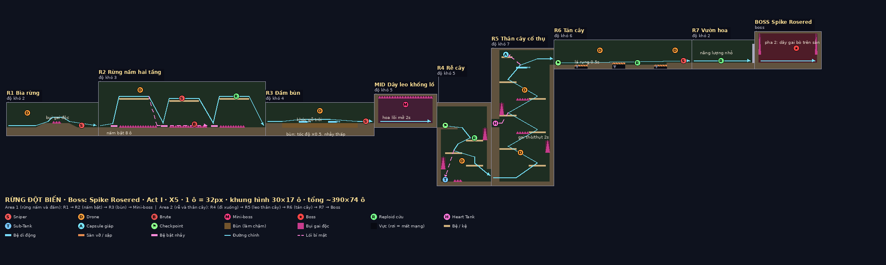

# Màn: RỪNG ĐỘT BIẾN (Mutant Jungle — Boss Spike Rosered)

Bản thiết kế để duyệt trước khi dựng. Sơ đồ: `maps/x5_rosered.png`.
Màn này thay cho `x5_rosered` hiện tại. Boss, capsule Gaea Foot, nấm bật nhảy và sub-boss Dây leo vẫn giữ; thêm 4 Reploid, Heart Tank, Sub-Tank và thay địa hình.

---

## 0. Công cụ và quy ước

Dùng chung với màn mẫu (`../lo-nham-thach-kich-ban.md`, mục 0): LDtk dựng bản đồ, Pixelorama vẽ tile, Krita vẽ nền parallax. 1 ô = 32px, khung hình 30×17 ô, các lớp `Collision` / `Tiles` / `Decor` / `Foreground` / `Entities`.

---

## 1. Ý tưởng tổng

Khu rừng máy móc đột biến mọc trùm lên một căn cứ bỏ hoang. Mặt đất là của gai độc, nên người chơi luôn phải tìm đường ở tầng trên: nấm bật, khúc gỗ, cành cây. Cao trào là leo lòng một cây cổ thụ khổng lồ.

- **Area 1 – Rừng nấm và đầm (ngoài trời):** xanh rêu, nắng lọt qua tán. Dạy gai độc, nấm bật, bùn làm chậm.
- **Area 2 – Rễ và thân cây:** nâu tối, nấm phát sáng. Đi xuống hố rễ, leo thân cây 60 ô, rồi chạy trên tán.
- **Điểm nhấn trải nghiệm:** né gai → bật nấm lên tán → lội bùn trên khúc gỗ → mini-boss dây leo → xuống hố rễ → leo thân cây cổ thụ → chạy trên lá rụng → boss
- **Đường cong độ khó:** 2 → 3 → 4 → (mini-boss) → 5 → 7 → 6 → 2 → boss (thang 10).
- **Thời lượng mục tiêu:** khoảng 6–8 phút lần đầu, khoảng 3 phút khi đã quen.

Các mẫu thiết kế tham khảo (không chép bản đồ gốc):

- **X5, màn Spike Rosered:** rừng máy, nấm bật, capsule Gaea trên tán cây cổ thụ.
- **X6, màn Commander Yammark:** rừng có hai tầng đường đi.
- **X8, màn Bamboo Pandamonium:** leo dọc dài với vật cản mọc ra theo nhịp.
- **X4, màn Web Spider:** rừng rậm, đi theo cành cây trên cao.
- **X Corrupted:** đặt bí mật ngay dưới mảng nguy hiểm để thưởng cho người hiểu cách đá tường.

---

## 2. Kịch bản từng phòng

Tọa độ tính theo ô, gốc (0,0) ở góc trên trái thế giới, y tăng xuống dưới.

### R1 – Bìa rừng (x 0–44, y 40–56) · độ khó 2
- **Mục đích:** giới thiệu **bụi gai độc**: chạm là mất máu và bị nhiễm độc (mất thêm 1 máu mỗi giây trong 3 giây).
- **Địa hình:**
  - Bìa rừng 44 ô, đất mấp mô, mặt đất ở y 52 và y 50.
  - Một gò đất có bụi gai ở giữa: nhảy qua, không có cách khác.
- **Địch:**
  - 1 Drone dạng ong máy, bay theo đường sóng.
  - 1 Sniper ở chân gò.
- **Trang trí:** cây máy gãy, dây cáp như dây leo, nấm phát sáng nhỏ.

### R2 – Rừng nấm hai tầng (x 44–124, y 30–56) · độ khó 3
- **Mục đích:** dạy **nấm bật nhảy** và chọn tầng: dưới đất toàn gai, trên tán cây an toàn hơn nhưng có địch.
- **Địa hình:**
  - Rừng 80 ô. Mặt đất ở y 52 gần như phủ kín bụi gai độc, chỉ chừa chỗ mọc nấm.
  - **3 cây nấm bật**: đáp lên thì bật cao 8 ô. Giữ NHẢY khi đáp thì bật 10 ô.
  - Tầng tán cây là 3 cành ngang dài 14 ô ở y 38–39.
- **Địch:**
  - 1 Drone ong ở đầu tầng tán.
  - 1 Sniper đứng trên cành thứ hai.
  - 1 Brute đứng giữa bãi gai dưới đất (miễn gai).
- **Vật phẩm:** Reploid #1 trên cành cuối.
- **Ghi chú:** đi dưới đất bằng giáp Shadow (miễn gai) là đường tắt.

### R3 – Đầm bùn (x 124–176, y 40–56) · độ khó 4
- **Mục đích:** đổi nhịp chậm lại. Bùn làm người chơi chậm hẳn, buộc phải dùng vật nổi.
- **Địa hình:**
  - Đầm dài 36 ô (x 132–168). Mặt bùn ở y 50.
  - Đứng trong bùn: tốc độ chạy ×0.5, độ cao nhảy ×0.6, không lướt được.
  - **2 khúc gỗ trôi** qua lại trên mặt bùn (60px/giây). Đứng trên gỗ thì di chuyển bình thường.
- **Địch:**
  - 1 Drone ong bay thấp, lao vào khi người chơi kẹt trong bùn.
  - 1 Sniper ở bờ bên kia.
- **Giáp hỗ trợ:** Falcon lướt trên không qua hết đầm.

### Mini-boss – Dây leo khổng lồ (x 176–206, y 36–52) · độ khó 5
- **Đấu trường 26 ô**, kín, hai vách đá tường được. Trần phủ gai.
- **Dây leo khổng lồ** có bông hoa lõi treo từ trần, 4 dây roi mọc từ sàn.
- **Đòn đánh:**
  - Dây roi trồi lên từ sàn ở chỗ người chơi đứng (đất nứt báo trước 0.6 giây).
  - Hoa phun 5 hạt độc hình quạt.
  - Hai dây roi quét ngang từ hai vách: phải nhảy qua đúng lúc.
- **Điểm yếu:** hoa lõi mở cánh 2 giây sau mỗi đợt phun hạt.
- **Phần thưởng:** mở lối xuống khu rễ cây. Hạ không mất máu thì được thưởng Souls.

### R4 – Rễ cây (x 206–232, y 40–80) · độ khó 5
- **Checkpoint 1** ở đầu phòng.
- **Mục đích:** đi xuống qua mạng rễ cây, đổi không gian sang dưới lòng đất.
- **Địa hình:**
  - Hố rễ rộng 22 ô, sâu 26 ô (từ y 52 xuống y 78).
  - 3 rễ ngang làm bậc, xếp zigzag.
  - Hai vách có mảng gai độc ở chỗ người chơi hay đá tường.
- **Địch:** 1 Drone ong dưới đáy hố.
- **Vật phẩm:** Reploid #2 trên rễ đầu tiên.
- **Lối phụ (Sub-Tank):**
  - Ở góc trái đáy hố, sau một bụi gai thấp.
  - Thả người thẳng từ rễ thứ hai xuống thì rơi trúng gai. Phải nhảy ra khỏi rễ, bám vách trái **phía dưới** mảng gai rồi trượt xuống.

### R5 – Thân cây cổ thụ (x 232–262, y 14–80) · độ khó 7
- **Mục đích:** cao trào của màn. Leo thân cây cao 60 ô (gấp hơn 3 lần chiều cao màn hình).
- **Địa hình:**
  - Lòng thân cây rộng 24 ô, từ đáy y 78 lên đỉnh y 15.
  - 6 cành ngang xếp zigzag cách nhau 8 ô.
  - Hai vách là vỏ cây, đá tường được, trừ các mảng gai.
- **Bẫy – gai thò thụt:**
  - Đầu trong của cành thứ ba và thứ năm có gai thò ra 2 giây rồi thụt vào 2 giây.
  - Mảng gai cố định trên vách ở đúng chỗ đá tường thuận tay nhất: buộc người chơi đổi bên.
- **Địch:** 2 Drone ong bay vòng trong lòng cây.
- **Lối phụ (Heart Tank):**
  - **Hốc trong vỏ cây** ở vách trái (x ≈ 232–236, y ≈ 52).
  - Nằm ngay dưới mảng gai trên vách: phải đá tường từ dưới lên rồi lướt ngang vào hốc, không được chạm gai.
- **Lối phụ (Capsule Gaea Foot):**
  - Trên đỉnh có **bệ lá di động** chạy ngang. Đứng trên bệ lá, nhảy sang kệ nhỏ sát vỏ cây bên trái (x ≈ 237, y ≈ 18).
  - Giáp Falcon bay thẳng lên được.

### R6 – Tán cây (x 262–328, y 10–24) · độ khó 6
- **Checkpoint 2** ở đầu phòng.
- **Mục đích:** tốc độ trên cao. Không được dừng trên lá.
- **Địa hình:**
  - Lối đi trên các cành lớn ở y 21–22, dài 66 ô. Dưới là khoảng không xuống tận đất rừng (rơi là mất mạng).
  - **3 đoạn lá rụng** nối các cành: đứng lên thì sau 0.5 giây lá rơi.
- **Địch:**
  - 2 Drone ong bay ngang tầm nhảy, ngay trên đoạn lá.
  - 1 Sniper ở cuối.
- **Vật phẩm:** Reploid #3 trên cành giữa.

### R7 – Vườn hoa (x 328–358, y 10–24) · độ khó 2
- Phòng nghỉ trước boss: Reploid #4, nạp năng lượng nhỏ, cửa boss. Vườn hoa máy yên tĩnh.

### BOSS – Spike Rosered (x 358–390, y 6–24)
- **Đấu trường 28 ô**. Hai vách phủ dây gai ở nửa trên: đá tường được ở nửa dưới thôi.
- **Pha 1** (100–50% HP): bộ chiêu hiện có (bóng gai, bám trần, roi dây leo).
- **Pha 2** (dưới 50% HP):
  - Dây gai bò dọc sàn từ một vách sang vách kia, che 1/3 sàn, đổi bên mỗi 8 giây.
  - Rosered bám lên trần thường xuyên hơn.
- Điểm yếu giữ nguyên theo dữ liệu game.

---

## 3. Bảng vật phẩm và kẻ địch

| Loại | Số lượng | Vị trí |
|---|---|---|
| Sniper | 4 | R1, R2, R3, R6 |
| Drone | 8 | R1, R2, R3, R4, R5 ×2, R6 ×2 |
| Brute | 1 | R2 |
| Mini-boss | 1 | MID |
| Reploid cứu | 4 | R2, R4, R6, R7 |
| Heart Tank | 1 | R5 |
| Sub-Tank | 1 | R4 |
| Capsule Gaea Foot | 1 | R5 |
| Checkpoint | 2 | R4, R6 |

Tổng 13 kẻ địch thường (bản cũ: 20 con xếp đều), đặt có chủ đích theo mục đích từng phòng.

---

## 4. Những gì engine cần bổ sung

1. Bụi gai độc: sát thương + nhiễm độc theo thời gian (giáp Shadow miễn).
2. Nấm bật: bật cao cố định, giữ NHẢY thì cao hơn.
3. Vùng bùn: giảm tốc độ, độ cao nhảy, khóa lướt.
4. Khúc gỗ trôi (bệ di động trên mặt bùn).
5. Gai thò thụt theo nhịp trên cành.
6. Sàn lá rụng (sàn vỡ 0.5 giây).
7. Mini-boss Dây leo khổng lồ: roi trồi từ sàn theo vị trí người chơi.

## 5. Danh sách hình cần vẽ

- **Tileset "Rừng máy" (Area 1):** 47 ô viền đất rêu, rễ máy, bụi gai (2 khung), nấm bật (3 khung), mặt bùn (4 khung).
- **Tileset "Thân cây" (Area 2):** 47 ô viền vỏ cây, cành ngang, gai thò thụt (3 khung), lá rụng (3 khung).
- **Vật thể:** khúc gỗ, bệ lá, hoa lõi mini-boss.
- **Nền:** Area 1: tán rừng xa và nắng lọt (2 lớp parallax). Area 2: lòng cây và nấm phát sáng (2 lớp).

**Hướng phối hợp:** như màn mẫu — dựng bằng khối màu tạm theo sơ đồ để chơi thử, chốt cảm giác rồi mới thay tile thật.
