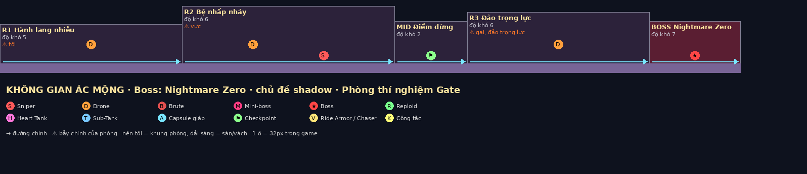

# Không gian ác mộng — Boss Nightmare Zero

`x6_f1_nzero` · chủ đề `shadow` · Phòng thí nghiệm Gate · tổng chiều ngang khoảng 244 ô (7808px)

## Ý tưởng
Không gian nhiễu tối: tầm nhìn bị thu hẹp quanh nhân vật, đèn quét tạo ảo ảnh (bệ giả), bệ nhấp nháy và đảo trọng lực.

## Tham khảo
X6 Nightmare stages, X8 Dark Mantis (tối), X5 Zero Space 3.

## Nhịp màn
R1 (5) → R2 (6) → MID (2) → R3 (6) → BOSS (7)

## Kịch bản từng phòng

### R1 – Hành lang nhiễu (60×16 ô, đi ngang) · độ khó 5
Tầm nhìn bán kính 220px; bệ ảo ảnh (viền nhấp nháy) không đứng được.
- **Bẫy:** tối
- **Đặt trong phòng:** Drone

### R2 – Bệ nhấp nháy (70×22 ô, đi ngang) · độ khó 6
Bệ đổi pha trên vực, đèn quét làm lộ bệ thật.
- **Bẫy:** vực
- **Đặt trong phòng:** Drone, Sniper

### MID – Điểm dừng (24×17 ô, đi ngang) · độ khó 2
Checkpoint.
- **Đặt trong phòng:** Checkpoint

### R3 – Đảo trọng lực (60×20 ô, đi ngang) · độ khó 6
Đi trên trần qua gai.
- **Bẫy:** gai, đảo trọng lực
- **Đặt trong phòng:** Drone

### BOSS – Nightmare Zero (30×17 ô, đấu trường) · độ khó 7
Bản sao Zero dùng Genmu Zero; đánh bại để mở khóa Zero thật.
- **Đặt trong phòng:** Boss

## Cơ chế mới cần engine
- Tầm nhìn hạn chế
- Bệ ảo ảnh

## Hình ảnh / element
bg-shadow tối, mmx6_cyberblock, vòng tối vẽ bằng mặt nạ canvas.
