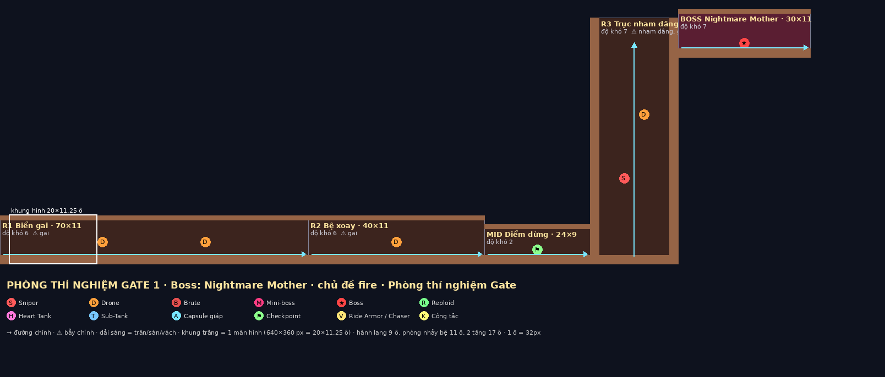

# Phòng thí nghiệm Gate 1 — Boss Nightmare Mother

`x6_f2_nmother` · chủ đề `fire` · Phòng thí nghiệm Gate · tổng chiều ngang khoảng 184 ô (5888px)

## Ý tưởng
Tầng 1 phòng thí nghiệm: biển gai với bệ di động, rồi trục leo dọc có dung nham dâng (khó hơn Lò Nham Thạch).

## Tham khảo
X6 Gate Lab 1, X4 Magma Dragoon, màn mẫu Lò Nham Thạch (R6).

## Chuẩn kích thước
Theo màn mẫu Lò Nham Thạch: khung hình 640×360 px = 20×11.25 ô; hành lang trần→sàn 9 ô, khối trần luôn nằm trong khung; phòng nhảy bệ/vực/nước 11 ô; phòng 2 tầng 17 ô (hai hành lang chồng nhau); đấu trường cao 11 ô, rộng 20–30 ô; giếng rộng 12–20 ô, leo bằng đá tường và kệ nghỉ. X nhảy cao ~2.6 ô (vy 520), xa ~5 ô: gờ trên đường chính ≤ 2.5 ô, hố ≤ 4 ô; cao/xa hơn phải dùng đá tường, lướt-nhảy hoặc giáp, và chỉ dùng cho bí mật.

## Nhịp màn
R1 (6) → R2 (6) → MID (2) → R3 (7) → BOSS (7)

## Kịch bản từng phòng

### R1 – Biển gai (70×11 ô, đi ngang, nhảy bệ) · độ khó 6
Bệ di động ngang/dọc trên sàn gai.
- **Bẫy:** gai
- **Đặt trong phòng:** Drone, Drone

### R2 – Bệ xoay (40×11 ô, đi ngang, nhảy bệ) · độ khó 6
Bệ xoay quanh trục, gai ở cả trên và dưới.
- **Bẫy:** gai
- **Đặt trong phòng:** Drone

### MID – Điểm dừng (24×9 ô, đi ngang) · độ khó 2
Checkpoint.
- **Đặt trong phòng:** Checkpoint

### R3 – Trục nham dâng (20×56 ô, leo dọc) · độ khó 7
Dung nham dâng 70→90 px/s, không có kệ dừng; gai trên tường trái.
- **Bẫy:** nham dâng, gai
- **Đặt trong phòng:** Drone, Sniper

### BOSS – Nightmare Mother (30×11 ô, đấu trường) · độ khó 7
Khối Nightmare lơ lửng, 4 lõi nguyên tố đổi màu.
- **Đặt trong phòng:** Boss

## Cơ chế mới cần engine
- Bệ xoay quanh trục

## Hình ảnh / element
Element màn Lò Nham Thạch + native-panel.
