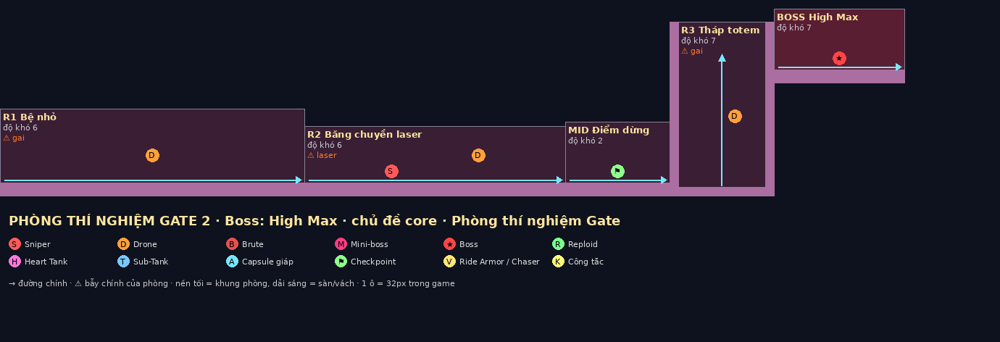

# Phòng thí nghiệm Gate 2 — Boss High Max

`x6_f3_highmax` · chủ đề `core` · Phòng thí nghiệm Gate · tổng chiều ngang khoảng 208 ô (6656px)

## Ý tưởng
Vực gai toàn khu vực, chuỗi bệ nhỏ có cột Totem chặn, băng chuyền laser.

## Tham khảo
X6 Gate Lab 2, X5 Zero Space 2.

## Nhịp màn
R1 (6) → R2 (6) → MID (2) → R3 (7) → BOSS (7)

## Kịch bản từng phòng

### R1 – Bệ nhỏ (70×20 ô, đi ngang) · độ khó 6
Bệ 2×1 ô trên vực gai; cột Totem trên bệ phải phá mới đứng được.
- **Bẫy:** gai
- **Đặt trong phòng:** Drone

### R2 – Băng chuyền laser (60×16 ô, đi ngang) · độ khó 6
Băng chuyền chạy nhanh dưới laser quét.
- **Bẫy:** laser
- **Đặt trong phòng:** Sniper, Drone

### MID – Điểm dừng (24×17 ô, đi ngang) · độ khó 2
Checkpoint.
- **Đặt trong phòng:** Checkpoint

### R3 – Tháp totem (24×40 ô, leo dọc) · độ khó 7
Leo giữa các totem bắn đạn.
- **Bẫy:** gai
- **Đặt trong phòng:** Drone

### BOSS – High Max (30×17 ô, đấu trường) · độ khó 7
Khiên bất khả xâm phạm; dùng Charge Saber của Blade (giữ ↑ rồi thả) để làm choáng.
- **Đặt trong phòng:** Boss

## Cơ chế mới cần engine
- Totem chặn bệ

## Hình ảnh / element
terrain-core, mmx6_totem_gate, fx-laser.
