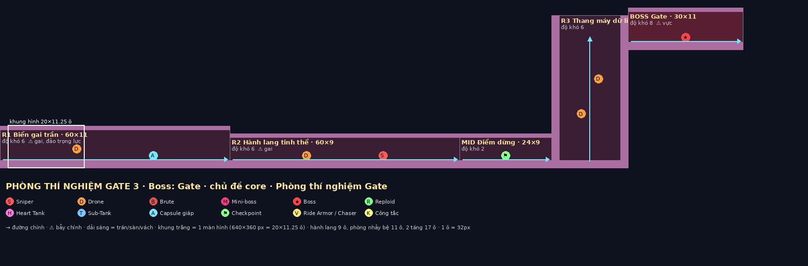

# Phòng thí nghiệm Gate 3 — Boss Gate

`x6_f4_gate` · chủ đề `core` · Phòng thí nghiệm Gate · tổng chiều ngang khoảng 194 ô (6208px)

## Ý tưởng
Vùng đảo trọng lực giấu Secret Ultimate Armor trên trần biển gai; đấu trường Gate có vực thẳm giữa sàn.

## Tham khảo
X6 Gate Lab 3, X5 Zero Space 3 (đảo trọng lực).

## Chuẩn kích thước
Theo màn mẫu Lò Nham Thạch: khung hình 640×360 px = 20×11.25 ô; hành lang trần→sàn 9 ô, khối trần luôn nằm trong khung; phòng nhảy bệ/vực/nước 11 ô; phòng 2 tầng 17 ô (hai hành lang chồng nhau); đấu trường cao 11 ô, rộng 20–30 ô; giếng rộng 12–20 ô, leo bằng đá tường và kệ nghỉ. X nhảy cao ~2.6 ô (vy 520), xa ~5 ô: gờ trên đường chính ≤ 2.5 ô, hố ≤ 4 ô; cao/xa hơn phải dùng đá tường, lướt-nhảy hoặc giáp, và chỉ dùng cho bí mật.

## Nhịp màn
R1 (6) → R2 (6) → MID (2) → R3 (6) → BOSS (8)

## Kịch bản từng phòng

### R1 – Biển gai trần (60×11 ô, đi ngang, nhảy bệ) · độ khó 6
Vùng đảo trọng lực X=1150: đi trên trần; Secret Ultimate Armor X=1850.
- **Bẫy:** gai, đảo trọng lực
- **Đặt trong phòng:** Drone, Capsule giáp

### R2 – Hành lang tinh thể (60×9 ô, đi ngang) · độ khó 6
Tinh thể Nightmare nổ khi bị bắn.
- **Bẫy:** gai
- **Đặt trong phòng:** Drone, Sniper

### MID – Điểm dừng (24×9 ô, đi ngang) · độ khó 2
Checkpoint.
- **Đặt trong phòng:** Checkpoint

### R3 – Thang máy dữ liệu (20×40 ô, leo dọc) · độ khó 6
Bệ nâng chậm, Drone bao quanh.
- **Đặt trong phòng:** Drone, Drone

### BOSS – Gate (30×11 ô, đấu trường) · độ khó 8
Sàn có vực giữa; Gate dùng quả cầu Nightmare.
- **Bẫy:** vực
- **Đặt trong phòng:** Boss

## Bí mật và vật phẩm
| Vật phẩm | Phòng | Cách lấy |
|---|---|---|
| Secret Ultimate Armor | R1 | Trần biển gai trong vùng đảo trọng lực. |

## Cơ chế mới cần engine
- Tinh thể Nightmare nổ

## Hình ảnh / element
terrain-core, native-cyberblock.
