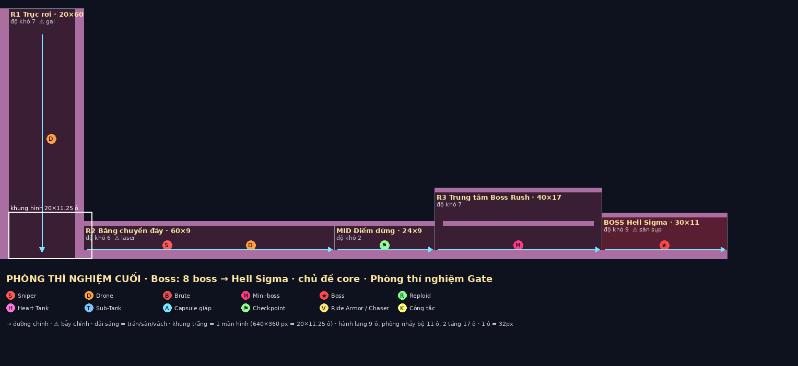

# Phòng thí nghiệm cuối — Boss 8 boss → Hell Sigma

`x6_f5_bossrush` · chủ đề `core` · Phòng thí nghiệm Gate · tổng chiều ngang khoảng 174 ô (5568px)

## Ý tưởng
Trục rơi đầy gai và băng chuyền dẫn tới trung tâm 8 cổng Boss Rush; xong 8 trận là Hell Sigma.

## Tham khảo
X5/X6 Boss Rush, X4 Final Weapon.

## Chuẩn kích thước
Theo màn mẫu Lò Nham Thạch: khung hình 640×360 px = 20×11.25 ô; hành lang trần→sàn 9 ô, khối trần luôn nằm trong khung; phòng nhảy bệ/vực/nước 11 ô; phòng 2 tầng 17 ô (hai hành lang chồng nhau); đấu trường cao 11 ô, rộng 20–30 ô; giếng rộng 12–20 ô, leo bằng đá tường và kệ nghỉ. X nhảy cao ~2.6 ô (vy 520), xa ~5 ô: gờ trên đường chính ≤ 2.5 ô, hố ≤ 4 ô; cao/xa hơn phải dùng đá tường, lướt-nhảy hoặc giáp, và chỉ dùng cho bí mật.

## Nhịp màn
R1 (7) → R2 (6) → MID (2) → R3 (7) → BOSS (9)

## Kịch bản từng phòng

### R1 – Trục rơi (20×60 ô, đi xuống) · độ khó 7
Rơi xuống, gai hai bên và gai nhô ra theo nhịp; lướt ngang để né.
- **Bẫy:** gai
- **Đặt trong phòng:** Drone

### R2 – Băng chuyền đáy (60×9 ô, đi ngang) · độ khó 6
Băng chuyền + laser.
- **Bẫy:** laser
- **Đặt trong phòng:** Sniper, Drone

### MID – Điểm dừng (24×9 ô, đi ngang) · độ khó 2
Checkpoint.
- **Đặt trong phòng:** Checkpoint

### R3 – Trung tâm Boss Rush (40×17 ô, đi ngang, 2 tầng) · độ khó 7
8 cổng dịch chuyển (2 hàng × 4), mỗi cổng một boss Act II.
- **Đặt trong phòng:** Mini-boss

### BOSS – Hell Sigma (30×11 ô, đấu trường) · độ khó 9
3 pha, sàn sụp và virus.
- **Bẫy:** sàn sụp
- **Đặt trong phòng:** Boss

## Cơ chế mới cần engine
- Gai nhô theo nhịp trong trục rơi

## Hình ảnh / element
terrain-core, native-portal.
