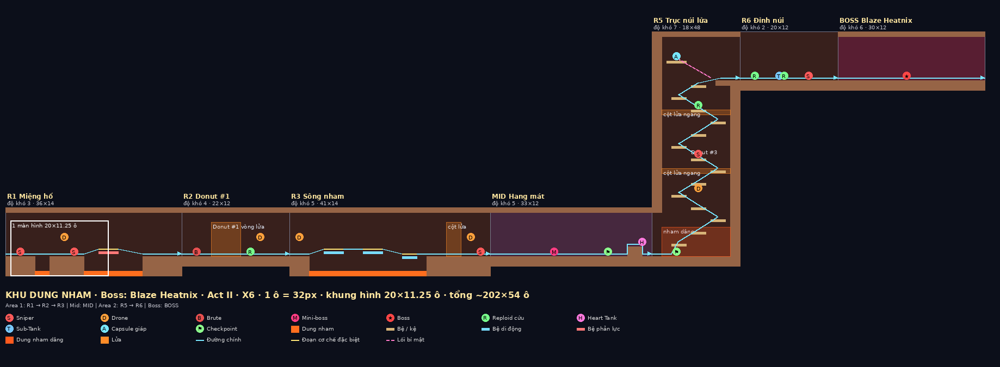

# Khu dung nham — Boss Blaze Heatnix

`x6_heatnix` · chủ đề `fire` · Act II · X6 · tổng ~202×54 ô (6464×1728 px)

## Ý tưởng
Khu núi lửa hoạt động, dùng lại bộ element của Lò Nham Thạch (dung nham, cột lửa, đá lăn). Cỗ máy vòng lửa Nightmare Donut chặn đường; bệ phản lực bay ngang có hết nhiên liệu. Cao trào là trục núi lửa có dung nham dâng, capsule Shadow Arm ở đỉnh.

## Tham khảo
X6 Blaze Heatnix (núi lửa), Lò Nham Thạch (màn mẫu), X2 Flame Stag (núi lửa leo dọc).

## Chuẩn kích thước
Khung hình 640×360 px = 20×11.25 ô. Hành lang: trần 1 ô, trong lòng 9 ô, khối trần luôn nằm trong khung; phòng nhảy bệ/vực/nước 11 ô; phòng 2 tầng 17 ô; đấu trường cao 11 ô, rộng 20–30 ô; giếng rộng 12–20 ô. X nhảy cao ~2.6 ô, xa ~5 ô: trên đường chính gờ ≤ 2.5 ô, nhảy xa ≤ 5 ô (lướt-nhảy ≤ 7 ô); cao/xa hơn chỉ bằng đá tường, giáp hoặc cơ chế của màn, và dùng cho bí mật.

## Cấu trúc

- **Area 1** (R1 → R2 → R3): miệng hố, Donut #1, sông nham
- **Mid** (MID): Donut #2
- **Area 2** (R5 → R6): trục núi lửa, đỉnh núi
- **Boss** (BOSS): miệng núi lửa

## Nhịp màn (độ khó)
R1 (3) → R2 (4) → R3 (5) → MID (5) → R5 (7) → R6 (2) → BOSS (6)

## Kịch bản từng phòng

### R1 – Miệng hố · đi ngang · độ khó 3
*x 0–36, y 38–52 (36×14 ô) · vào ở sàn y 48, ra ở sàn y 48* · Area 1 · miệng hố và sông nham

Mưa đá lửa nhỏ, hố nham. Bệ phản lực đầu tiên: đứng lên là bay ngang 6 ô rồi hết nhiên liệu (đèn đỏ 1 s trước khi tắt).
- **Thông số:** bệ phản lực: bay 4 s rồi rơi; đá lửa mỗi 2 s
- **Địa hình:** hố dung nham x 6–9 (rộng 3 ô); hố dung nham x 16–28 (rộng 12 ô); bệ phản lực x 19–23, y 47
- **Thực thể:** Sniper (3, 48); Drone (12, 45); Sniper (14, 48)
- **Đường chính dùng:** bệ di động, nhảy

### R2 – Donut #1 · đi ngang · độ khó 4
*x 36–58, y 38–50 (22×12 ô) · vào ở sàn y 48, ra ở sàn y 48* · Area 1 · miệng hố và sông nham

Cỗ máy vòng lửa Donut #1 (vật cản, 20 HP) bắn vòng lửa lan rộng; bệ phản lực hai bên. Reploid sau Donut.
- **Thông số:** vòng lửa mỗi 2.5 s, lan 4 ô
- **Địa hình:** lửa x 42–48, y 41–48 (Donut #1 vòng lửa)
- **Thực thể:** Brute (39, 48); Reploid cứu (50, 48); Drone (52, 45)

### R3 – Sông nham · đi ngang · độ khó 5
*x 58–99, y 38–52 (41×14 ô) · vào ở sàn y 48, ra ở sàn y 48* · Area 1 · miệng hố và sông nham

Bệ đá trôi trên sông nham (60 px/s), cột lửa phun theo nhịp ở ba điểm (bọt nham báo trước 0.6 s).
- **Thông số:** bệ đá trôi 60 px/s; cột lửa 1.2 s mỗi 3.5 s
- **Địa hình:** hố dung nham x 62–86 (rộng 24 ô); bệ di động x 65–69, y 47; bệ di động x 73–77, y 47; bệ di động x 81–84, y 48; lửa x 90–93, y 41–48 (cột lửa)
- **Thực thể:** Drone (60, 45); Drone (95, 45); Sniper (97, 48)
- **Đường chính dùng:** bệ di động, nhảy

### MID – Hang mát · đấu trường · độ khó 5
*x 99–132, y 38–50 (33×12 ô) · vào ở sàn y 48, ra ở sàn y 48* · Mid

Mini-boss: Nightmare Donut #2 (cỡ lớn, 45 HP) + đá lăn từ dốc. Checkpoint 1; Heart Tank trên gờ đá sau trận.
- **Thông số:** vòng lửa mỗi 2 s; đá lăn mỗi 4 s
- **Địa hình:** khối x 127–130, y 46–48
- **Thực thể:** Mini-boss (112, 48) – Donut #2 45 HP; Checkpoint (123, 48); Heart Tank (130, 46) – gờ đá
- **Đường chính dùng:** nhảy, rơi xuống

### R5 – Trục núi lửa · leo dọc · độ khó 7
*x 132–150, y 2–50 (18×48 ô) · vào ở sàn y 48, ra ở sàn y 12* · Area 2 · trục núi lửa

Cao trào: trục leo X=5250 (dữ liệu game), dung nham dâng 55→75 px/s từ khi bước vào; Donut #3 (vật cản) ở giữa trục. Kệ đá so le, cột lửa phun ngang ở hai tầng. Capsule Shadow Arm ở đỉnh trục bên trái. Checkpoint 2 ở đáy.
- **Thông số:** nham dâng 55→75 px/s, dừng 2 s ở kệ an toàn; cột lửa ngang 1 s mỗi 3 s
- **Địa hình:** khối x 145–148, y 12–13; dung nham dâng x 134–148, y 42–48 (nham dâng); lửa x 134–148, y 30–31 (cột lửa ngang); lửa x 134–148, y 18–19 (cột lửa ngang); bệ / kệ x 136–139, y 45.5; bệ / kệ x 140–143, y 43; bệ / kệ x 144–147, y 40.5; bệ / kệ x 140–143, y 38; bệ / kệ x 136–139, y 35.5; bệ / kệ x 140–143, y 33; bệ / kệ x 144–147, y 30.5; bệ / kệ x 140–143, y 28; bệ / kệ x 136–139, y 25.5; bệ / kệ x 140–143, y 23; bệ / kệ x 144–147, y 20.5; bệ / kệ x 140–143, y 18; bệ / kệ x 136–139, y 15.5; bệ / kệ x 140–143, y 13; bệ / kệ x 135–139, y 8
- **Thực thể:** Checkpoint (137, 48); Drone (141.5, 35); Sniper (141.5, 28); Reploid cứu (141.5, 18); Capsule giáp (137, 8) – Shadow Arm (đỉnh trục)
- **Đường chính dùng:** nhảy
- **Lối bí mật:** (144, 12) → (137, 8)

### R6 – Đỉnh núi · đi ngang · độ khó 2
*x 150–170, y 2–14 (20×12 ô) · vào ở sàn y 12, ra ở sàn y 12* · Area 2 · trục núi lửa

Phòng nghỉ trên miệng núi lửa: Sub-Tank, hai Reploid, cửa boss.
- **Thực thể:** Reploid cứu (153, 12); Sub-Tank (158, 12) – hốc đá; Reploid cứu (159, 12); Sniper (164, 12)

### BOSS – Blaze Heatnix · đấu trường · độ khó 6
*x 170–200, y 2–14 (30×12 ô) · vào ở sàn y 12, ra ở sàn y 12* · Boss

Đấu trường miệng núi lửa; Heatnix bay vòng.
- **Thực thể:** Boss (184, 12)

## Bảng kẻ địch và vật phẩm

| Loại | Phòng | x | y | Ghi chú |
|---|---|---|---|---|
| Sniper | R1 | 3 | 48 |  |
| Drone | R1 | 12 | 45 |  |
| Sniper | R1 | 14 | 48 |  |
| Brute | R2 | 39 | 48 |  |
| Reploid cứu | R2 | 50 | 48 |  |
| Drone | R2 | 52 | 45 |  |
| Drone | R3 | 60 | 45 |  |
| Drone | R3 | 95 | 45 |  |
| Sniper | R3 | 97 | 48 |  |
| Mini-boss | MID | 112 | 48 | Donut #2 45 HP |
| Checkpoint | MID | 123 | 48 |  |
| Heart Tank | MID | 130 | 46 | gờ đá |
| Checkpoint | R5 | 137 | 48 |  |
| Drone | R5 | 141.5 | 35 |  |
| Sniper | R5 | 141.5 | 28 |  |
| Reploid cứu | R5 | 141.5 | 18 |  |
| Capsule giáp | R5 | 137 | 8 | Shadow Arm (đỉnh trục) |
| Reploid cứu | R6 | 153 | 12 |  |
| Sub-Tank | R6 | 158 | 12 | hốc đá |
| Reploid cứu | R6 | 159 | 12 |  |
| Sniper | R6 | 164 | 12 |  |
| Boss | BOSS | 184 | 12 |  |

Tổng: 11 kẻ địch thường (Sniper 5, Drone 5, Brute 1), 4 Reploid, 2 checkpoint, Heart Tank 1, Sub-Tank 1, capsule 1.

## Capsule theo dữ liệu game
🛡️ Capsule Shadow Armor — Arm Part (X=5520, Y=270 — Đỉnh trục leo dung nham Area 2 [YT 01:08:54]): Hạ Nightmare Donut #3 (X=4850), leo lên đỉnh trục dọc X=5250 và dùng Charge Saber phá khối sắt nứt (X=5360). 3 Cỗ máy vòng lửa Nightmare Donut + Bệ phản lực Thruster + Trục leo dọc lấy Shadow Arm Area 1: Vượt hồ dung nham bằng bệ đẩy phản lực Thruster và tiêu diệt 2 cỗ máy vòng lửa Nightmare Donut. Area 2: Trục leo dọc giữa lòng núi lửa khi dung nham dâng cao, hạ Donut #3 và phá khối sắt lấy Shadow Arm Part.

## Bí mật
| Vật phẩm | Phòng | Cách lấy |
|---|---|---|
| Capsule Shadow Arm | R5 | Đỉnh trục bên trái (dùng Charge Saber phá đá chắn theo dữ liệu game). |
| Heart Tank | MID | Gờ đá sau trận Donut #2. |
| Sub-Tank | R6 | Hốc đá đỉnh núi. |

## Boss
**Blaze Heatnix** · điểm yếu: Ground Dash / Sentsuizan
- **Bộ chiêu (dữ liệu game):** Magma Blade: Vung kiếm lửa phóng sóng nhiệt hình bán nguyệt. Dive Bomb: Biến thành cầu lửa phượng hoàng lao thẳng xuống đất. Flame Pillars: Tạo loạt cột lửa bùng lên từ mặt sàn. Overdrive (Phase 2): Phủ lửa toàn thân, bay hình số 8 thả mưa cầu lửa.
- **Đấu trường:** miệng núi lửa 30×11 ô.
- **Pha 2 (dưới 50% HP):** dung nham lấp nửa dưới đấu trường (như boss Lò Nham Thạch: nham hai bên rộng ra), Heatnix bay hình số 8.

## Engine cần bổ sung
- Bệ phản lực bay ngang có nhiên liệu
- Cột lửa phun theo nhịp (dùng lại Lò Nham Thạch)
- Nham dâng có kệ dừng
- Nightmare Donut (vật cản bắn vòng lửa)

## Hình cần vẽ
- Dùng lại element Lò Nham Thạch: dung nham, thác nham, đá lăn
- Bệ phản lực
- Nightmare Donut
- Trục núi lửa

## Kiểm tra tự động
Đường chính đã được kiểm tra theo khả năng nhảy (gờ ≤ 2.5 ô, nhảy xa ≤ 5 ô, lướt-nhảy ≤ 7 ô, đi bộ phải có nền) và theo quy ước số lượng.

**Kết quả: đạt.**
