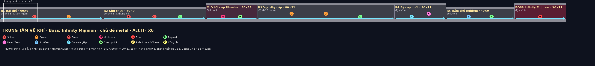

# Trung tâm vũ khí — Boss Infinity Mijinion

`x6_mijinion` · chủ đề `metal` · Act II · X6 · tổng chiều ngang khoảng 330 ô (10560px)

## Ý tưởng
Trung tâm thử vũ khí ở Tây Úc. Siêu phi thuyền Illumina lượn trên đầu và khóa tâm ngắm vào người chơi. Giữa màn là vực với 7 bệ treo dây cáp.

## Tham khảo
X6 Weapon Center (Illumina), X8 Dark Mantis (lẩn tránh), X3 Gravity Beetle (nhà máy vũ khí).

## Chuẩn kích thước
Theo màn mẫu Lò Nham Thạch: khung hình 640×360 px = 20×11.25 ô; hành lang trần→sàn 9 ô, khối trần luôn nằm trong khung; phòng nhảy bệ/vực/nước 11 ô; phòng 2 tầng 17 ô (hai hành lang chồng nhau); đấu trường cao 11 ô, rộng 20–30 ô; giếng rộng 12–20 ô, leo bằng đá tường và kệ nghỉ. X nhảy cao ~2.6 ô (vy 520), xa ~5 ô: gờ trên đường chính ≤ 2.5 ô, hố ≤ 4 ô; cao/xa hơn phải dùng đá tường, lướt-nhảy hoặc giáp, và chỉ dùng cho bí mật.

## Nhịp màn
R1 (3) → R2 (4) → MID (5) → R3 (6) → R4 (4) → R5 (3) → BOSS (6)

## Kịch bản từng phòng

### R1 – Bãi thử (60×9 ô, đi ngang) · độ khó 3
Illumina lượn trên trời, vòng ngắm đỏ bám theo; đứng dưới mái che khi vòng chuyển đỏ đậm.
- **Bẫy:** tâm ngắm
- **Đặt trong phòng:** Sniper, Drone

### R2 – Khu chứa (60×9 ô, đi ngang) · độ khó 4
Thùng vũ khí phát nổ khi bị bắn (dùng để diệt Brute).
- **Bẫy:** thùng nổ
- **Đặt trong phòng:** Brute, Sniper, Reploid

### MID – Lõi cáp Illumina (30×11 ô, đấu trường) · độ khó 5
Sub-boss: phá 3 lõi cáp Illumina. Checkpoint.
- **Đặt trong phòng:** Mini-boss, Checkpoint

### R3 – Vực dây cáp (80×11 ô, đi ngang, nhảy bệ) · độ khó 6
7 bệ treo dây cáp đung đưa; bắn đứt dây → bệ rơi.
- **Bẫy:** vực
- **Đặt trong phòng:** Drone, Drone, Reploid

### R4 – Bệ cáp cuối (30×11 ô, đi ngang, nhảy bệ) · độ khó 4
Capsule Blade Head trên bệ cuối.
- **Đặt trong phòng:** Capsule giáp, Heart Tank

### R5 – Hầm thử nghiệm (40×9 ô, đi ngang) · độ khó 3
Phòng nghỉ, Sub-Tank, cửa boss.
- **Đặt trong phòng:** Sub-Tank, Reploid

### BOSS – Infinity Mijinion (30×11 ô, đấu trường) · độ khó 6
Boss nhân bản khi trúng đạn; diệt bản gốc bằng đạn nạp.
- **Đặt trong phòng:** Boss

## Bí mật và vật phẩm
| Vật phẩm | Phòng | Cách lấy |
|---|---|---|
| Capsule Blade Head | R4 | Bệ cáp cuối Area 2. |
| Heart Tank | R4 | Trên dây cáp cao nhất. |
| Sub-Tank | R5 | Hầm thử nghiệm. |

## Cơ chế mới cần engine
- Vòng ngắm Illumina
- Bệ treo cáp đung đưa
- Thùng nổ

## Hình ảnh / element
terrain-metal, mmx6-platform cho bệ, native-deck, Illumina sprite có sẵn (sub illumina).
