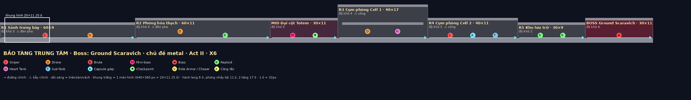

# Bảo tàng Trung tâm — Boss Ground Scaravich

`x6_scaravich` · chủ đề `metal` · Act II · X6 · tổng chiều ngang khoảng 290 ô (9280px)

## Ý tưởng
Bảo tàng ban đêm: đèn pha an ninh quét, bị phát hiện thì cửa sập khóa phòng và gọi lính. Hai cụm phòng nối bằng 4 cổng dịch chuyển, cột Totem chặn ở giữa màn.

## Tham khảo
X6 Central Museum, X8 Dark Mantis (lẩn tránh), X4 Bio Lab.

## Chuẩn kích thước
Theo màn mẫu Lò Nham Thạch: khung hình 640×360 px = 20×11.25 ô; hành lang trần→sàn 9 ô, khối trần luôn nằm trong khung; phòng nhảy bệ/vực/nước 11 ô; phòng 2 tầng 17 ô (hai hành lang chồng nhau); đấu trường cao 11 ô, rộng 20–30 ô; giếng rộng 12–20 ô, leo bằng đá tường và kệ nghỉ. X nhảy cao ~2.6 ô (vy 520), xa ~5 ô: gờ trên đường chính ≤ 2.5 ô, hố ≤ 4 ô; cao/xa hơn phải dùng đá tường, lướt-nhảy hoặc giáp, và chỉ dùng cho bí mật.

## Nhịp màn
R1 (3) → R2 (4) → MID (5) → R3 (4) → R4 (5) → R5 (2) → BOSS (6)

## Kịch bản từng phòng

### R1 – Sảnh trưng bày (60×9 ô, đi ngang) · độ khó 3
Đèn pha quét đầu tiên; bị phát hiện → báo động + 2 Drone.
- **Bẫy:** đèn pha
- **Đặt trong phòng:** Sniper, Drone

### R2 – Phòng hóa thạch (60×11 ô, đi ngang, nhảy bệ) · độ khó 4
Đi trên khung xương khủng long; đèn pha quét chéo.
- **Bẫy:** đèn pha
- **Đặt trong phòng:** Drone, Reploid

### MID – Đại cột Totem (30×11 ô, đấu trường) · độ khó 5
Phá cột Totem chặn đường; checkpoint.
- **Đặt trong phòng:** Mini-boss, Checkpoint

### R3 – Cụm phòng Cell 1 (40×17 ô, đi ngang, 2 tầng) · độ khó 4
4 cổng dịch chuyển nối 2 cụm phòng; mỗi phòng 1 tủ trưng bày (Heart Tank ở một tủ).
- **Bẫy:** cổng
- **Đặt trong phòng:** Drone, Heart Tank

### R4 – Cụm phòng Cell 2 (40×11 ô, đi ngang, nhảy bệ) · độ khó 5
Hốc cao Cell 2: capsule Blade Arm X=4840.
- **Bẫy:** cổng
- **Đặt trong phòng:** Sniper, Capsule giáp, Sub-Tank

### R5 – Kho lưu trữ (30×9 ô, đi ngang) · độ khó 2
Phòng nghỉ, Reploid, cửa boss.
- **Đặt trong phòng:** Reploid, Reploid

### BOSS – Ground Scaravich (30×11 ô, đấu trường) · độ khó 6
Bọ hung lăn tảng đá khổng lồ; cổng dịch chuyển trong đấu trường.
- **Đặt trong phòng:** Boss

## Bí mật và vật phẩm
| Vật phẩm | Phòng | Cách lấy |
|---|---|---|
| Capsule Blade Arm | R4 | Hốc cao Cell 2. |
| Heart Tank | R3 | Tủ trưng bày Cell 1. |
| Sub-Tank | R4 | Phòng cuối Cell 2. |

## Cơ chế mới cần engine
- Báo động khi bị đèn pha phát hiện
- Cột Totem chặn đường

## Hình ảnh / element
terrain-metal, mmx6_totem_gate / mmx6_totem_exit, mmx6_probe_8201-u_type cho đèn pha, native-portal.
