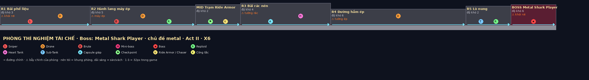

# Phòng thí nghiệm tái chế — Boss Metal Shark Player

`x6_shark` · chủ đề `metal` · Act II · X6 · tổng chiều ngang khoảng 370 ô (11840px)

## Ý tưởng
Nhà máy tái chế phế liệu: 4 trần máy ép thủy lực, Ride Armor đục bãi rác, cuối màn là đường hầm tự cuộn bị tường ép đuổi.

## Tham khảo
X6 Recycle Lab, X4 Split Mushroom (máy kẹp), X8 Earthrock Trilobite (bị đuổi).

## Nhịp màn
R1 (3) → R2 (5) → MID (2) → R3 (4) → R4 (6) → R5 (2) → BOSS (6)

## Kịch bản từng phòng

### R1 – Bãi phế liệu (60×16 ô, đi ngang) · độ khó 3
Khối sắt rơi từ băng tải trên cao.
- **Bẫy:** khối rơi
- **Đặt trong phòng:** Sniper, Drone

### R2 – Hành lang máy ép (70×16 ô, đi ngang) · độ khó 5
4 trần máy ép thủy lực theo nhịp lệch pha, hốc an toàn giữa.
- **Bẫy:** máy ép
- **Đặt trong phòng:** Brute, Drone, Reploid

### MID – Trạm Ride Armor (30×17 ô, đi ngang) · độ khó 2
Checkpoint + Ride Armor Pod X=3240.
- **Đặt trong phòng:** Checkpoint, Ride Armor / Chaser

### R3 – Bãi rác nén (60×18 ô, đi ngang) · độ khó 4
Đục thủng 2 tường rác bằng Ride Armor; tường thứ 2 X=4950 giấu Shadow Foot.
- **Bẫy:** tường rác
- **Đặt trong phòng:** Capsule giáp, Heart Tank

### R4 – Đường hầm ép (90×14 ô, đi ngang) · độ khó 6
Tường ép đuổi từ trái (tự cuộn 120px/s); khối sắt chắn phải bắn vỡ.
- **Bẫy:** tường ép
- **Đặt trong phòng:** Drone

### R5 – Lò nung (30×16 ô, đi ngang) · độ khó 2
Phòng nghỉ, Sub-Tank, cửa boss.
- **Đặt trong phòng:** Sub-Tank, Reploid

### BOSS – Metal Shark Player (30×17 ô, đấu trường) · độ khó 6
Boss lặn dưới nền phế liệu, khối sắt rơi từ trần.
- **Bẫy:** khối rơi
- **Đặt trong phòng:** Boss

## Bí mật và vật phẩm
| Vật phẩm | Phòng | Cách lấy |
|---|---|---|
| Capsule Shadow Foot | R3 | Sau tường rác thứ 2. |
| Heart Tank | R3 | Trên đống rác cao. |
| Sub-Tank | R5 | Lò nung. |

## Cơ chế mới cần engine
- Tường ép đuổi tự cuộn
- Tường rác phá bằng Ride Armor

## Hình ảnh / element
terrain-metal, mmx5_spikeplat cho máy ép, mmx6-block cho khối sắt, x6_catapiride cho Ride Armor.
