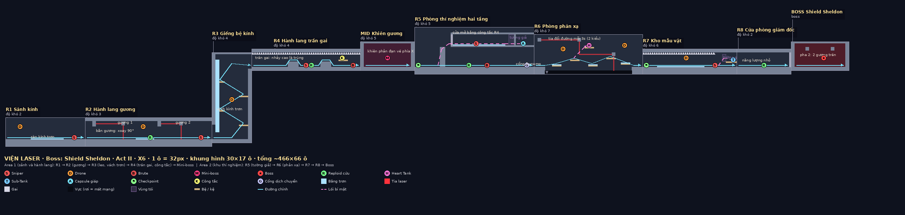

# Màn: VIỆN LASER (Laser Institute — Boss Shield Sheldon)

Bản thiết kế để duyệt trước khi dựng. Sơ đồ: `maps/x6_sheldon.png`.
Màn này thay cho `x6_sheldon` hiện tại. Boss, capsule Shadow Head, sàn kính trơn, tia laser gương, tường giả, hành lang trần gai và cổng Dynamo vẫn giữ; thêm 4 Reploid, Heart Tank, Sub-Tank và thay địa hình.

---

## 0. Công cụ và quy ước

Dùng chung với màn mẫu (`../lo-nham-thach-kich-ban.md`, mục 0): LDtk dựng bản đồ, Pixelorama vẽ tile, Krita vẽ nền parallax. 1 ô = 32px, khung hình 30×17 ô, các lớp `Collision` / `Tiles` / `Decor` / `Foreground` / `Entities`.

---

## 1. Ý tưởng tổng

Viện nghiên cứu quang học sau thảm họa Nightmare, sàn và vách bằng kính trơn. Khác màn Laser của X5 (bật/tắt bằng công tắc), ở đây người chơi **bẻ đường đi của tia** bằng gương, và học rằng **không phải bức tường nào cũng là thật**.

- **Area 1 – Sảnh và hành lang:** kính trong, ánh xanh lạnh. Dạy sàn trơn, gương xoay bằng đạn, vách không bám được, trần gai.
- **Area 2 – Khu thí nghiệm:** tối hơn, nhiều tia đỏ. Tường giả, phòng phản xạ đổi đường tia, kho mẫu vật.
- **Điểm nhấn trải nghiệm:** trượt trên kính → bắn gương mở đường → leo giếng một vách → nhảy ngắn dưới trần gai → mini-boss phản đạn → đi xuyên tường giả → nhảy theo nhịp tia đổi đường → boss có gương trần
- **Đường cong độ khó:** 2 → 3 → 4 → 4 → (mini-boss) → 5 → 7 → 6 → 2 → boss (thang 10).
- **Thời lượng mục tiêu:** khoảng 6–7 phút lần đầu, khoảng 3 phút khi đã quen.

Các mẫu thiết kế tham khảo (không chép bản đồ gốc):

- **X6, màn Shield Sheldon:** viện laser, bệ kính trơn, tường giả giấu capsule Shadow Head, cổng sang Dynamo.
- **X5, màn Shining Hotarunicus:** công tắc quang học (ở đây đổi thành gương xoay để không lặp cơ chế).
- **X3, màn Crush Crawfish / X4, màn Frost Walrus:** sàn trơn có quán tính.
- **X Corrupted:** tường giả có dấu hiệu nhỏ (nhấp nháy khi đứng sát) để người chơi tinh ý tìm được.

---

## 2. Kịch bản từng phòng

Tọa độ tính theo ô, gốc (0,0) ở góc trên trái thế giới, y tăng xuống dưới.

### R1 – Sảnh kính (x 0–44, y 50–66) · độ khó 2
- **Mục đích:** giới thiệu **sàn kính trơn**: có quán tính, dừng lại thì trượt thêm khoảng 2 ô.
- **Địa hình:** sảnh 44 ô, mặt sàn ở y 62. Đoạn giữa dài 18 ô là sàn kính.
- **Địch:**
  - 1 Drone ở đầu sảnh.
  - 1 Sniper ngay sau đoạn kính: lướt trên kính thì trượt thẳng vào tầm bắn của nó.
- **Trang trí:** vách kính, bể chứa mẫu vật, đèn trần xanh lạnh.

### R2 – Hành lang gương (x 44–114, y 50–66) · độ khó 3
- **Mục đích:** dạy **gương xoay bằng đạn**: tia laser bắn ngang, chạm gương thì bẻ thẳng xuống, chắn đường.
- **Địa hình:** hành lang 70 ô, 2 bộ đầu phát + gương treo trần.
- **Cơ chế:**
  - Mỗi gương lúc đầu bẻ tia xuống sàn, tạo một cột laser chắn đường.
  - **Bắn gương 1 phát** thì gương xoay 90°, tia đi thẳng lên trần, mở đường trong **6 giây** rồi gương xoay lại.
  - Đạn nạp đầy xoay gương vĩnh viễn.
- **Địch:**
  - 1 Drone giữa hai bộ gương.
  - 1 Sniper cuối hành lang.
- **Vật phẩm:** Reploid #1 giữa hai cột laser, trên đoạn sàn kính.

### R3 – Giếng bệ kính (x 114–136, y 14–64) · độ khó 4
- **Mục đích:** đoạn dọc. Vách trái là kính trơn nên **không đá tường được**, chỉ vách phải bám được.
- **Địa hình:** giếng rộng 18 ô, cao 46 ô (từ y 62 lên y 16). 4 bệ kính zigzag.
- **Cơ chế:** đứng trên bệ kính cũng trượt. Nhảy từ bệ bên trái phải nhảy chéo thẳng sang vách phải rồi đá tường.
- **Địch:** 1 Drone giữa giếng.
- **Giáp hỗ trợ:** Blade lướt trên không 2 lần, dễ bù trượt.

### R4 – Hành lang trần gai (x 136–196, y 12–24) · độ khó 4
- **Mục đích:** áp lực trần thấp: không được nhảy hết lực.
- **Địa hình:**
  - Hành lang 60 ô, trần phủ gai ở y 15, sàn ở y 22. Khoảng trống chỉ 7 ô.
  - 2 khối thép cao 3 ô làm bậc. Nhảy hết lực từ trên khối là chạm gai trần.
  - Nhảy ngắn (nhả nút sớm) là kỹ năng chính của phòng.
- **Công tắc:** trên kệ cuối hành lang. Bắn vào thì mở cửa tầng trên của R5 (cần cho capsule).
- **Địch:**
  - 1 Sniper giữa hai khối.
  - 1 Brute cuối hành lang.
- **Vật phẩm:** Reploid #2 giữa hai khối.

### Mini-boss – Khiên gương (x 196–226, y 8–24) · độ khó 5
- **Đấu trường 26 ô**, kín, hai vách đá tường được.
- **Khiên gương** là cỗ máy cầm tấm gương lớn, luôn xoay gương về phía người chơi.
- **Đòn đánh:**
  - Phản mọi viên đạn bắn thẳng vào gương về phía X.
  - Chiếu tia laser qua gương, quét nửa sân.
  - Lao húc bằng khiên.
- **Điểm yếu:** lưng. Đá tường qua đầu nó rồi bắn từ phía sau.
- **Phần thưởng:** mở cửa vào khu thí nghiệm. Hạ không mất máu thì được thưởng Souls.

### R5 – Phòng thí nghiệm hai tầng (x 226–292, y 0–26) · độ khó 5
- **Checkpoint 1** ở đầu phòng.
- **Mục đích:** phòng hai tầng. Tầng dưới là đường chính, tầng trên giấu capsule sau **tường giả**.
- **Địa hình:**
  - Sàn chính ở y 22, dài 66 ô.
  - Tầng trên là sàn kính ở y 10, chạy từ x 246 tới hết phòng. Lối vào là một cửa ở x ≈ 246, chỉ mở khi đã bắn công tắc ở R4.
  - Cột thép cao 11 ô để đá tường lên tầng trên.
- **Địch:**
  - 1 Brute ở tầng dưới.
  - 1 Sniper ở tầng trên, bắn xuống qua sàn kính (đạn xuyên kính, người thì không).
- **Vật phẩm:** Reploid #3 ở tầng dưới.
- **Lối phụ (Capsule Shadow Head):**
  - Cuối tầng trên là một bức tường trông như vách thật, nhưng hơi nhấp nháy khi đứng sát.
  - Đi thẳng vào thì xuyên qua. Capsule nằm sau tường (x ≈ 286, y ≈ 9).
  - Quên bắn công tắc ở R4 thì cửa tầng trên đóng: phải quay lại.
- **Cổng Dynamo:** cuối tầng dưới có cổng sang lối thay thế đấu Dynamo (theo dữ liệu game).

### R6 – Phòng phản xạ (x 292–352, y 4–26) · độ khó 7
- **Mục đích:** cao trào của màn. Nhảy trên bệ kính trơn qua vực, trong khi đường tia laser đổi liên tục.
- **Địa hình:** vực rộng 48 ô, 5 bệ kính (3 bệ trơn). Rơi là mất mạng.
- **Cơ chế – tia đổi đường:**
  - Một đầu phát ở góc trên trái, 2 gương tự xoay.
  - Mỗi 3 giây, gương đổi góc và tia chuyển giữa **2 kiểu đường đi**: kiểu A chắn bệ 2 và bệ 5, kiểu B chắn bệ 3 và bệ 4.
  - Đèn trên gương đổi màu 1 giây trước khi xoay.
  - Người chơi phải nhảy theo nhịp đổi kiểu. Bắn gương ở phòng này không có tác dụng.
- **Địch:** 2 Drone.
- **Lối phụ (Heart Tank):**
  - Một bệ nhỏ nằm cao giữa vực (x ≈ 320, y ≈ 11). Tia kiểu A đi ngay sát dưới nó.
  - Chỉ an toàn lúc tia ở kiểu B: nhảy từ bệ 2 lên, lấy Heart Tank, rồi xuống bệ 4 trước khi đổi kiểu.

### R7 – Kho mẫu vật (x 352–404, y 12–26) · độ khó 6
- **Checkpoint 2** ở đầu phòng.
- **Mục đích:** kết hợp: trần gai, sàn kính trơn, tường giả.
- **Địa hình:** kho 52 ô, trần gai ở 40 ô đầu, sàn kính 26 ô ở giữa.
- **Địch:**
  - 1 Drone giữa kho.
  - 1 Sniper cuối đoạn kính: trượt vào nó là trúng đạn.
- **Lối phụ (Sub-Tank):** góc trên bên phải có một ô tường nhấp nháy giống ở R5. Đá tường vào thì xuyên qua, Sub-Tank trên kệ phía sau (x ≈ 402, y ≈ 18).

### R8 – Cửa phòng giám đốc (x 404–434, y 12–26) · độ khó 2
- Phòng nghỉ trước boss: Reploid #4, nạp năng lượng nhỏ, cửa boss.

### BOSS – Shield Sheldon (x 434–466, y 8–24)
- **Đấu trường 28 ô**, kín, hai vách đá tường được.
- **Pha 1** (100–50% HP): bộ chiêu hiện có (khiên phản đạn, Guard Shell, dịch chuyển).
- **Pha 2** (dưới 50% HP):
  - **2 gương trên trần** bật lên. Tia của Sheldon bắn vào gương sẽ dội xuống sân theo góc chéo.
  - Bắn gương thì gương xoay, có thể dội tia ngược vào Sheldon (gây sát thương lớn).
- Điểm yếu giữ nguyên theo dữ liệu game.

---

## 3. Bảng vật phẩm và kẻ địch

| Loại | Số lượng | Vị trí |
|---|---|---|
| Sniper | 5 | R1, R2, R4, R5, R7 |
| Drone | 6 | R1, R2, R3, R6 ×2, R7 |
| Brute | 2 | R4, R5 |
| Mini-boss | 1 | MID |
| Reploid cứu | 4 | R2, R4, R5, R8 |
| Heart Tank | 1 | R6 |
| Sub-Tank | 1 | R7 |
| Capsule Shadow Head | 1 | R5 |
| Công tắc | 1 | R4 |
| Cổng dịch chuyển | 1 | R5 |
| Checkpoint | 2 | R5, R7 |

Tổng 13 kẻ địch thường (bản cũ: 20 con xếp đều), đặt có chủ đích theo mục đích từng phòng.

---

## 4. Những gì engine cần bổ sung

1. Sàn và vách kính trơn: quán tính khi đứng, không đá tường được trên vách kính.
2. Tia laser đi theo đường gương: tính đường tia qua các gương, gương xoay bằng đạn hoặc tự xoay theo nhịp.
3. Tường giả: ô Collision không chặn, nhấp nháy nhẹ khi người chơi đứng sát.
4. Trần gai.
5. Công tắc ở phòng này mở cửa ở phòng khác (liên kết theo id).
6. Cổng dịch chuyển sang lối Dynamo (giữ theo dữ liệu game).
7. Mini-boss Khiên gương phản đạn theo hướng.

## 5. Danh sách hình cần vẽ

- **Tileset "Sảnh kính" (Area 1):** 47 ô viền kính và khung thép, sàn kính trơn (ánh phản chiếu), trần gai.
- **Tileset "Khu thí nghiệm" (Area 2):** 47 ô viền tối, ô tường giả (giống hệt tường thật + 2 khung nhấp nháy).
- **Vật thể:** đầu phát laser, gương (4 góc), tia laser (đoạn thẳng, 3 khung), bể mẫu vật.
- **Nền:** Area 1: phòng thí nghiệm kính (2 lớp parallax). Area 2: lưới laser mờ và tủ mẫu (2 lớp).

**Hướng phối hợp:** như màn mẫu — dựng bằng khối màu tạm theo sơ đồ để chơi thử, chốt cảm giác rồi mới thay tile thật.
