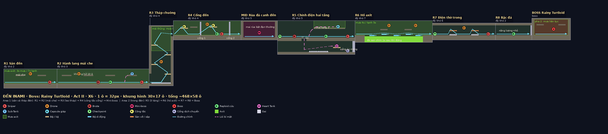

# Màn: ĐỀN INAMI (Inami Temple — Boss Rainy Turtloid)

Bản thiết kế để duyệt trước khi dựng. Sơ đồ: `maps/x6_turtloid.png`.
Màn này thay cho `x6_turtloid` hiện tại. Boss, capsule Shadow Body, mưa axit, mái che, 2 công tắc mở cổng và cổng dịch chuyển lối Nightmare Zero vẫn giữ; thêm 4 Reploid, Heart Tank, Sub-Tank và thay địa hình.

---

## 0. Công cụ và quy ước

Dùng chung với màn mẫu (`../lo-nham-thach-kich-ban.md`, mục 0): LDtk dựng bản đồ, Pixelorama vẽ tile, Krita vẽ nền parallax. 1 ô = 32px, khung hình 30×17 ô, các lớp `Collision` / `Tiles` / `Decor` / `Foreground` / `Entities`.

---

## 1. Ý tưởng tổng

Ngôi đền cổ trên núi bị mây axit bao phủ. Cả màn là **trò chơi với nhịp mưa**: mỗi đợt tạnh là một cửa sổ thời gian để chạy, leo hoặc lấy bí mật.

- **Area 1 – Sân và tháp đền (ngoài trời):** đá rêu, mây xanh lục. Dạy mưa axit, mái che, leo tháp trong mưa, bắn công tắc cổng.
- **Area 2 – Chính điện và hồ:** gỗ son, đèn lồng. Phòng 3 tầng có bí mật, hồ axit với đá sen chìm, điện thờ có ván mục.
- **Điểm nhấn trải nghiệm:** trú mưa → chạy giữa mái che → leo tháp thủng mái → bắn công tắc mở cổng → mini-boss rùa đá → chọn tầng trong chính điện → vượt hồ axit → boss mưa liên tục
- **Đường cong độ khó:** 2 → 3 → 4 → 4 → (mini-boss) → 5 → 7 → 6 → 2 → boss (thang 10).
- **Thời lượng mục tiêu:** khoảng 6–8 phút lần đầu, khoảng 3 phút khi đã quen.

Các mẫu thiết kế tham khảo (không chép bản đồ gốc):

- **X6, màn Rainy Turtloid:** đền cổ, mưa axit định kỳ, mái che, capsule Shadow trên mái, cổng sang Nightmare Zero.
- **X4, màn Split Mushroom / X8, màn Dark Mantis:** cơ chế môi trường theo nhịp có báo trước.
- **X5, màn Spike Rosered:** bí mật nằm ở tầng khác với đường chính, chia phòng thành nhiều tầng.
- **X Corrupted:** buộc người chơi đánh đổi giữa an toàn (trú mưa) và tiến độ (đá sen chìm).

---

## 2. Kịch bản từng phòng

Tọa độ tính theo ô, gốc (0,0) ở góc trên trái thế giới, y tăng xuống dưới.

### R1 – Sân đền (x 0–44, y 50–66) · độ khó 2
- **Mục đích:** giới thiệu **mưa axit**: trong lúc mưa, đứng ngoài trời mất 1 máu mỗi 0.5 giây.
- **Địa hình:** sân đá 44 ô, mặt đất ở y 62. 2 mái ngói nhô ra từ tường đền làm chỗ trú.
- **Cơ chế:**
  - Mưa 3 giây, tạnh 7 giây. Trời tối sầm và có tiếng sấm 1.5 giây trước mỗi đợt.
  - Đứng dưới mái che thì an toàn.
- **Địch:**
  - 1 Drone bay lượn giữa hai mái.
  - 1 Sniper cuối sân, không sợ mưa.
- **Trang trí:** đèn lồng đá, cổng torii đổ, rêu ăn mòn.

### R2 – Hành lang mái che (x 44–120, y 50–66) · độ khó 3
- **Mục đích:** chạy giữa các chỗ trú theo nhịp mưa.
- **Địa hình:** hành lang 76 ô có **4 mái che** dài 8 ô, cách nhau 10 ô.
- **Cơ chế:** 7 giây tạnh vừa đủ chạy qua 1 khoảng hở và hạ 1 con địch. Dừng lại đánh lâu là bị mưa bắt ngoài trời.
- **Địch:**
  - 1 Drone ở khoảng hở thứ nhất.
  - 1 Brute đứng giữa khoảng hở thứ hai: chặn đường chạy.
  - 1 Sniper cuối hành lang.
- **Vật phẩm:** Reploid #1 dưới mái che thứ ba.
- **Lối phụ (Sub-Tank):** trên **nóc mái che thứ tư** (x ≈ 106, y ≈ 64). Đá tường cột đền bên cạnh để lên, nhưng nóc mái là ngoài trời: phải lên, lấy và xuống trong một lần tạnh.

### R3 – Tháp chuông (x 120–140, y 14–64) · độ khó 4
- **Mục đích:** đoạn dọc. Nửa dưới tháp có mái che, nửa trên mái thủng nên mưa lọt vào.
- **Địa hình:** tháp rộng 16 ô, cao 46 ô (từ y 62 lên y 15). 4 kệ zigzag, hai vách đá tường được.
- **Cơ chế:** nửa trên (20 ô) dính mưa. Phải chờ tạnh ở kệ thứ hai rồi leo một mạch lên đỉnh trong 7 giây.
- **Địch:** 1 Drone giữa tháp.
- **Bẫy:** đáy tháp là rãnh gai (rơi từ kệ thứ nhất là trúng).

### R4 – Cổng đền (x 140–196, y 10–26) · độ khó 4
- **Mục đích:** bắn công tắc mở cổng đền, trong khi vẫn phải canh mưa.
- **Địa hình:** sân trước đền 56 ô, 2 cổng gỗ đóng chặn đường.
- **Cơ chế:**
  - **Công tắc #1** trên kệ đá trước cổng 1, **công tắc #2** trên kệ trước cổng 2.
  - Bắn trúng thì cổng mở hẳn. Kệ công tắc không có mái che: lên bắn lúc trời tạnh.
- **Địch:**
  - 1 Drone canh kệ công tắc #2.
  - 1 Sniper sau cổng 2.
- **Vật phẩm:** Reploid #2 giữa hai cổng, dưới mái che.

### Mini-boss – Rùa đá canh đền (x 196–226, y 10–26) · độ khó 5
- **Đấu trường 26 ô**, có mái, hai vách đá tường được.
- **Rùa đá canh đền** bò qua lại, mai cứng phản lại đạn thường.
- **Đòn đánh:**
  - Rụt vào mai và lăn ngang sân: đá tường để né.
  - Phun 3 giọt axit theo đường cong, đọng lại thành vũng 2 giây.
  - Dậm chân làm rơi đá vụn từ trần.
- **Điểm yếu:** đầu thò ra sau mỗi lần lăn. Đạn nạp đầy làm lật mai 3 giây.
- **Phần thưởng:** mở cửa vào chính điện. Hạ không mất máu thì được thưởng Souls.

### R5 – Chính điện hai tầng (x 226–290, y 10–38) · độ khó 5
- **Checkpoint 1** ở đầu phòng.
- **Mục đích:** phòng có **3 tầng**: mái ngói ngoài trời (capsule), sàn chính điện (đường chính), hầm dưới sàn (Heart Tank và cổng ác mộng).
- **Địa hình:**
  - Sàn chính ở y 24, dài 64 ô. Một **lỗ sàn** 4 ô (x 246–250) rơi xuống hầm.
  - Hầm ở y 36, đáy phủ gai 16 ô, có một kệ đá cao.
  - Mái tầng 2 ở y 16, nằm ngoài trời nên dính mưa.
- **Địch:** 1 Brute đầu điện, 1 Sniper cuối điện.
- **Vật phẩm:** Reploid #3 giữa điện.
- **Lối phụ (Capsule Shadow Body):**
  - Đá tường cột đỡ mái lên **mái tầng 2**. Capsule nằm cuối mái (x ≈ 276, y ≈ 15).
  - Mái dài 26 ô ngoài trời mà chỉ có 7 giây tạnh: phải lên ngay khi vừa tạnh.
- **Lối phụ (Heart Tank):**
  - Thả xuống lỗ sàn, lướt-nhảy qua bãi gai tới kệ đá. Heart Tank trên kệ (x ≈ 275, y ≈ 31).
  - Giáp Shadow miễn gai nên đi bộ qua được.
- **Cổng ác mộng:** cuối hầm có cổng dịch chuyển sang lối thay thế đấu Nightmare Zero (theo dữ liệu game). Thoát hầm bằng cửa phải.

### R6 – Hồ axit (x 290–354, y 10–28) · độ khó 7
- **Mục đích:** cao trào của màn. Vượt hồ axit trên các phiến đá sen đang chìm, trong mưa dày hơn.
- **Địa hình:** hồ axit rộng 48 ô. Rơi xuống axit là mất mạng.
- **Cơ chế:**
  - **5 phiến đá sen** trôi nhẹ. Đứng lên thì 1 giây sau phiến chìm dần, 2 giây sau chìm hẳn rồi nổi lại sau 3 giây.
  - Mưa dày hơn: **mưa 4 giây, tạnh 5 giây**.
  - Chỉ có 2 mái che nhỏ trên phiến thứ hai và thứ tư. Trú ở đó thì phiến lại chìm.
  - Người chơi phải tính: chờ mưa trên phiến có mái nhưng không được đứng quá 2 giây.
- **Địch:** 2 Drone bay sát mặt hồ, bắn chéo lên.
- **Giáp hỗ trợ:** Shadow nhảy cao hơn; Blade lướt trên không xa hơn.

### R7 – Điện thờ trong (x 354–406, y 12–26) · độ khó 6
- **Checkpoint 2** ở đầu phòng.
- **Mục đích:** kết hợp sau đoạn cao trào: gai sàn và sàn gỗ mục, không còn mưa (trong nhà).
- **Địa hình:** điện thờ 52 ô, 2 hố gai 6 ô. Trên mỗi hố là một tấm **ván gỗ mục**, đứng 0.5 giây thì gãy.
- **Địch:** 1 Drone giữa điện, 1 Sniper cuối điện.

### R8 – Bậc đá (x 406–436, y 12–26) · độ khó 2
- Phòng nghỉ trước boss: Reploid #4, nạp năng lượng nhỏ, cửa boss.

### BOSS – Rainy Turtloid (x 436–468, y 8–26)
- **Đấu trường 28 ô**, có 2 mái che nhỏ trên cao (đá tường lên được).
- **Pha 1** (100–50% HP): bộ chiêu hiện có (Meteor Rain, xoay mai, bắn giọt).
- **Pha 2** (dưới 50% HP):
  - **Mưa axit liên tục**, chỉ tạnh 2 giây khi Turtloid rụt vào mai.
  - Người chơi phải đánh từ dưới mái che, hoặc chịu mất máu để tấn công.
- Điểm yếu giữ nguyên theo dữ liệu game.

---

## 3. Bảng vật phẩm và kẻ địch

| Loại | Số lượng | Vị trí |
|---|---|---|
| Sniper | 5 | R1, R2, R4, R5, R7 |
| Drone | 7 | R1, R2, R3, R4, R6 ×2, R7 |
| Brute | 2 | R2, R5 |
| Mini-boss | 1 | MID |
| Reploid cứu | 4 | R2, R4, R5, R8 |
| Heart Tank | 1 | R5 |
| Sub-Tank | 1 | R2 |
| Capsule Shadow Body | 1 | R5 |
| Công tắc | 2 | R4 ×2 |
| Cổng dịch chuyển | 1 | R5 |
| Checkpoint | 2 | R5, R7 |

Tổng 14 kẻ địch thường (bản cũ: 20 con xếp đều), đặt có chủ đích theo mục đích từng phòng.

---

## 4. Những gì engine cần bổ sung

1. Mưa axit theo nhịp, có báo trước; vùng mái che chặn mưa.
2. Cổng mở bằng công tắc (vĩnh viễn).
3. Phiến đá sen chìm khi đứng và nổi lại sau thời gian.
4. Ván gỗ mục (sàn vỡ 0.5 giây).
5. Cổng dịch chuyển sang lối Nightmare Zero (giữ theo dữ liệu game).
6. Mini-boss Rùa đá canh đền: mai phản đạn thường.

## 5. Danh sách hình cần vẽ

- **Tileset "Sân đền" (Area 1):** 47 ô viền đá rêu, mái ngói, cổng gỗ (2 trạng thái).
- **Tileset "Chính điện" (Area 2):** 47 ô viền gỗ son, ván mục (3 khung), hầm đá.
- **Vật thể:** hạt mưa axit (lớp phủ toàn màn hình, 4 khung), đá sen (3 khung chìm), đèn lồng, công tắc.
- **Nền:** Area 1: núi mây axit xanh lục (2 lớp parallax). Area 2: hành lang đền và tượng (2 lớp).

**Hướng phối hợp:** như màn mẫu — dựng bằng khối màu tạm theo sơ đồ để chơi thử, chốt cảm giác rồi mới thay tile thật.
