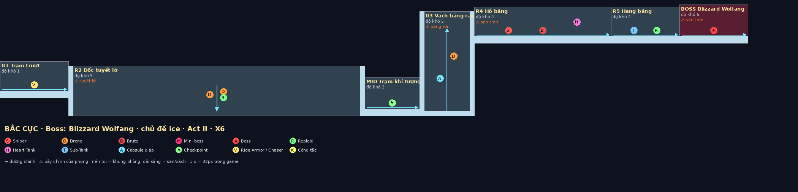

# Bắc Cực — Boss Blizzard Wolfang

`x6_wolfang` · chủ đề `ice` · Act II · X6 · tổng chiều ngang khoảng 328 ô (10496px)

## Ý tưởng
Area 1 là chặng Ride Chaser trượt dốc tuyết bị tuyết lở đuổi; Area 2 là vách băng cao, sàn trơn và băng rơi.

## Tham khảo
X6 North Pole Area, X4 Frost Walrus, X8 Avalanche Yeti (bản demake làm lại thành màn chơi thường).

## Nhịp màn
R1 (1) → R2 (5) → MID (2) → R3 (5) → R4 (4) → R5 (2) → BOSS (6)

## Kịch bản từng phòng

### R1 – Trạm trượt (30×16 ô, đi ngang) · độ khó 1
Lên Ride Chaser.
- **Đặt trong phòng:** Ride Armor / Chaser

### R2 – Dốc tuyết lở (130×22 ô, đi xuống) · độ khó 5
Ride Chaser xuống dốc dài; tuyết lở đuổi phía sau, nhảy qua khe băng, né cây thông đổ.
- **Bẫy:** tuyết lở
- **Đặt trong phòng:** Drone, Drone, Reploid

### MID – Trạm khí tượng (24×17 ô, đi ngang) · độ khó 2
Checkpoint, xuống xe.
- **Đặt trong phòng:** Checkpoint

### R3 – Vách băng cao (24×46 ô, leo dọc) · độ khó 5
Bám tường băng X=3850 (trơn, trượt nhanh hơn); Blade Body ở hốc cao.
- **Bẫy:** băng rơi
- **Đặt trong phòng:** Drone, Capsule giáp

### R4 – Hồ băng (60×16 ô, đi ngang) · độ khó 4
Sàn băng trơn, băng nhọn rơi từ trần theo nhịp; Heart Tank trên tảng băng trôi.
- **Bẫy:** sàn trơn
- **Đặt trong phòng:** Sniper, Brute, Heart Tank

### R5 – Hang băng (30×16 ô, đi ngang) · độ khó 2
Phòng nghỉ, Sub-Tank, cửa boss.
- **Đặt trong phòng:** Sub-Tank, Reploid

### BOSS – Blizzard Wolfang (30×17 ô, đấu trường) · độ khó 6
Sàn đấu đóng băng dần (trơn), sói phóng băng.
- **Bẫy:** sàn trơn
- **Đặt trong phòng:** Boss

## Bí mật và vật phẩm
| Vật phẩm | Phòng | Cách lấy |
|---|---|---|
| Capsule Blade Body | R3 | Vách băng cao. |
| Heart Tank | R4 | Tảng băng trôi. |
| Sub-Tank | R5 | Hang băng. |

## Cơ chế mới cần engine
- Tường băng trượt nhanh
- Tuyết lở đuổi khi đang cưỡi Ride Chaser

## Hình ảnh / element
terrain-ice/cap-ice, native-ice, mmx6-ice, mmx6_invertediceblocks.
