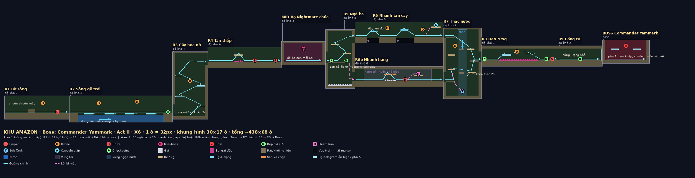

# Màn: KHU AMAZON (Amazon Area — Boss Commander Yammark)

Bản thiết kế để duyệt trước khi dựng. Sơ đồ: `maps/x6_yammark.png`.
Màn này thay cho `x6_yammark` hiện tại. Boss, capsule Blade Foot, rừng tách 2 nhánh ở mid-checkpoint (nhánh trên: Blade Foot, nhánh dưới: Heart Tank) và bọ Nightmare vẫn giữ; thêm 4 Reploid, Sub-Tank và thay địa hình.

---

## 0. Công cụ và quy ước

Dùng chung với màn mẫu (`../lo-nham-thach-kich-ban.md`, mục 0): LDtk dựng bản đồ, Pixelorama vẽ tile, Krita vẽ nền parallax. 1 ô = 32px, khung hình 30×17 ô, các lớp `Collision` / `Tiles` / `Decor` / `Foreground` / `Entities`.

---

## 1. Ý tưởng tổng

Rừng Amazon nhiễm virus Nightmare. Điểm khác biệt là **màn tách đôi**: sau ngã ba người chơi chọn nhánh tán cây hoặc nhánh hang, mỗi nhánh giữ một vật phẩm, rồi hai nhánh gặp nhau ở thác nước.

- **Area 1 – Sông và tán thấp:** xanh lá, sương, nắng lọt. Dạy gỗ trôi, hoa nở/khép, chuồn chuồn máy.
- **Area 2 – Hai nhánh và thác:** nhánh trên ngoài trời có dây leo đu, nhánh dưới là hang tối. Cả hai đổ về thác nước.
- **Điểm nhấn trải nghiệm:** nhảy gỗ trôi qua sông → leo trên hoa nở → mini-boss bọ chúa → chọn nhánh ở ngã ba → đu dây leo hoặc lần trong hang tối → vượt thác có gỗ rơi → boss có chuồn chuồn hộ vệ
- **Đường cong độ khó:** 2 → 3 → 4 → 4 → (mini-boss) → 5 → 6 → 6 → 7 → 6 → 2 → boss (thang 10).
- **Thời lượng mục tiêu:** khoảng 6–7 phút lần đầu (một nhánh), khoảng 3 phút khi đã quen.

Các mẫu thiết kế tham khảo (không chép bản đồ gốc):

- **X6, màn Commander Yammark:** rừng tách 2 tầng ở mid-checkpoint, mỗi tầng một vật phẩm.
- **X (SNES), màn Sting Chameleon:** rừng có hang, lối phụ phía trên.
- **X8, màn Bamboo Pandamonium:** vật cản rơi theo nhịp trên đường leo.
- **X Corrupted:** nhiều đường đi cùng tới một điểm hội tụ, mỗi đường thưởng một thứ.

---

## 2. Kịch bản từng phòng

Tọa độ tính theo ô, gốc (0,0) ở góc trên trái thế giới, y tăng xuống dưới.

### R1 – Bờ sông (x 0–44, y 50–66) · độ khó 2
- **Mục đích:** mở đầu trong rừng Amazon, làm quen **chuồn chuồn máy** (Drone bay đường sóng, có thể đổi hướng bất ngờ).
- **Địa hình:** bờ sông 44 ô, mặt đất ở y 62, một tảng đá thấp.
- **Địch:** 1 Drone chuồn chuồn, 1 Sniper cuối bờ.
- **Trang trí:** cây khổng lồ, dây leo, hoa máy phát sáng, sương mù sát mặt đất.

### R2 – Sông gỗ trôi (x 44–114, y 50–68) · độ khó 3
- **Mục đích:** nhảy trên **khúc gỗ trôi** xuôi dòng.
- **Địa hình:** sông rộng 58 ô. Rơi xuống nước là bị dòng xiết cuốn đi (mất mạng).
- **Cơ chế:**
  - 4 khúc gỗ trôi sang phải 70px/giây, sinh ra liên tục ở đầu sông.
  - Khúc gỗ chìm xuống nửa ô khi đứng lên, rồi nổi lại.
  - Đứng yên trên gỗ thì vẫn sang được bờ bên kia, nhưng chuồn chuồn sẽ lao vào.
- **Địch:** 2 Drone chuồn chuồn.
- **Vật phẩm:** Reploid #1 ở bờ bên kia.

### R3 – Cây hoa nở (x 114–138, y 20–66) · độ khó 4
- **Mục đích:** đoạn dọc. Leo trên các **bông hoa máy** nở và khép theo nhịp.
- **Địa hình:** khoảng trống giữa hai thân cây, rộng 20 ô, cao 42 ô (từ y 64 lên y 27).
- **Cơ chế – hoa nở:** 4 bông hoa làm bệ. Nở 3 giây (đứng được), khép 2 giây (rơi xuyên qua). Các bông lệch pha nhau từ dưới lên.
- **Địch:** 1 Drone chuồn chuồn.
- **Giáp hỗ trợ:** hai vách là thân cây, đá tường được: có thể bỏ qua hoa và leo thẳng.

### R4 – Tán thấp (x 138–188, y 17–31) · độ khó 4
- **Mục đích:** đoạn chạy ngắn trước mini-boss.
- **Địa hình:** tán cây thấp 50 ô, mặt cành ở y 27. Một bụi gai có cành ngang phía trên để nhảy qua.
- **Địch:** 1 Brute, 1 Sniper.

### Mini-boss – Bọ Nightmare chúa (x 188–218, y 13–29) · độ khó 5
- **Đấu trường 26 ô** trong hốc cây, hai vách đá tường được.
- **Bọ Nightmare chúa** bám trên trần hốc cây.
- **Đòn đánh:**
  - Đẻ 3 bọ con mỗi 6 giây. Bọ con bò dọc sàn và vách.
  - Phun tơ: trúng thì chậm 50% trong 2 giây.
  - Rơi xuống đập sàn khi máu dưới một nửa.
- **Điểm yếu:** bụng, lộ ra lúc đẻ bọ con.
- **Phần thưởng:** mở lối vào ngã ba. Hạ không mất máu thì được thưởng Souls.

### R5 – Ngã ba (x 218–238, y 5–45) · độ khó 5
- **Checkpoint 1** ở giữa phòng (sàn y 27).
- **Mục đích:** ngã ba chia màn làm **2 nhánh độc lập** dài khoảng 60 ô, gặp lại nhau ở thác nước (R7).
- **Địa hình:**
  - Hốc cây rộng 16 ô.
  - Đi lên (2 kệ, đá tường) ra **nhánh tán cây** ở y 10.
  - Rơi qua lỗ sàn bên phải xuống **nhánh hang** ở y 40.
- **Vật phẩm:** Reploid #2 cạnh checkpoint.
- **Ghi chú:** mỗi nhánh có một vật phẩm riêng. Muốn lấy cả hai thì đi một nhánh, chết hoặc quay lại checkpoint 1 rồi đi nhánh kia (vật phẩm đã lấy được giữ lại).

### R6 – Nhánh tán cây (x 238–298, y 0–14) · độ khó 6
- **Nhánh trên.** Chạy trên các cành lớn ngoài trời, có 2 khe phải đu dây leo qua.
- **Địa hình:**
  - Cành ở y 10, dài 60 ô. 2 khe rộng 8 và 12 ô, rơi là mất mạng.
  - Mỗi khe có một **dây leo đu** qua lại (biên độ 4 ô, chu kỳ 3 giây). Bám vào thì đu theo, nhả nút để bay ra theo đà.
- **Địch:** 2 Drone chuồn chuồn.
- **Lối phụ (Capsule Blade Foot):** cuối nhánh có một nhánh cây cao (x ≈ 290, y ≈ 3). Đá tường thân cây ở cuối phòng để lên.

### R6b – Nhánh hang (x 238–298, y 30–44) · độ khó 6
- **Nhánh dưới.** Hang ẩm, tối, trần thấp.
- **Địa hình:** hang 60 ô, sàn ở y 40, một hố gai có tấm đá mỏng phía trên (sập 0.5 giây sau khi đứng).
- **Cơ chế:** hang tối, chỉ thấy quanh X 6 ô. Giọt nước rơi từ trần chỉ làm hiệu ứng nhưng che tầm nhìn.
- **Địch:** 1 Brute giữa hang.
- **Lối phụ (Heart Tank):** trên một gờ đá ngay phía sau Brute (x ≈ 281, y ≈ 35). Phải hạ Brute rồi đá tường vách hang lên.

### R7 – Thác nước (x 298–324, y 4–52) · độ khó 7
- **Mục đích:** cao trào của màn. Hai nhánh gặp nhau ở một thác nước dọc. Nhánh trên phải đi xuống, nhánh dưới phải leo lên, cả hai tới cùng một cửa ra ở giữa vách phải (y 26).
- **Địa hình:** khe đá rộng 22 ô, cao 44 ô. Thác nước rộng 6 ô đổ thẳng giữa khe.
- **Cơ chế:**
  - **Đứng trong thác** thì bị đẩy xuống 120px/giây, không nhảy lên được.
  - **Khúc gỗ rơi theo thác** mỗi 2 giây: trúng là mất 1/4 máu và bị đẩy văng ra.
  - Đi qua thác phải lướt ngang thật nhanh, chọn lúc giữa hai khúc gỗ.
- **Địch:** 1 Drone chuồn chuồn.
- **Lối phụ (Sub-Tank):** **sau màn thác** ở đáy khe có một hốc (x ≈ 311, y ≈ 47). Thả người theo dòng thác xuống đáy là rơi thẳng vào hốc. Ra lại bằng cách đá vách trái.

### R8 – Đền rừng (x 324–376, y 16–30) · độ khó 6
- **Checkpoint 2** ở đầu phòng.
- **Mục đích:** kết hợp: bụi gai dưới, hoa nở/khép phía trên.
- **Địa hình:** sân đền đổ nát 52 ô, giữa là bãi gai 26 ô, chỉ có 2 bông hoa máy để bước qua (nở 3 giây, khép 2 giây).
- **Địch:** 1 Drone, 1 Sniper.
- **Vật phẩm:** Reploid #3 cuối sân.

### R9 – Cổng tổ (x 376–406, y 16–30) · độ khó 2
- Phòng nghỉ trước boss: Reploid #4, nạp năng lượng nhỏ, cửa boss.

### BOSS – Commander Yammark (x 406–438, y 12–28)
- **Đấu trường 28 ô**, có 2 bông hoa máy làm bệ trên cao.
- **Pha 1** (100–50% HP): bộ chiêu hiện có (chuồn chuồn hộ vệ, lao chéo, bắn đạn).
- **Pha 2** (dưới 50% HP):
  - Hoa nở/khép theo nhịp như R3 (nở 3 giây, khép 2 giây).
  - 3 chuồn chuồn hộ vệ bay vòng quanh Yammark, chắn đạn. Hạ chuồn chuồn trước rồi mới đánh boss.
- Điểm yếu giữ nguyên theo dữ liệu game.

---

## 3. Bảng vật phẩm và kẻ địch

| Loại | Số lượng | Vị trí |
|---|---|---|
| Sniper | 3 | R1, R4, R8 |
| Drone | 8 | R1, R2 ×2, R3, R6 ×2, R7, R8 |
| Brute | 2 | R4, R6b |
| Mini-boss | 1 | MID |
| Reploid cứu | 4 | R2, R5, R8, R9 |
| Heart Tank | 1 | R6b |
| Sub-Tank | 1 | R7 |
| Capsule Blade Foot | 1 | R6 |
| Checkpoint | 2 | R5, R8 |

Tổng 13 kẻ địch thường (bản cũ: 20 con xếp đều), đặt có chủ đích theo mục đích từng phòng.

---

## 4. Những gì engine cần bổ sung

1. Khúc gỗ trôi (bệ di động sinh liên tục, chìm nhẹ khi đứng). Nước chảy xiết: rơi là mất mạng.
2. Bệ hoa nở/khép theo nhịp (bệ ẩn hiện).
3. Dây leo đu: bám, đu theo con lắc, nhả để bay theo đà.
4. Vùng thác nước đẩy xuống; vật rơi theo thác theo lịch.
5. Vùng tối trong hang (tầm nhìn quanh X).
6. Mini-boss Bọ Nightmare chúa đẻ bọ con.

## 5. Danh sách hình cần vẽ

- **Tileset "Rừng Amazon" (Area 1):** 47 ô viền đất rừng, cành lớn, hoa máy (3 khung nở/khép), mặt sông (4 khung).
- **Tileset "Hang và thác" (Area 2):** 47 ô viền đá ẩm, thác nước (4 khung), dây leo.
- **Vật thể:** khúc gỗ, dây leo đu, bọ con, chuồn chuồn hộ vệ.
- **Nền:** Area 1: rừng xa và sương (2 lớp parallax). Area 2: vách hang và tia nắng xuyên thác (2 lớp).

**Hướng phối hợp:** như màn mẫu — dựng bằng khối màu tạm theo sơ đồ để chơi thử, chốt cảm giác rồi mới thay tile thật.
